# RustUI 架构设计文档

**项目名称：** RustUI
**文档类型：** 架构设计（基于源码实现）
**版本：** 0.1.0
**状态：** Final
**语言：** Rust
**目标平台：** Windows / Linux / macOS

> **文档定位**：本文档描述 RustUI 的**整体架构**——分层、模块依赖、核心对象模型，
> 以及贯穿多模块的关键流程（帧管线、事件分发、渲染、文本、坐标、线程）。
> 每个模块的内部细节见 [`modules/`](modules/) 下的详细设计文档；
> 与初版设计文档的偏离见 [`Design_Corrections.md`](Design_Corrections.md)
> （C-001 ~ C-054），三者冲突时以修正记录为准。

---

## 1. 总体架构

RustUI 是一个原生、跨平台、GPU 加速的**保留模式**（retained mode）GUI 框架：
应用构建一棵 Widget 树并常驻内存，框架在事件驱动下按帧执行
`update → layout → paint`，将绘制命令交给 wgpu 渲染。

设计原则（详见修正记录）：

* **P1 — 平台无关的核心**：`rustui-core` 及其上的布局/控件/模型/动画 crate 不依赖
  `winit`/`wgpu`，控件永远看不到任何平台类型。
* **P2 — 底层依赖收敛**：直接底层依赖仅 winit + wgpu；shaping/剪贴板等以 C-053/C-054
  明示豁免（rustybuzz/unicode-bidi 仅在 `rustui-text` 内部，arboard 仅在
  `rustui-platform` 内部）。
* **P3 — 无 `Rc<RefCell<T>>` 对象模型**：Widget 以 `Box<dyn Widget>` 存入
  `WidgetStore`，用代际 `ObjectId` 寻址；跨模块共享状态走 `SharedProperty`/`Signal`。

### 1.1 分层视图

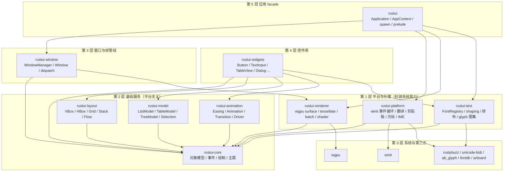

**分层规则**：箭头只能从上层指向下层，同层之间除注明外不得互相依赖。
`rustui-widgets` 依赖 `rustui-text`（测量接口 `TextMeasurer`），但**不**依赖
`rustui-platform`/`rustui-renderer`——这是 P1 的硬边界。

### 1.2 crate 依赖矩阵

| crate | 直接依赖 | 一句话职责 |
|---|---|---|
| `rustui-core` | std + log | 对象模型、几何、事件契约、绘制命令、主题、信号 |
| `rustui-layout` | core | 两阶段布局容器（measure/arrange） |
| `rustui-model` | core | Model/View 数据层与选择模型 |
| `rustui-animation` | core | 缓动、动画、属性过渡、帧驱动 |
| `rustui-text` | core + ab_glyph/fontdb/rustybuzz/unicode-bidi | 字体、整形、排布、字形图集 |
| `rustui-renderer` | core + wgpu | PaintCommand → 实例化 draw call |
| `rustui-platform` | core + winit + arboard | 事件循环、事件翻译、剪贴板、光标、IME |
| `rustui-window` | core + renderer | 每窗口状态、事件路由、帧管线编排 |
| `rustui-widgets` | core + layout + model + animation + text | 标准控件库 |
| `rustui`（facade） | 以上全部 + wgpu | Application、多窗口、跨线程任务、prelude |

---

## 2. 核心对象模型

对象模型是全框架的公共语言，定义在 `rustui-core`（`object.rs` / `widget_store.rs` /
`widget.rs`）。

### 2.1 类图

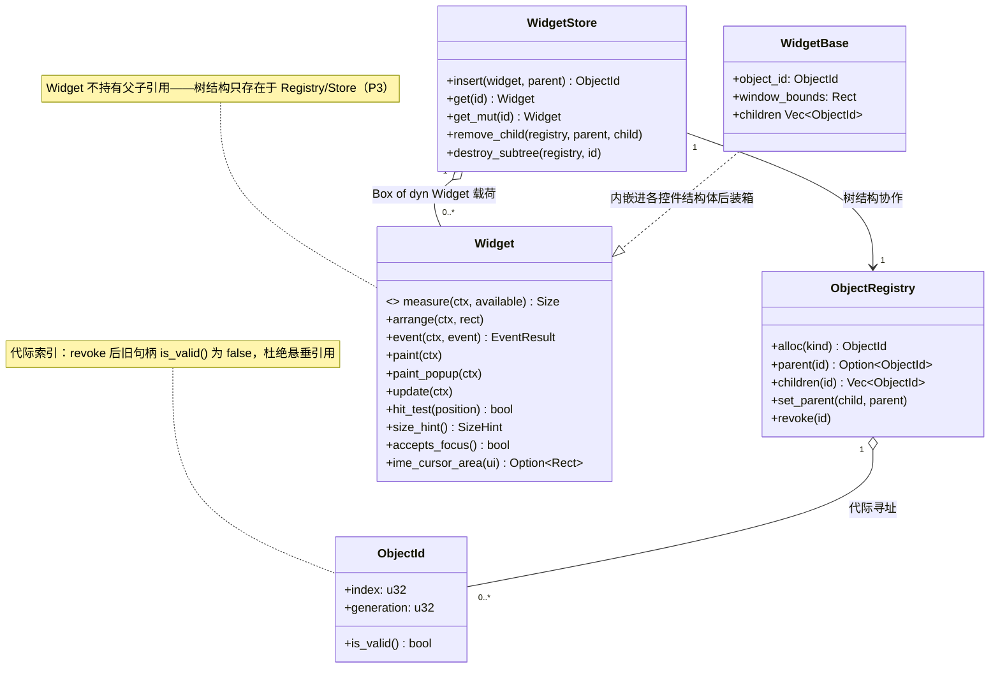

**要点**：

* `ObjectId { index, generation }` 是唯一句柄；销毁后代际递增，旧句柄
  `is_valid() == false`，从根上消除悬垂指针。
* `ObjectRegistry` 只管**树结构**（父子关系、世代），`WidgetStore` 只管**载荷**
  （`Box<dyn Widget>`）。二者配合实现子树创建/销毁，上层无需关心。
* `Widget` 是纯行为 trait：状态在各控件自身的结构体里，结构互不引用——这就是
  P3「无 `Rc<RefCell>`」的落地方式。

### 2.2 上下文对象

Widget 的每个回调都通过一个专用上下文与框架交互，上下文借出共享服务的切片，
保证别名安全且 API 面最小：

| 上下文 | 回调 | 可做的事 |
|---|---|---|
| `UpdateContext` | `update` | 定时器、动画推进、请求失效 |
| `MeasureContext` | `measure` | 读主题/文本测量器，缓存测量结果 |
| `ArrangeContext` | `arrange` | 查询本节点窗口原点 `offset()`，排列子节点 |
| `EventContext` | `event` | 接收事件、`accept()`、改焦点/捕获/光标、入队事件 |
| `PaintContext` | `paint` / `paint_popup` | `paint_child`（自动裁剪）、绘制图元、请求 popup 层 |

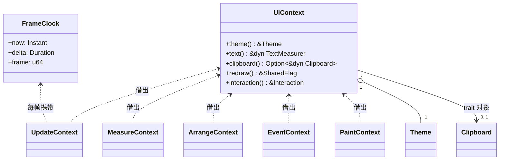

`UiContext` 是**跨窗口共享**的服务（主题、文本引擎、剪贴板、失效标志），
由 `WindowManager` 唯一持有；每窗口状态（焦点、捕获、painter）在 `Window` 内。

---

## 3. 帧管线（update → layout → paint → render）

每帧由失效驱动（`SharedProperty::set`、动画推进、输入事件、resize 均会置
redraw 标志），在 winit 的 `about_to_wait` 阶段执行：

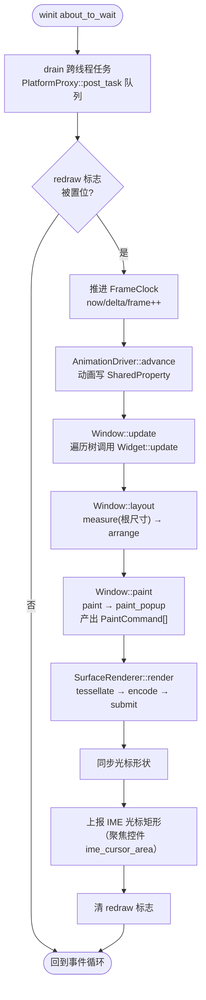

对应实现：`rustui/src/app.rs` 的 `run_frame` 编排整个管线；
`rustui-window/src/manager.rs` 提供 `update/layout` 入口；
`rustui-window/src/window.rs` 完成 `layout`（两阶段）与 `paint`
（含 overlay 层与 popup 层）；`rustui-renderer/src/surface.rs` 消费命令流。

### 3.1 一帧的完整时序

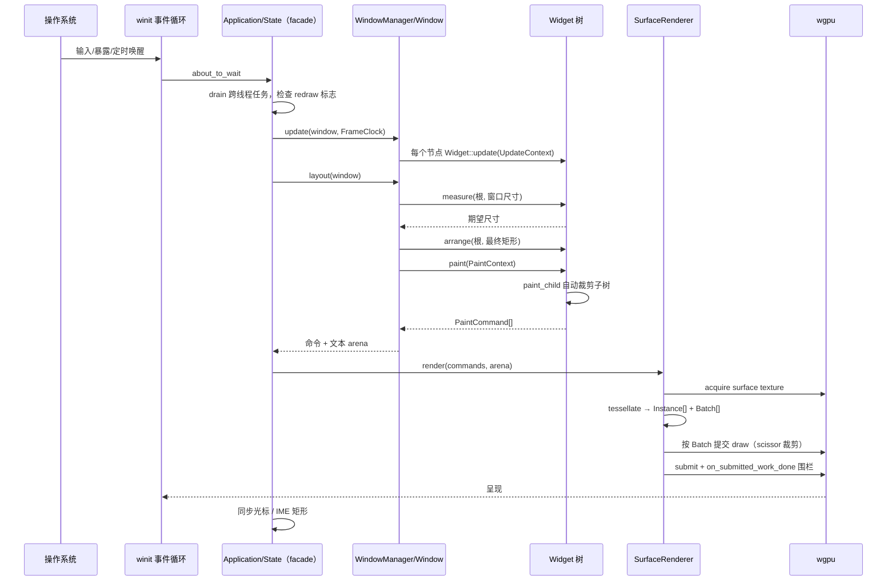

---

## 4. 事件系统

### 4.1 事件翻译与路由

事件从操作系统到控件经过两级翻译/路由，控件只见平台无关的 `UiEvent`：

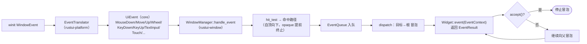

### 4.2 一次 MouseDown 的端到端时序

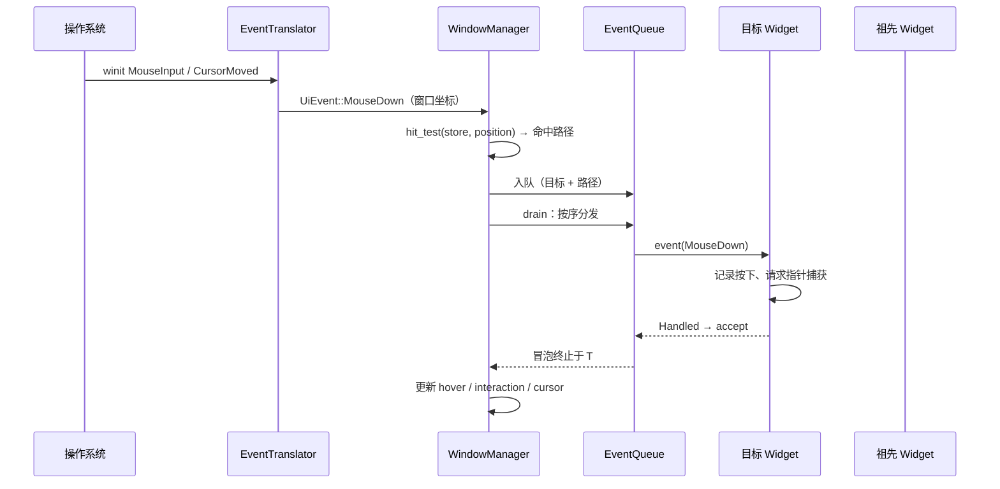

**关键语义**：

* **捕获**：按下时 `EventContext` 请求捕获，之后 drag/抬起事件无论指针在何处都
  重定向到捕获对象，直到捕获释放（状态见 §4.3）。
* **焦点**：`focus_step`/`focus_object`（`dispatch.rs`）沿祖先链找可聚焦节点，
  `FocusReason` 区分点击/程序/遍历移动。
* **入队**：`event` 回调内产生的事件（如合成 `TextInput`）进 `EventQueue`，
  在当前事件完成后按序 drain，避免重入。

### 4.3 指针捕获状态机

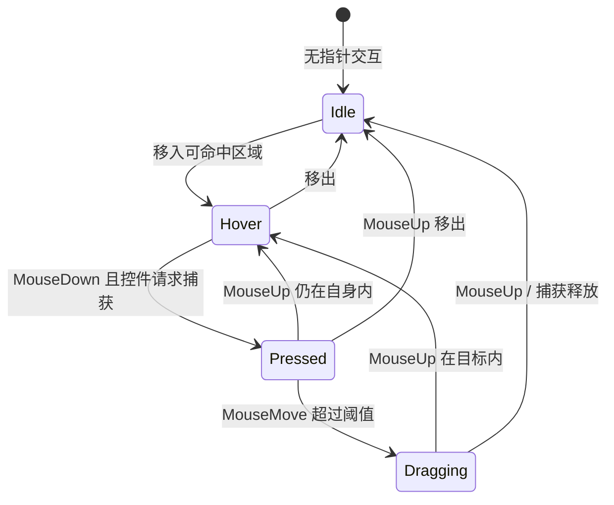

（以上为交互语义概括；代码中的实际状态由 `Interaction` 结构与
`finish_pointer_state` 维护。）

---

## 5. 渲染管线

`rustui-renderer` 把 `PaintCommand[]` 变成 GPU 实例化绘制：

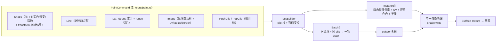

设计要点：

* **单管线多实例**：所有图元统一为带 UV/颜色/圆角的四边形实例，一个 pipeline
  吃下全部批次；描边通过顶点外扩 + 抗锯齿 alpha 实现。
* **合批**：相邻实例按「纹理 + clip 矩形」聚成 `Batch`，每个 Batch 一次
  `draw` + scissor，天然按绘制顺序解决重叠，无需深度缓冲。
* **双后端**：`Target::Surface`（真实窗口）与 `Target::Offscreen`（无窗口离屏，
  黄金图测试与 `render_to_png` 用）共享同一条 tessellate/encode 路径。

---

## 6. 文本管线

`rustui-text` 是唯一的文本引擎，对上只暴露两个 trait：
`TextMeasurer`（控件测量用）与 `GlyphSource`（渲染器取字形图集用）。

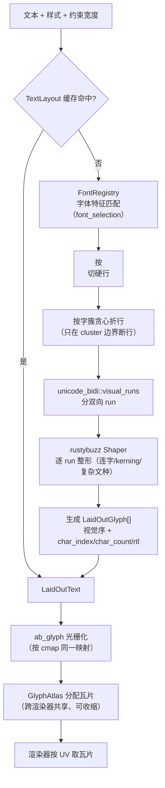

要点：整形（rustybuzz）负责形状与字形序，光栅化（ab_glyph）负责像素——
二者共用同一 cmap 映射，由集成测试 `shaped_glyph_ids_match_the_rasterizer` 钉住；
光标/命中均按**字簇**插值（`caret_rect` / `hit_test_x`），连字与 RTL 下不撕裂字符。

---

## 7. 坐标双空间（C-020）

框架同时存在两种坐标，类型上不区分但语义严格分离：

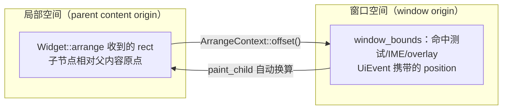

* `arrange` 期间父通过 `ctx.offset()` 告知子其窗口原点，子据此维护
  `window_bounds`。
* 命中测试、`UiEvent` 的指针位置、IME 光标矩形都在**窗口空间**；
  `Painter` 内部使用绘制栈顶的变换，`paint_child` 负责把子树裁剪并平移到正确位置。

---

## 8. 线程模型

**UI 单线程 + 后台任务回投**：

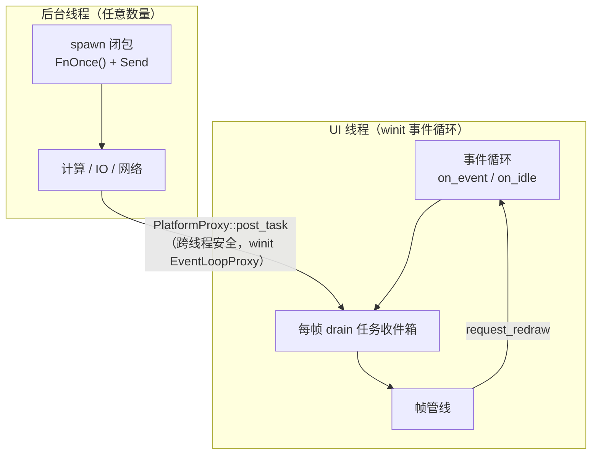

* `spawn`（facade 全局函数或 `AppContext::spawn`）把闭包发到后台线程执行；
  结果经 `post_task` 回到 UI 线程，由注册的 `on_task` 回调消费——该回调运行在
  UI 线程，可以安全地操作 Widget 与 `SharedProperty`。
* `SharedProperty::set` 通过全局 redraw sink 置失效标志，任何线程触发的属性变更
  都会在下一帧的管线中体现。
* GPU/渲染始终在 UI 线程（wgpu surface 归属事件循环线程）。

---

## 9. 模块文档索引

| 文档 | 模块 |
|---|---|
| [`modules/rustui-core.md`](modules/rustui-core.md) | 对象模型、事件、绘制、主题、信号 |
| [`modules/rustui-platform.md`](modules/rustui-platform.md) | winit 事件循环、事件翻译、剪贴板、光标、IME |
| [`modules/rustui-window.md`](modules/rustui-window.md) | WindowManager、事件路由、帧管线编排 |
| [`modules/rustui-renderer.md`](modules/rustui-renderer.md) | wgpu surface、tessellate、合批、shader |
| [`modules/rustui-text.md`](modules/rustui-text.md) | 字体、shaping、排布、字形图集 |
| [`modules/rustui-layout.md`](modules/rustui-layout.md) | 两阶段布局与容器 |
| [`modules/rustui-model.md`](modules/rustui-model.md) | Model/View 数据层与选择 |
| [`modules/rustui-animation.md`](modules/rustui-animation.md) | 缓动、动画、属性过渡、驱动 |
| [`modules/rustui-widgets.md`](modules/rustui-widgets.md) | 标准控件库 |
| [`modules/rustui.md`](modules/rustui.md) | Application facade、多窗口、跨线程任务 |

---

## 10. 架构不变式清单

1. `rustui-core`/`layout`/`model`/`animation`/`widgets` 中**不存在**任何
   `winit`/`wgpu` 类型（P1，由依赖表与 crate 边界保证）。
2. 对象寻址只经 `ObjectId`；任何长期持有的引用都必须是索引，不能是指针
   （P3，配合代际校验防悬垂）。
3. 事件冒泡以 `EventResult`/`accept()` 为唯一终止协议；入队事件不重入分发。
4. 所有失效统一收敛到 redraw 标志；帧管线是唯一消费点。
5. 坐标在 API 上以文档前缀（"window coordinates"）+ 测试钉住双空间语义（C-020）。
6. GPU 资源（surface、pipeline、图集上传）只在 UI 线程触碰。
