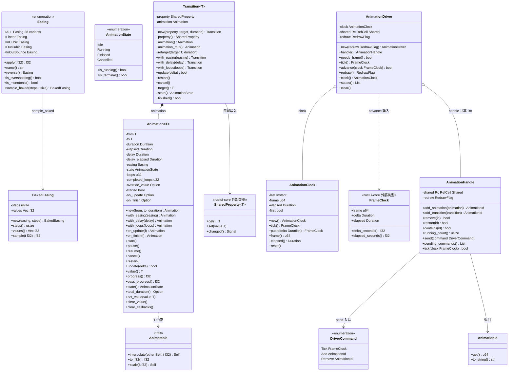
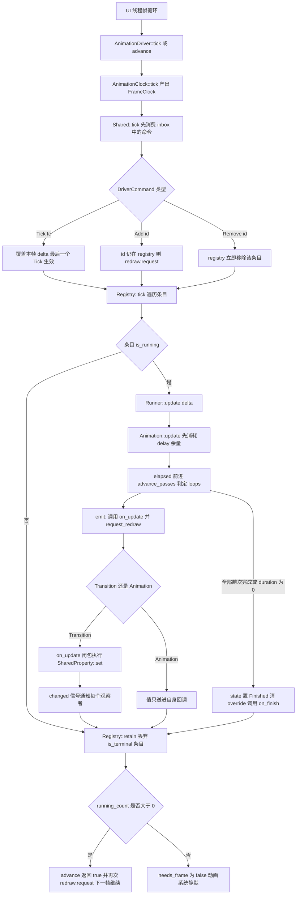
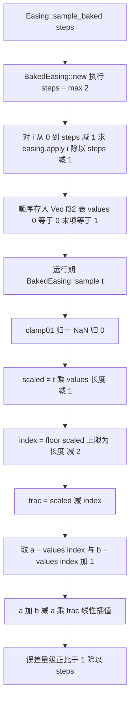
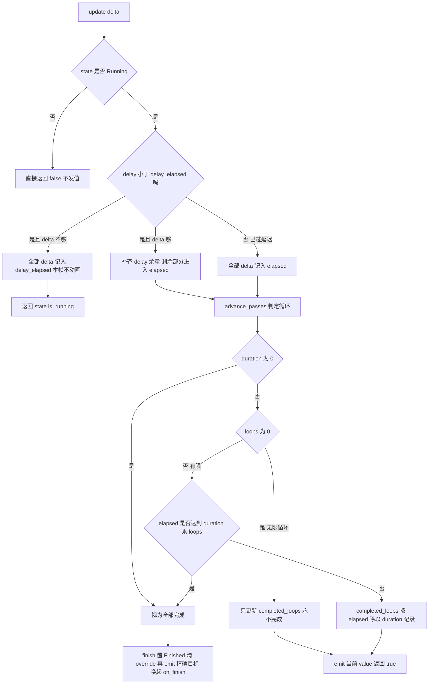
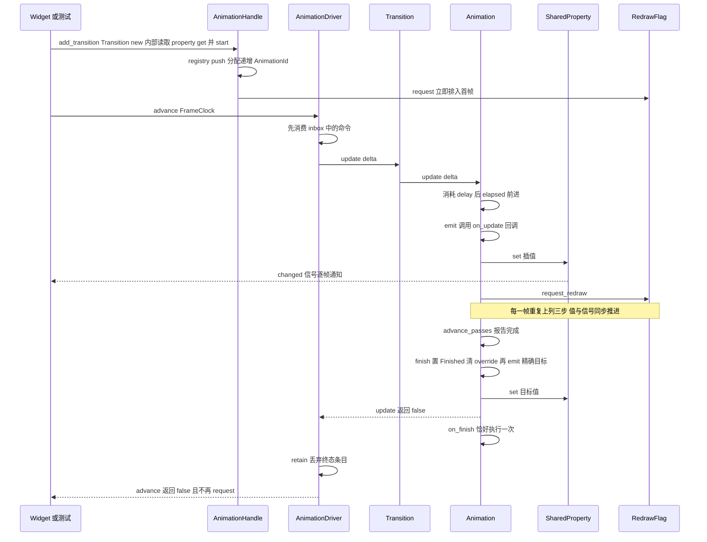
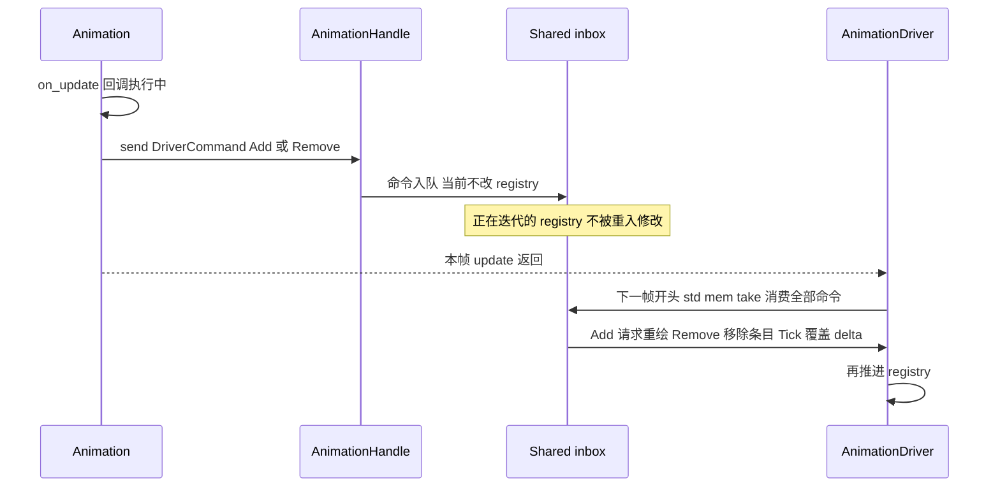
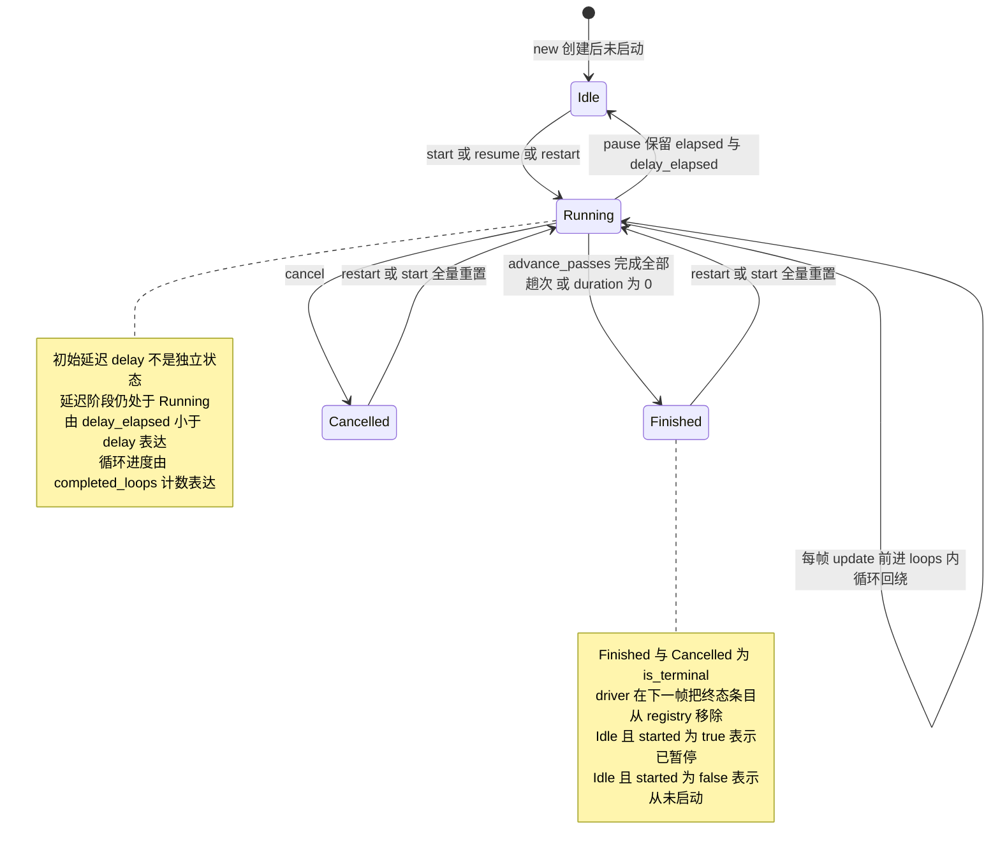
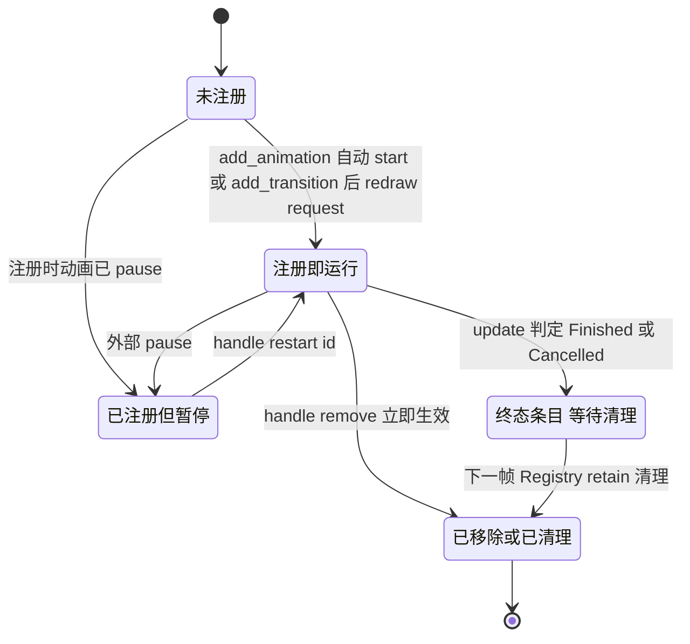

# rustui-animation 模块详细设计

> 所属体系：[架构设计文档](../Architecture_Design_Document.md) · 分层：第 2 层 基础服务（平台无关）——动画子系统
> 源码：`crates/rustui-animation/src/` · 依赖：仅 `rustui-core`（`SharedProperty`、`notify::request_redraw` / `RedrawFlag`、`FrameClock` re-export），无 winit/wgpu（原则 P1）

## 1. 模块职责

- 提供**时间曲线**：`Easing` 枚举 28 条 Penner 风格曲线（多项式 / 三角 / 物理三族，各含 `In` / `Out` / `InOut` 变体加 `Linear`），`apply` 求值、`reverse` 时间镜像、`is_overshooting` / `is_monotonic` 分类，以及 `sample_baked` → `BakedEasing` 烘焙查表（详细设计 §34）。
- 提供**可插值标量契约**：`Animatable` trait（`f32` / `f64` / `i32` / `i64` / `u32` / `u64` 六个实现）与 `lerp` / `inv_lerp` 自由函数——复合类型不实现该 trait，由上层逐分量动画（见 `rustui-widgets` 对 `Vec2` 的处理）。
- 提供**单值动画** `Animation<T>`：起止值、时长、初始延迟 `delay`、缓动、循环次数 `loops`、值覆盖 `set_value`、`on_update` / `on_finish` 回调，由外部帧增量 `update` 推进，**自己不读时钟、不 sleep、不开线程**。
- 提供**属性过渡** `Transition<T>`：把 `Animation<T>` 的每个中间值写进 `SharedProperty`，widget 渲染 `property.get()`，观察者经 `changed` 信号逐帧收到通知——这是控件实际使用动画的形态。
- 提供**帧时钟** `AnimationClock`：把"现在"折算成 `FrameClock { frame, delta, elapsed }`（结构定义在详细设计 §33，本 crate 从 `rustui-core` re-export），首帧固定 `NOMINAL_FRAME` 16 ms、单帧增量钳到 `MAX_FRAME_DELTA` 100 ms；`push(delta)` 供测试与定步长模拟**手动推进**（本 crate 没有名为 `ManualClock` 的类型，手动时钟就是 `AnimationClock::push`）。
- 提供**帧驱动器** `AnimationDriver`：应用持有它、每帧推进一次；`AnimationHandle` 是可克隆的 `Rc<RefCell<..>>` 门面，widget 在只有 `&self` 时也能**无 `&mut` 注册 / 移除 / 重启动画**。
- 把"值变化"折算成"重绘请求"：每次 `emit` 都调用 `rustui_core::notify::request_redraw()`，动画因此自动驱动 UI 反复重绘，无需额外调度逻辑（详细设计 §34 的 `Easing → Property → Render` 通路）。

## 2. 模块结构（文件表）

| 文件 | 职责 |
| --- | --- |
| `lib.rs` | 模块声明、crate 根 re-export（`Animation` / `AnimationState` / `Transition` / `AnimationClock` / `FrameClock` / `MAX_FRAME_DELTA` / `NOMINAL_FRAME` / `AnimationDriver` / `AnimationHandle` / `AnimationId` / `DriverCommand` / `BakedEasing` / `Easing` / `inv_lerp` / `lerp` / `Animatable`）、`prelude`，以及 5 个 crate 级集成测试 |
| `easing.rs` | `Easing` 枚举与 `Easing::ALL`、`apply` / `name` / `reverse` / `is_overshooting` / `is_monotonic` / `sample_baked`；`BakedEasing` 烘焙表；私有 `clamp01` 与 `out_bounce` |
| `value.rs` | `Animatable` trait 与 6 个标量实现（`impl_float_animatable!` / `impl_int_animatable!` 宏）、`lerp` / `inv_lerp` |
| `animation.rs` | `AnimationState` 生命周期枚举、`Animation<T>` 单值动画、`Transition<T>` 属性过渡 |
| `clock.rs` | `NOMINAL_FRAME` / `MAX_FRAME_DELTA` 常量、`AnimationClock`（`tick` / `push` / `frame` / `elapsed` / `reset`），并 `pub use rustui_core::FrameClock` |
| `driver.rs` | `AnimationId`、`DriverCommand`、`AnimationHandle`、`AnimationDriver`；私有 `Runner` trait（类型擦除）、`Driven`、`Registry`、`Shared` |

## 3. 核心类型设计

### 3.1 类图

### 3.2 类型说明表

| 类型 | 关键 API | 语义与注意点 |
| --- | --- | --- |
| `Easing` | `apply(t)`、`name()`、`reverse()`、`is_overshooting()`、`is_monotonic()`、`sample_baked(steps)`、`ALL` | 28 条曲线；`apply` 把 `t` 先 `clamp01`（`NaN` 归 0、`±∞` 归端点），端点精确满足 `f(0)=0`、`f(1)=1`；`Back` / `Elastic` 族会离开 `0..=1`（`is_overshooting`），`Bounce` 族留在范围内但非单调，故 `is_monotonic = !overshooting && !Bounce` |
| `BakedEasing` | `new(easing, steps)`、`sample(t)`、`steps()`、`values()` | `steps` 至少 2，`values[0]==0`、`values[last]==1`；`sample` 两次载入加一次线性插值，近似误差正比 `1/steps`，避免每帧每通道跑 `powf` / `sin` |
| `Animatable` | `interpolate(other, t)`、`to_f32()`、`scale(k)` | `Copy + PartialOrd + 'static`；`t` 在 `0..=1` 外允许线性外推；整型经 `f64` 计算后 `round`，`lerp(0u32, 10, 0.5) == 5` |
| `lerp` / `inv_lerp` | `lerp(a, b, t)`、`inv_lerp(a, b, value)` | `lerp` 把 `t` 钳到 `0..=1` 且 `t<=0` 返回 `a`、`t>=1` 返回 `b` **精确值**——完成态动画因此报告精确目标而非浮点累积；`inv_lerp` 在 `a==b` 时返回 `0.0` |
| `AnimationState` | `Idle` / `Running` / `Finished` / `Cancelled`、`is_running()`、`is_terminal()` | `Idle` 同时表示"未启动"与"已暂停"（用 `is_started()` 区分，源码注释明确说明没有独立 `Paused` 态）；`is_terminal = Finished | Cancelled` |
| `Animation<T>` | `new` / `with_easing` / `with_delay` / `with_loops` / `on_update` / `on_finish`、`start` / `pause` / `resume` / `cancel` / `restart`、`update(delta) -> bool` | `loops==0` 无限循环、`loops==1` 默认；每趟循环各自施加 easing，`value()` 在新一趟回到 `from`，而 `progress()` 跨所有趟单调 `0..=1`；`duration==0` 立即 `Finished`；`update` 对非 `Running` 状态是 no-op 并返回 `false` |
| `Animation<T>` 值覆盖 | `set_value(v)` / `clear_value()` | 覆盖值优先于插值（拖拽期间由用户拥有该值）；`start` / `restart` / 进入 `Finished` 时清空，完成时必然报告精确 `to` |
| `Transition<T>` | `new(property, target, duration)`、`retarget`、`restart`、`cancel`、`with_easing` / `with_delay` / `with_loops` | `new` 从 `property.get()` 取起点并**立即 `start()`**，`on_update` 闭包持有 `property` 副本并 `set`；`retarget` 用当前属性值重设 `from`，中途改目标不产生跳变；`cancel` 后属性停在最后写入的值 |
| `AnimationClock` | `tick()`、`push(delta)`、`frame()`、`elapsed()`、`reset()` | `NOMINAL_FRAME=16ms`、`MAX_FRAME_DELTA=100ms`；构造后/`reset` 后首帧固定 `NOMINAL_FRAME`，`tick` 之后取实测增量并钳到上限（卡顿后动画只"落后一点"，不瞬移到终点）；`push` 同样钳位，是测试与定步长模拟的手动入口 |
| `FrameClock` | `frame` / `delta` / `elapsed` | 类型来自 `rustui-core`，`clock.rs` 直接 `pub use`，本 crate 不重复定义 |
| `AnimationId` | `get()`、`Display` | 单调递增 `u64`，**永不复用**——延迟命令里的陈旧 id 不会指向别的动画；`Display` 形如 `#1` |
| `AnimationHandle` | `add_animation` / `add_transition` / `remove` / `restart` / `contains` / `send` / `tick` / `pending_commands` | `Rc<RefCell<Shared>>` + `RedrawFlag`，可自由克隆，**注册不需要 `&mut`**；`add_animation` 若未启动会先 `start()` 并立即 `redraw.request()`；`remove` 立即生效，`send(DriverCommand::Remove)` 则推迟到下一帧 |
| `DriverCommand` | `Tick(FrameClock)` / `Add(AnimationId)` / `Remove(AnimationId)` | 供 `send` 入队、下一帧 `Shared::tick` 开头统一消费；`Tick` 采用"最后一个胜出"覆盖本帧实测增量；`Add` 只有 id 仍注册时才请求重绘 |
| `AnimationDriver` | `new(redraw)`、`handle()`、`needs_frame()`、`tick()`、`advance(clock)`、`states()`、`clear()` | 持有 `AnimationClock` + 共享 `Shared` + `RedrawFlag`；`tick` 用真实时间推进，`advance` 由调用方给时钟（测试 / 定步长模拟）；`advance` 在仍有动画运行时补一次 `redraw.request()`；`clear` 清空注册表、inbox 并 `clock.reset()` |

## 4. 主要流程

### 4.1 一帧：driver 推进 → 属性写入 → 失效

要点：**失效来自两处叠加**——`Animation::emit` 内部的 `request_redraw()`（每次出值必发）与 `SharedProperty::set` 触发的 `changed` 信号（widget 依赖链）；`advance` 收尾还会为仍在运行的条目再请求一次，保证没有额外事件也会连续重绘。

### 4.2 烘焙采样：`sample_baked` → `sample`

### 4.3 `Animation::update` 的时间分配（delay → 循环 → 完成）

## 5. 关键时序

### 5.1 一个 `Transition` 从 `start` 到完成回调

### 5.2 在 `on_update` 回调里链接下一个动画

## 6. 状态转换

### 6.1 单个动画的生命周期（`AnimationState`，源码枚举命名）

### 6.2 注册表条目在 driver 中的去向

## 7. 关键设计约束与不变式

引用编号来自 [Design_Corrections.md](../Design_Corrections.md) 与 [Detailed_Design_Document.md](../Detailed_Design_Document.md) §33（Frame Clock）、§34（Animation）。

- **§33 落地**：`FrameClock { frame, delta, elapsed }` 定义在 `rustui-core`，本 crate 的 `clock.rs` 直接 re-export；`NOMINAL_FRAME` 与 `MAX_FRAME_DELTA` 两个常量实现"首帧固定、卡顿钳位"的帧时钟语义。
- **§34 落地并扩展**：设计文档给出的 `Animation { duration, elapsed, easing }` 是最小骨架，实现补齐了 `delay` / `loops` / 回调 / 值覆盖 / 生命周期枚举，并把 `Easing → Property → Render` 落成 `Transition` 写 `SharedProperty` 的具体通路。
- **C-034 crate 依赖方向**：`rustui-animation` 只依赖 `rustui-core`，`rustui-widgets` 依赖本 crate 而不反向依赖，动画可在无窗口环境直接单测。
- **P1 平台无关**：本 crate 不出现 `winit` / `wgpu` 类型，也**不读墙钟做推进**——`AnimationClock::tick` 由应用帧循环调用，其余路径一律显式传 `Duration`。

模块级不变式（P 原则，本 crate 自身约定）：

- **P-AN1 动画是纯函数式的推进器**：`Animation::update` 只依赖入参 `delta` 与自身状态；同样的调用序列产生同样的值序列，测试因此无需 sleep。
- **P-AN2 端点精确**：`lerp` 在 `t<=0` / `t>=1` 直接返回 `a` / `b`，`Easing::apply` 在 `0` / `1` 处特判，`finish()` 清 `override` 后重算——完成态值**永远**是精确目标，整型尤其不能留半步。
- **P-AN3 每次出值必请求重绘**：`emit` = `on_update` + `request_redraw`，`start` 也发一次首值；动画停止后不再发出任何重绘请求（`a_finished_animation_does_not_request_more_frames` 用例锁死该行为）。
- **P-AN4 终态自动出表**：`Registry::tick` 在推进后 `retain(!is_terminal)`，`Finished` / `Cancelled` 条目下一帧即被丢弃；`needs_frame()` 只看 `running_count`，暂停的动画留在表里但不占用帧循环。
- **P-AN5 id 永不复用**：`Registry::next_id` 只增不减，`clear()` 重置的是整个注册表而非把 id 发回池子；陈旧 `DriverCommand` 打不到新动画。
- **P-AN6 命令延迟一帧**：`Rc<RefCell>` 内的 registry 绝不在被迭代时修改——`on_update` 回调里只能 `send`，命令在下一帧开头 `std::mem::take` 后统一消费（`Tick` 最后一个胜出）。这是 driver 模块文档列出的四条 `Rc<RefCell>` 合法性理由之一。
- **P-AN7 只有 UI 线程**：共享状态用 `Rc<RefCell<..>>` 而非 `Arc<Mutex<..>>`，无锁无原子；所有访问器都在单个表达式内借用并返回拷贝，引用不会跨越可变操作存活。
- **P-AN8 手动时钟即 `push`**：确定性推进只有一个入口 `AnimationClock::push`（配合 `AnimationDriver::advance`），不存在第二个"手动时钟"类型，避免两套时间语义分叉。

## 8. 测试布局

本 crate 共 **74 个 `#[test]`**，全部为模块内单测（`#[cfg(test)] mod tests`），无独立 `tests/` 目录；运行方式 `cargo test -p rustui-animation`，文档示例随 `cargo test --doc -p rustui-animation` 执行。

| 文件 | 数量 | 覆盖要点 |
| --- | --- | --- |
| `src/easing.rs` | 14 | 全 28 条曲线端点精确 `0`/`1`、有界曲线不越 `0..=1`、`Back`/`Elastic` 确实越界且幅度显著、`is_monotonic` 与 `is_overshooting` 不相交、`Bounce` 在范围内回弹、参考值、输入钳制含 `NaN`/`±∞`、`name` 与变体名一致且唯一、`reverse` 交换 `In`/`Out` 并时间镜像、烘焙表与精确曲线误差小于 `1/64`、`sample_baked(0)` 退化为 2 样本 |
| `src/animation.rs` | 25 | 精确步数完成、进度随时间、easing 作用于进度、延迟推迟动画且单帧可跨过、暂停恢复保留 `elapsed`、取消即终止、重跑全量重置、循环各趟独立 easing 与跨趟 `progress`、`loops==0` 无限、零时长立即完成、`on_update` 每值必达、`on_finish` 恰一次、值覆盖优先且完成即清、整型落点、降序动画、改目标、`clear_callbacks`、`Transition` 写属性 / 每帧发信号 / 从当前值 restart / 取消后 retarget / 尊重 easing 与 delay |
| `src/driver.rs` | 17 | 新 driver 空闲、`needs_frame` 随动画起落、推进到目标值、Transition 写入属性、注册请求重绘、移除即停、多 handle 共享同一 driver、id 递增唯一、重跑再生效、取消结束帧循环、注册未启动动画即启动、暂停动画不占用帧循环、命令下一帧消费、`Add` 排程重绘、`Remove` 可重复应用、`tick` 帧号单调、`clear` 全清 |
| `src/value.rs` | 8 | `lerp` 端点精确、中点与解析值一致、`t` 钳制含 `NaN`、降序区间、`scale` 乘法、`to_f32` 覆盖六类型、`inv_lerp` 与 `lerp` 互逆、`interpolate` 在 `0..=1` 外外推 |
| `src/clock.rs` | 5 | 首帧固定 `NOMINAL_FRAME`、帧号与 `elapsed` 单调、`push` 确定性、`push` 钳住 30 秒卡顿、`reset` 归零 |
| `src/lib.rs` | 5 | 值变化请求重绘（`Animation` 与 `Transition` 两条路径）、完成动画不再要帧、`prelude` 暴露全部公开 API、端到端：`AnimationClock::push` 驱动 `advance` 五帧后属性到达目标且 `clock.frame()==5` |

注意事项：`lib.rs` 与部分用例通过 `set_redraw_sink` / `clear_redraw_sink` 安装全局重绘旗标（与 `Application::run` 的安装方式一致），测试之间必须成对清理，避免线程局部 sink 泄漏到其他用例。
