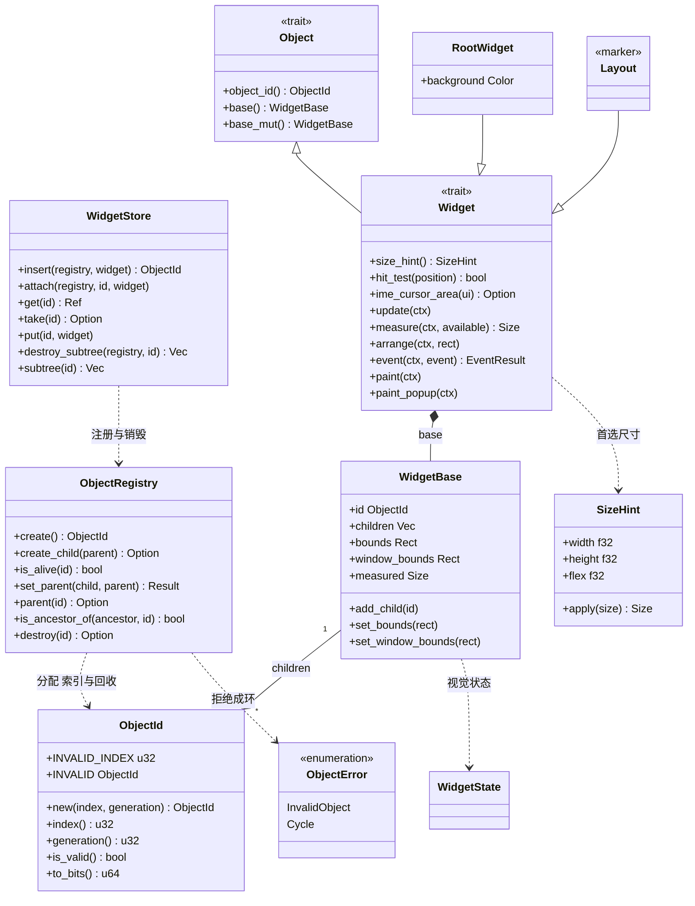
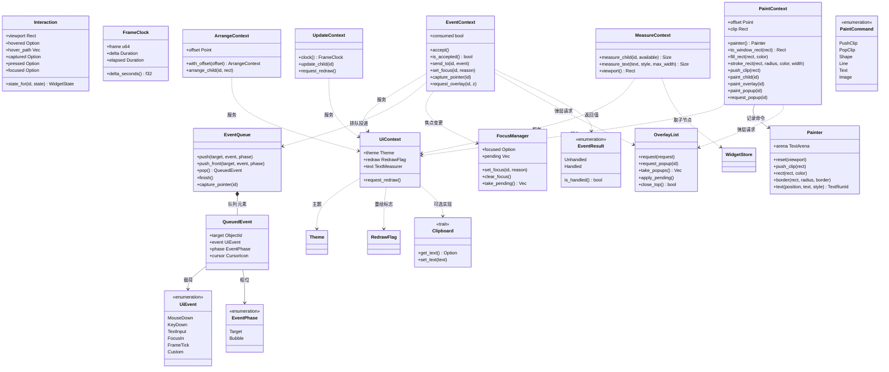
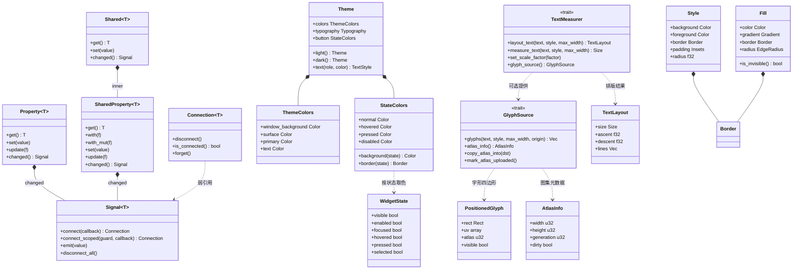
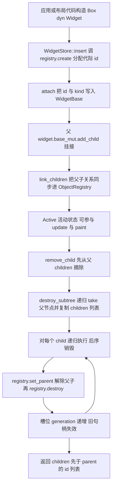
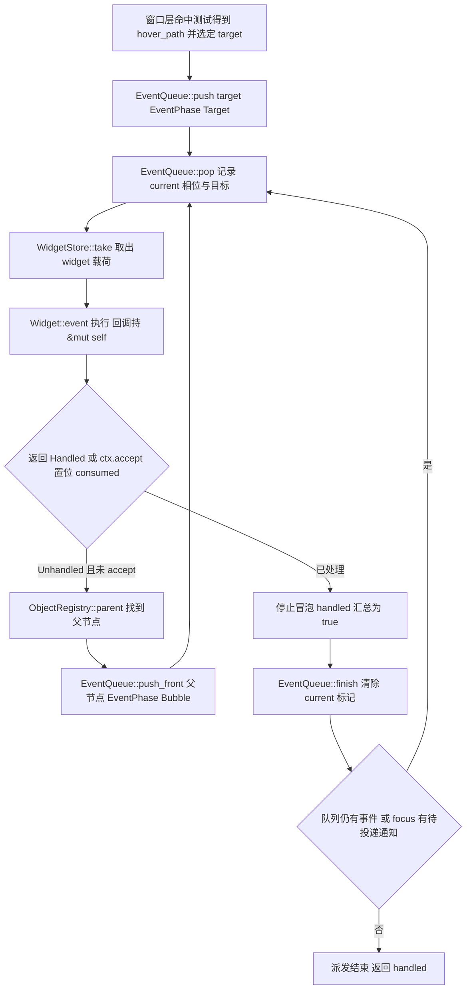
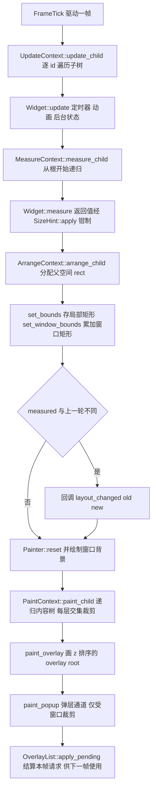
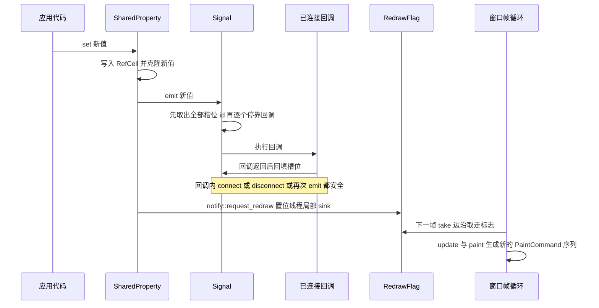
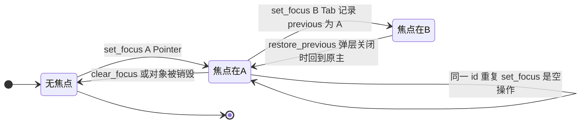
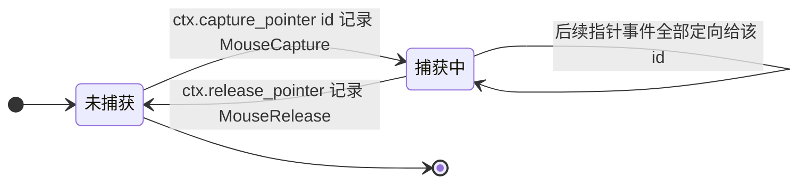

# rustui-core 模块详细设计

> 所属体系：[架构设计文档](../Architecture_Design_Document.md) · 分层：第 2 层（基础层）
> 源码：`crates/rustui-core/src/` · 依赖：仅 std + log（无 winit/wgpu，原则 P1/P2）

## 1. 模块职责

- 定义**保留模式对象模型**：代际句柄 `ObjectId` + 身份注册表 `ObjectRegistry` + 载荷池 `WidgetStore`，widget 之间只用 id 相互寻址，不持有彼此的 `Rc<RefCell<..>>` 指针（详细设计 §52；修正 C-001 / C-002）。
- 定义 **Widget 契约与基础状态**：`Object` / `Widget` trait、`WidgetBase`（children、局部 bounds、窗口 bounds、`WidgetState`）、`SizeHint`、`impl_widget_base!` 宏与 `RootWidget`（修正 C-003，不提供 downcast 见 C-004）。
- 定义**各阶段上下文与共享服务**：`MeasureContext` / `ArrangeContext` / `UpdateContext` / `EventContext` / `PaintContext` 全部只借 `&UiContext` 与 `&WidgetStore`，帧时钟、主题、文本引擎、剪贴板、重绘标志集中在 `UiContext`（详细设计 §39 剪贴板、§33 帧时钟）。
- 定义**平台无关的事件、键盘与焦点模型**：`UiEvent` / `EventResult` / `EventPhase` / `QueuedEvent` / `EventQueue`，`Key` / `Modifiers` / `CursorIcon` / `FocusReason`，以及仅存状态的 `FocusManager`（修正 C-008 ~ C-013）。
- 定义**绘制与外观原语**：`Painter` + `PaintCommand` 帧级命令缓冲、`TextArena` 字符串驻留、`Fill` / `Border` / `Style` / `WidgetState`、`Theme` / `ThemeColors` / `StateColors`（修正 C-021 / C-023 / C-025 / C-030）。
- 定义**响应式与文本测量接口**：`Signal<T>` / `Connection<T>` / `Property<T>` / `SharedProperty<T>` / `Shared<T>`，以及 `TextMeasurer` / `GlyphSource` 两个 trait——核心只声明"怎么量、怎么拿字形"，实现交给 `rustui-text`（修正 C-026 / C-027）。

## 2. 模块结构

| 文件 | 职责 |
| --- | --- |
| `lib.rs` | 模块声明、顶层 re-export、`prelude`，以及 `Layout: Widget` 标记 trait（供 `rustui-layout` 的布局原语做泛型约束） |
| `object.rs` | `ObjectId`（index + generation 代际句柄）、`ObjectRegistry`（身份 / 父子索引 / 根集合）、`ObjectError` |
| `widget.rs` | `Object` / `Widget` trait、`WidgetBase`、`SizeHint`、`impl_widget_base!`、`RootWidget`、`hinted_measure` / `align_child` / `distribute` / `clamp_scroll` 等布局小工具 |
| `widget_store.rs` | `WidgetStore`（`RefCell<HashMap<ObjectId, Box<dyn Widget>>>`）与 take/put 协议、`destroy_subtree`、`detach_from_parent`、`link_children` |
| `context.rs` | `UiContext`、`Interaction`、`FrameClock`、五类阶段上下文、`EventQueue`、`OverlayList` / `OverlayRequest`、`Clipboard` / `MemoryClipboard`、`BoxMetrics` |
| `event.rs` | `UiEvent` 枚举、`EventResult`、`EventPhase`、`QueuedEvent`、`TaskId` / `TaskPayload` |
| `keyboard.rs` | `Key` / `NamedKey` / `Modifiers` / `MouseButton` / `ScrollPhase` / `FocusReason` / `CursorIcon` |
| `focus.rs` | `FocusManager`：焦点归属、previous 记录、pending 通知队列、焦点环开关 |
| `geometry.rs` | `Vec2` / `Point` / `Size` / `Rect` / `Insets` / `EdgeWidths` / `EdgeRadius` / `Align` / `AlignSelf` / `MainAxisAlign` / `CrossAxisAlign` / `MainAxisSize`（逻辑像素 `f32`） |
| `color.rs` | `Color`：sRGB 分量、hex 解析、`lerp` / `modulate` / `lighten` 等 |
| `paint.rs` | `Painter`、`PaintCommand`、`TextArena` / `TextRunId`、`TextStyle` / `TextAlign`、`Gradient`、`Transform`、`TextureId` / `FontId` |
| `style.rs` | `Border` / `Fill` / `Style` / `WidgetState` |
| `theme.rs` | `Theme`（`light` / `dark`）、`ThemeColors`、`Typography`、`Spacing`、`Radius`、`BorderWidths`、`StateColors`、`TextRole` |
| `signal.rs` | `Signal<T>`、`Connection<T>`：类型安全回调列表与可重入安全的 emit |
| `property.rs` | `Property<T>`、`SharedProperty<T>`、`Shared<T>`：带 `changed` 信号的响应式值 |
| `text.rs` | `TextMeasurer` / `GlyphSource` trait 与 `TextLayout` / `TextLine` / `PositionedGlyph` / `AtlasInfo` 数据类型 |
| `notify.rs` | `RedrawFlag`（`Arc<AtomicBool>`）与线程局部 `set_redraw_sink` / `request_redraw` |
| `error.rs` | `UiError` 枚举、`Result<T>` 别名、`From<std::io::Error>` |

## 3. 核心类型设计

### 3.1 类图

### 3.2 关键类型说明

| 类型 | 职责 | 关键字段 / 方法 |
| --- | --- | --- |
| `ObjectId` | 代际句柄，`index + generation`，槽位回收后旧句柄自然失效 | `INVALID`、`new`、`is_valid`、`to_bits` / `from_bits` |
| `ObjectRegistry` | 只保存身份与父子关系，不持有 widget 载荷 | `create`、`create_child`、`set_parent`（拒绝成环）、`destroy`（generation 递增）、`depth_of` |
| `WidgetStore` | 持有 `Box<dyn Widget>` 的内部可变池，scoped take/put 协议 | `insert`、`take` / `put`、`destroy_subtree`（后序返回）、`subtree`、`for_each_in_order` |
| `Object` / `Widget` | 对象身份 trait 与保留模式控件契约 | `Widget::measure` / `arrange` / `event` / `paint` / `paint_popup` / `ime_cursor_area` |
| `WidgetBase` | 每个 widget 的公共状态：children、双空间矩形、`WidgetState`、kind | `bounds`（局部，原点钉在 0,0）、`window_bounds`（窗口）、`measured` |
| `SizeHint` | `measure` 之前的首选尺寸与伸缩权重 | `flex`、`min/max`、`apply` 把测得尺寸钳入区间 |
| `UiContext` | 与窗口无关的共享服务：主题、重绘标志、文本引擎、剪贴板、光标 | `request_redraw`、`theme`、`text`、`set_cursor` |
| `Interaction` | 每窗口交互状态，派生 `WidgetState` | `hover_path`（整条链）、`captured`、`state_for` |
| `FrameClock` | 帧序号与时间，驱动动画与光标闪烁 | `delta_seconds` 下限钳到 1ms，避免暂停后动画跳变 |
| `MeasureContext` / `ArrangeContext` | 布局两阶段上下文，携带 `offset` 累加窗口坐标 | `measure_child`、`arrange_child`、`with_offset` |
| `UpdateContext` | 帧首逐 widget 回调上下文 | `clock`、`update_child`、`request_redraw` |
| `EventContext` | 事件回调上下文；投递**排队不重入** | `accept` / `is_accepted`、`send_to`、`capture_pointer`、`set_focus`（返回 `()`） |
| `EventQueue` | FIFO 事件队列 + 派发期副作用（捕获、光标、current 标记） | `push` / `push_front`、`pop` / `finish`、`take_cursor` |
| `OverlayList` | 内容树之外的 overlay root 集合（按 z 排序）与本帧弹层队列 | `request` / `apply_pending`、`request_popup` / `take_popups`、`close_top` |
| `FocusManager` | 焦点状态与待投递的 `FocusIn` / `FocusOut` 通知 | `set_focus` / `clear_focus` / `restore_previous` / `take_pending` |
| `Painter` | 帧级绘制命令缓冲，不认识"当前 widget" | `reset`、`push_clip` / `pop_clip`、`rect` / `border` / `text` / `image`、`arena` |
| `PaintCommand` | 单条绘制指令；`Text` 只引用驻留 id + 切片范围 | `PushClip` / `PopClip` / `Shape` / `Line` / `Text` / `Image` |
| `TextArena` | 帧级字符串驻留池，避免每帧克隆 `String` | `intern` / `get`，随 `Painter::reset` 清空 |
| `Signal<T>` / `Connection<T>` | 类型安全回调列表；emit 期间"停靠"回调保证可重入安全 | `connect`、`emit`、`Connection::disconnect`（Drop 不自动断开） |
| `Property<T>` / `SharedProperty<T>` / `Shared<T>` | 带 `changed` 信号的值；`SharedProperty` 是跨 widget 共享状态的入口 | `set` / `update`（写入后 emit 并 `notify::request_redraw`）、`with` / `with_mut` |
| `Theme` / `StateColors` | 主题与按状态取色，widget 不写死颜色 | `Theme::light` / `dark`、`StateColors::background(state)`、`Theme::text(role, color)` |
| `Style` / `Fill` / `Border` / `WidgetState` | 视觉样式与七位控件状态 | `Fill::is_invisible`、`Border::is_visible`、`WidgetState::is_interactive` |
| `TextMeasurer` / `GlyphSource` | 测量与字形供给接口，`rustui-text` 实现 | `layout_text`、`glyph_source`（默认 `None`）、`copy_atlas_into` / `mark_atlas_uploaded` |
| `RedrawFlag` | 跨任意 UI 线程位置请求重绘的原子标志 | `request` / `take`（边沿触发）、线程局部 `set_redraw_sink` |

## 4. 主要流程

### 4.1 Widget 子树的创建与销毁

要点：`ObjectRegistry::destroy` 只释放自己这一个槽位（子树由 `WidgetStore::destroy_subtree` 沿 `Widget::children` 走完）；父节点先被销毁时，子节点记录的 parent 因代际不匹配而读作 `None`，悬空链接不会指向新对象。

### 4.2 事件契约：排队投递、冒泡与 accept

要点：向子节点投递**永远排队**（`EventContext::send_to` 只入队），当前 widget 可以在 `&mut self` 期间安全触达任意后代；`EventResult` 只有两态，`ctx.accept()` 与返回 `Handled` 等价（C-008）；`MouseEnter` / `MouseLeave` / `FocusIn` / `FocusOut` 这类合成通知逐个寻址，不参与二次冒泡。队列驱动循环在 `crates/rustui-window/src/dispatch.rs`（详细设计 §10）。

### 4.3 一帧：update → measure → arrange → paint

要点：各阶段上下文共享同一批借用（`&UiContext`、`&WidgetStore`），阶段之间不保留任何对 widget 的可变借用；`arrange` 同时记录局部与窗口两套矩形，`layout_changed` 只在 `old != new` 时触发。

## 5. 关键时序

### 5.1 Signal 从 emit 到 widget 重绘响应

## 6. 状态转换

### 6.1 键盘焦点（FocusManager）

每次焦点变更都会向 `pending` 队列压入 `(旧主, None)` 与 `(新主, Some(reason))`，窗口层 `take_pending` 后转成 `FocusOut` / `FocusIn` 事件入 `EventQueue`（C-007：`EventContext::set_focus` 返回 `()`，参数错误走返回值、语义拒绝走事件）。

### 6.2 指针捕获（EventQueue / Interaction）

`EventQueue::capture` 与 `Interaction::captured` 是同一份状态的两处投影（派发前 `sync_interaction` 同步），`Interaction::state_for` 借此把 `hovered` / `pressed` / `focused` 合成进 `WidgetState`（C-030）。

## 7. 关键设计约束与不变式

- **P1 / P2（G-001）**：`Cargo.toml` 只声明 `log` 一个依赖；`lib.rs` 文档明确"无 winit/wgpu"，平台事件在 `rustui-platform` 翻译成 `UiEvent`（C-010）后才进入核心。
- **§52 禁止 `Rc<RefCell<T>>` 作为对象模型**：对象间只有 `ObjectId`；`WidgetStore` 用 take/put 短借协议——`take` 立即移除条目并释放 `RefMut`，重入取同一 id 返回 `None` 而不是 panic（`widget_store.rs` 模块注释与测试 `take_put_roundtrip`）。`Rc`/`RefCell` 只出现在**信号与属性内部**（`signal.rs` 注释声明这不属于对象模型）。
- **C-001 代际句柄**：`registry.destroy` 执行 `generation.wrapping_add(1).max(1)` 并把槽位压入 free 栈；`is_alive` / `slot` 一律比对 generation，测试 `generational_ids_are_not_reused` 锁定该行为。
- **C-002 身份与载荷分离**：`ObjectRegistry` 只有 `slots / free / alive / root`；`WidgetStore` 才持有 `Box<dyn Widget>`，因此遍历结构不触碰 `RefCell`。
- **C-003 / C-004**：`impl_widget_base!` 只生成 `Object` 三个方法；`WidgetStore` 不暴露 `Any`，全链路无 downcast，跨边界数据走 `SharedProperty` / `Shared`（C-033）。
- **C-008 / C-009 / C-013**：`EventResult` 只有 `Unhandled` / `Handled`；`EventContext` 字段为 `ui / store / interaction / focus / queue / overlays / depth / consumed`，不含 clock 与 modifiers（时钟在 `UpdateContext`，修饰键在 `UiEvent` 载荷里）；`UiEvent` 仅 `derive(Clone, Debug)`。
- **C-020 坐标双空间（最重要）**：`WidgetBase::bounds` 是局部空间且 `set_bounds` 把原点钉在 `(0,0)`；`window_bounds` 是窗口空间、由 `arrange` 沿树路径累加；`PaintContext` 的帮助方法（`fill_rect` / `stroke_rect` / `push_clip*` / `paint_child`）参数吃**局部**并在内部 `to_window_rect`，`ctx.painter()` 直接调用吃**窗口**坐标。回归测试 `nested_paint_accumulates_window_origins` 保证孙节点相对自己的父节点定位。
- **C-021**：`stroke_rect` 走 `Painter::border` 产出环形边框（画在 rect 内侧），`width <= 0` 或 `alpha <= 0` 直接早退，背景之后画边框不会盖住子内容。
- **C-022 / C-023**：`PaintContext` 的裁剪栈始终是矩形求交，`push_clip_rounded` 只把 radius 记进 `PaintCommand::PushClip`；填充用 `Fill { color, gradient, border, radius }` 单条命令表达。
- **C-025**：`PaintCommand::Text` 只带 `run: TextRunId` 与 `range`，字符串驻留在 `TextArena`，`Painter::reset` 每帧重建，命令内不复制 `String`（测试 `commands_carry_geometry_without_copying_strings`）。
- **C-045 弹层通道**：widget 在普通 `paint` 里 `request_popup(self.id())`，`OverlayList::request_popup` 去重入队、`take_popups` 每帧取走即清空；`PaintContext::paint_popup` 用该 widget 的窗口原点做 offset、窗口矩形做 clip，保证弹层不被祖先裁剪、不被后绘兄弟盖住（测试 `popup_layer_requests_are_deduplicated_and_drained`）。
- **C-026 / C-027 / C-028 / C-029**：`TextMeasurer::glyph_source` 默认返回 `None`（测试桩可只测量不渲染），真实引擎必须覆写；字形图集在内部可变性之后，故用 `copy_atlas_into` + `mark_atlas_uploaded` 两步协议；`set_scale_factor` 默认空实现，布局恒为逻辑像素；`measure_text(.., None)` 取自然宽度。
- **C-037 / C-038**：`Clipboard` trait 定义在核心（`EventContext::clipboard()`），实现在 platform；`Widget::ime_cursor_area` 默认 `None` 表示不需要输入法，每帧向焦点 widget 询问窗口坐标矩形。
- **C-043**：`window_bounds` 只在 `arrange` 之后有效，几何断言必须先跑一帧布局。
- **C-042（信号句柄）**：当前源码 `Signal::connect` 返回 `Connection<T>`，`Connection::drop` **刻意不自动断开**（`signal.rs` 注释：长期存在的 signal 行为不应因临时句柄出作用域而改变），需显式 `disconnect()`；`emit` 通过"取出回调—执行—回填"实现可重入安全。

## 8. 测试布局

核心无 `tests/` 目录，全部单测内联在各文件的 `#[cfg(test)] mod tests` 中，共 **66 个 `#[test]`**：

| 文件 | 测试数 | 代表性覆盖点 |
| --- | --- | --- |
| `object.rs` | 5 | `generational_ids_are_not_reused`、`cycles_are_rejected`、`destroy_detaches_from_parent`、`id_bits_roundtrip` |
| `widget_store.rs` | 5 | `take_put_roundtrip`（重入不 panic）、`destroy_subtree_is_post_order`、`subtree_walks_children`、`detach_removes_from_parent` |
| `context.rs` | 10 | `nested_paint_accumulates_window_origins`（C-020 回归）、`paint_clip_is_restored_after_child`、`popup_layer_requests_are_deduplicated_and_drained`（C-045）、`event_queue_is_fifo_and_records_cursor`、`frame_clock_delta_is_clamped` |
| `signal.rs` | 6 | `emit_calls_slots_in_order`、`self_disconnect_during_emit_is_safe`、`disconnect_all_from_callback_stops_pending_slots`、`connecting_from_callback_does_not_recurse` |
| `property.rs` | 3 | `property_emits_changed`、`shared_property_is_visible_to_all_clones`、`shared_property_update` |
| `paint.rs` | 7 | `clip_stack_tracks_intersection`、`text_arena_interns_repeated_strings`、`commands_carry_geometry_without_copying_strings`（C-025）、`text_commands_carry_their_transform_and_width`（C-049） |
| `widget.rs` | 5 | `size_hint_clamps`、`widget_base_children_are_unique`、`distribute_weights`、`clamp_scroll_offsets`、`align_child_positions` |
| `focus.rs` | 4 | `set_focus_queues_notifications`、`set_same_focus_is_noop`、`restore_previous` |
| `theme.rs` / `style.rs` | 3 + 3 | `state_colors_pick_by_state`（C-030）、`text_roles_resolve`、`fill_visibility` |
| `event.rs` / `keyboard.rs` | 3 + 2 | `event_result_combine`（C-008 两态）、`position_extraction`、`modifiers` |
| `color.rs` / `geometry.rs` / `notify.rs` / `error.rs` | 3 + 4 + 2 + 1 | hex 解析往返、几何运算、`flag_take_is_edge_triggered`、`request_redraw_without_sink_is_safe` |

跨 crate 的相关测试：端到端管线 `crates/rustui/tests/pipeline.rs`（C-044，真实 `TextEngine` 不碰 GPU）、弹层与事件回归分布在 `crates/rustui-window` 与 `crates/rustui-widgets` 的单测中（C-045 列出的 `the_popup_layer_is_painted_after_the_content_tree` 等）。`text.rs` 与 `lib.rs` 本身只有 trait 与 re-export，无独立单测——其实现方在 `rustui-text`，消费方在 `rustui-window` / `rustui-widgets`。
