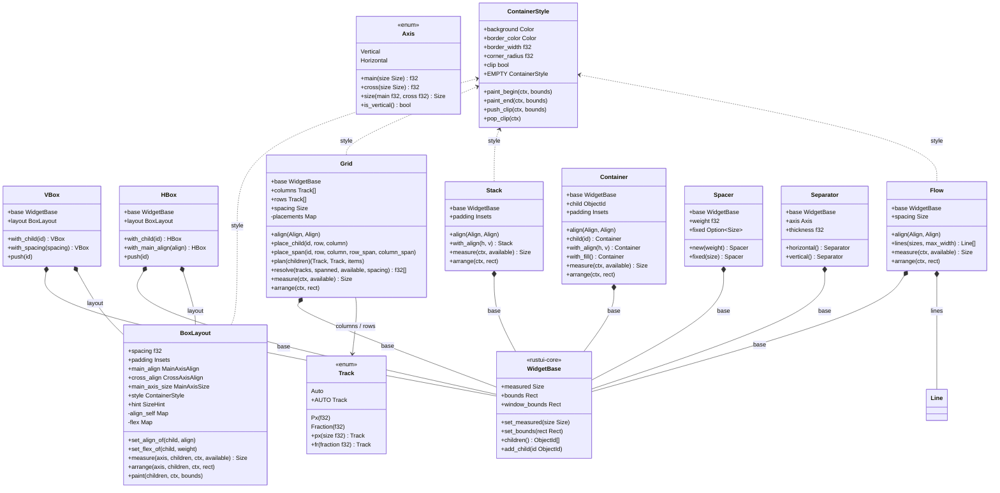
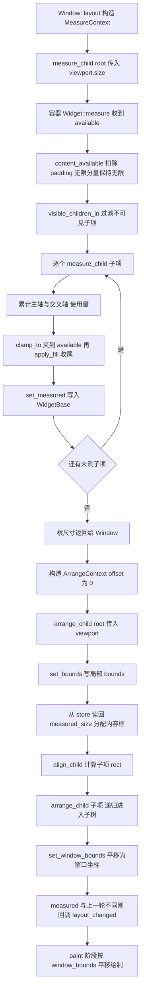
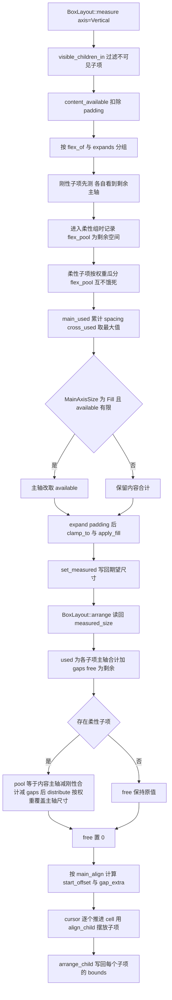
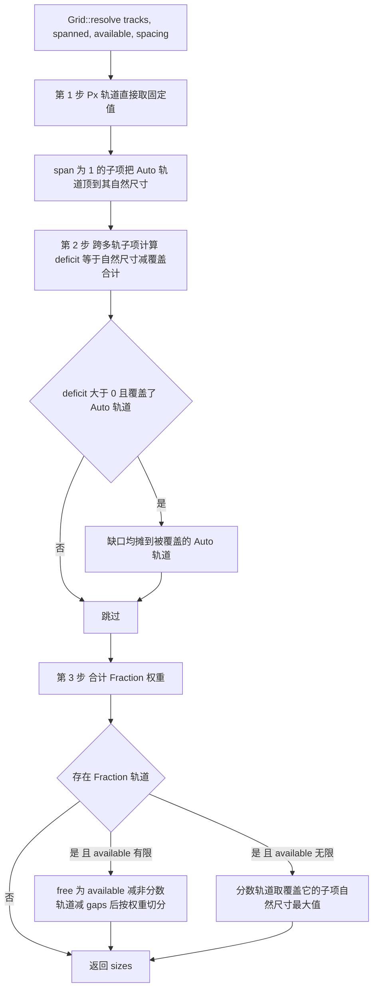
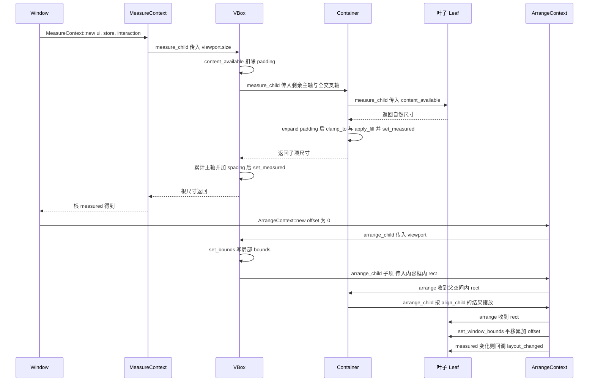
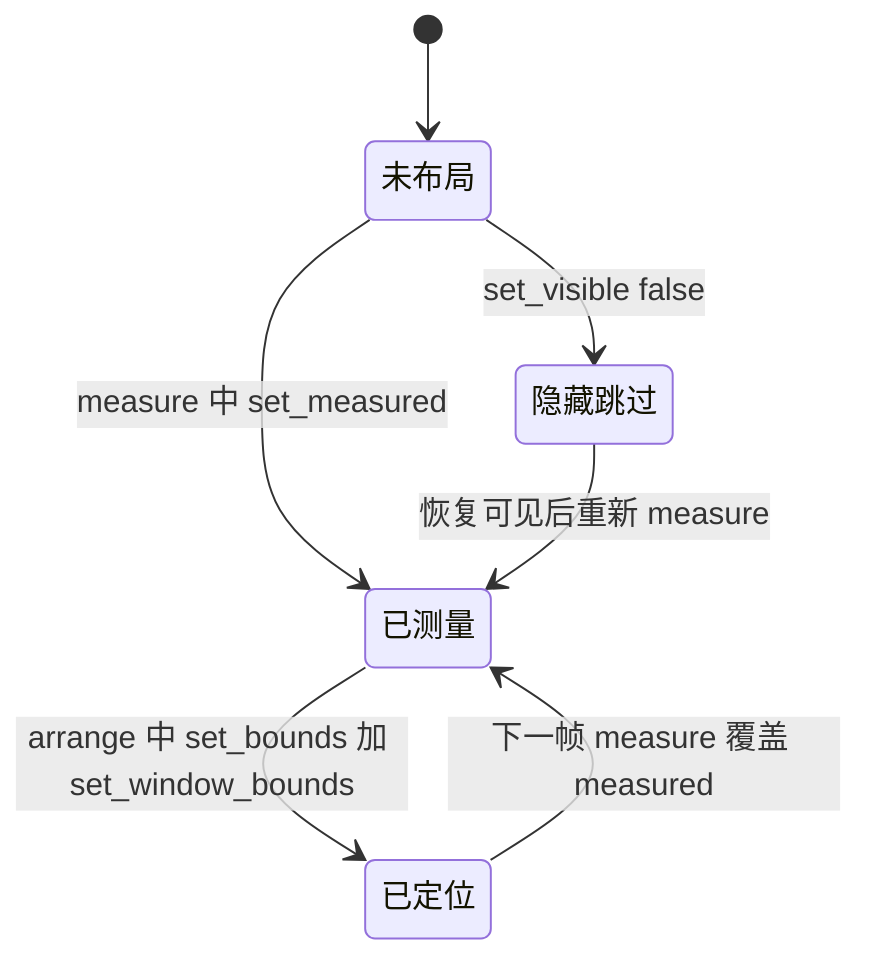

# rustui-layout 模块详细设计

> 所属体系：[架构设计文档](../Architecture_Design_Document.md) · 分层：第 2 层（布局/数据层）
> 源码：`crates/rustui-layout/src/` · 依赖：仅 rustui-core

本模块对应[详细设计文档](../Detailed_Design_Document.md) §15（Layout）、§16（VBox）、
§17（HBox）、§18（Grid），并落实[设计修正](../Design_Corrections.md) C-005、C-014 ~ C-020、
C-043 的布局约定。

## 1. 模块职责

`rustui-layout` 提供 RustUI 的全部**布局原语**：每个类型都是一个普通的
`rustui_core::Widget`，只依赖 `rustui-core`，因此可以被 widget、示例与测试直接使用，
不必引入平台层或渲染层。它承担四件事：

1. **容器算法**：把「父容器能给多少空间」转换成「每个子项的期望尺寸与位置」。
   - 一维：`VBox`（自上而下）/ `HBox`（自左而右），共享 `BoxLayout` 配置结构；
   - 二维：`Grid`（`Auto` / `Px` / `Fraction` 轨道 + 间距 + 跨行跨列）；
   - 叠放：`Stack`（同一盒子内重叠，后绘制者在上）；
   - 流式：`Flow`（水平流动、按容器宽度换行）；
   - 单子项：`Container`（padding + background + border + radius + clip + 对齐）；
   - 辅助：`Spacer`（柔性/固定间隙）、`Separator`（细分隔线）。
2. **两阶段布局**：`measure(available)` 只拿到父容器能提供的空间，返回期望尺寸并写入
   `WidgetBase::measured`；`arrange(rect)` 从不重新测量，只把已测得的尺寸分配到局部
   rect 中，写入 `WidgetBase::bounds` 与 `window_bounds`。
3. **装饰绘制**：`ContainerStyle` 统一提供背景、边框、圆角与裁剪，
   `paint_begin` / `paint_end` 成对出现在每个容器的 `paint` 首尾。
4. **坐标约定**：`arrange` 接收的 rect 是「在父容器内」的矩形，widget 只保存
   **局部** bounds（原点恒为 `(0, 0, width, height)`）；窗口坐标单独存放在
   `window_bounds`，`paint` 用它平移子项（[设计修正](../Design_Corrections.md) C-020
   坐标双空间约定）。

三遍流水线（crate 根文档 `lib.rs` 给出的官方表述）：

```text
measure(available) -> desired size, stored in `WidgetBase::measured`
arrange(rect)      -> local bounds + `window_bounds` for every child
paint(ctx)         -> decoration first, then the children
```

## 2. 模块结构（文件表）

| 文件 | 内容 |
|------|------|
| `crates/rustui-layout/src/lib.rs` | crate 文档（容器一览、三遍流水线、坐标约定）、模块声明、`prelude` |
| `crates/rustui-layout/src/style.rs` | 所有布局 widget 共享的工具：`Axis`、`ContainerStyle`、`content_rect` / `content_available` / `clamp_to` / `apply_fill` / `expands` / `measured_size` / `hint_of` / `visible_children` / `paint_children` |
| `crates/rustui-layout/src/boxes.rs` | `BoxLayout`（measure / arrange / paint 共享算法）、`define_box!` 宏生成的 `VBox` / `HBox`、`Spacer`、`Separator` |
| `crates/rustui-layout/src/container.rs` | `Container`：单子项 + padding + 装饰 + 水平/垂直对齐 |
| `crates/rustui-layout/src/grid.rs` | `Grid`、`Track`（`Auto` / `Px` / `Fraction`）、私有 `Placement`、`plan` / `resolve` / `offsets` 轨道算法 |
| `crates/rustui-layout/src/stack.rs` | `Stack`：子项在同一内容框内叠放，默认 `Stretch` 拉满 |
| `crates/rustui-layout/src/flow.rs` | `Flow`、私有 `Line`：水平流动 + 按宽度换行 |
| `crates/rustui-layout/tests/layout.rs` | 端到端布局测试：自备 `Leaf` / `StubText` / `Tree` 测试骨架，18 个 `#[test]` |

## 3. 核心类型设计

### 3.1 类图



> 说明：`VBox` / `HBox` 由 `boxes.rs` 中的 `define_box!` 宏生成，二者只在 `Axis` 常量上
> 不同；模块中**没有**名为 `FlexBox` 的类型，"弹性盒子"的能力来自 `BoxLayout` 的
> `flex` 权重表与子项 `SizeHint::flex`。

### 3.2 类型说明表

| 类型 | 文件 | 说明 |
|------|------|------|
| `Axis` | `style.rs` | `Vertical` / `Horizontal`；`main` / `cross` / `size` 在主轴与交叉轴之间换算尺寸 |
| `ContainerStyle` | `style.rs` | 装饰五元组（背景色、边框色、边框宽、圆角、是否裁剪）；`EMPTY` / `Default` 表示什么都不画；`paint_begin` = 背景 + 推裁剪，`paint_end` = 弹裁剪 + 描边 |
| `BoxLayout` | `boxes.rs` | `VBox` / `HBox` 的共享配置与算法：`spacing`、`padding`、`main_align`、`cross_align`、`main_axis_size`、`hint`，以及私有的 `align_self` / `flex` 两张按子项覆盖表；`set_flex_of(child, 0)` 移除覆盖 |
| `VBox` / `HBox` | `boxes.rs` | 一维容器，`measure` / `arrange` / `paint` 全部委托给 `BoxLayout`，仅传入固定 `Axis` |
| `Spacer` | `boxes.rs` | 柔性间隙：`SizeHint { flex: weight, ..SizeHint::fill() }`，`measure` 返回 `Size::ZERO`（或 `fixed(size)` 的固定值），不绘制任何内容 |
| `Separator` | `boxes.rs` | 分隔线：横线（用于 `VBox`）报 `width: ∞`、`height: thickness`，纵线相反；主轴永远固定为线宽，因此不会吃掉自由空间 |
| `Grid` + `Track` | `grid.rs` | 轨道：`Auto`（取该轨道最大项）、`Px(f32)`（固定）、`Fraction(f32)`（瓜分剩余空间）；`with_spacing` / `with_gaps` 设行列间距；`place_child` / `place_span` 显式定位，未定位子项按行优先自动流布 |
| `Placement`（私有） | `grid.rs` | `(row, column, row_span, column_span, h, v)`，由 `plan` 统一产出，measure 与 arrange 共用同一份几何规划 |
| `Stack` | `stack.rs` | 所有可见子项测量同一个内容框，`arrange` 用同一 `align`（默认 `(Stretch, Stretch)`）摆放，后绘制的子项盖在上面 |
| `Flow` + `Line`（私有） | `flow.rs` | `Line { items, width, height }` 是换行结果；`align.0` 决定行在容器内的水平对齐，`align.1` 决定子项在行内的垂直对齐（默认 `(Start, Center)`） |
| `Container` | `container.rs` | 单子项容器：`child(id)` 是 builder 方法（同时 `add_child`），`with_align(h, v)`、`with_fill()` 设置自身 `SizeHint::fill()`；`is_opaque` 取决于背景 alpha |

## 4. 主要流程

### 4.1 两阶段布局：measure → arrange



要点：

- `measure` 从来看不到 rect，只拿到父容器「还剩多少」的可用空间；`arrange` 从不重新
  测量（arrange 上下文背后没有文本引擎），子项尺寸一律通过 `style::measured_size`
  从 `WidgetStore` 读回。
- 约束向下（`available` 逐层收紧）与 hint 向上（`SizeHint::flex`、无限尺寸偏好
  `f32::INFINITY` 向上冒泡为「我要更多空间」）在同一遍里完成：`expands(hint, axis)`
  判定 `flex > 0.0 || 偏好无限`，命中者进入柔性组参与分池。

### 4.2 VBox 一次布局的轨道分配（`BoxLayout::measure` + `arrange`）



- 第 1 步（measure 内的柔性组）只是「预分配」，让同排两个 flex 子项互相不饿死；
  **权威分配在第 2 步（arrange）**：整行已知后 `distribute(pool, weights)` 覆盖柔性
  子项的主轴尺寸，测量值此时只决定交叉轴（[设计修正](../Design_Corrections.md) C-017）。
- `main_align` 的六种取值（`Start` / `Center` / `End` / `SpaceBetween` /
  `SpaceAround` / `SpaceEvenly`）只在**没有**柔性子项吃掉空间时才产生可见效果。

### 4.3 Grid 轨道尺寸解析（`Grid::resolve`）



`plan` 在 measure 与 arrange 中被**同样调用**，因此两遍得到的行列规划完全一致：
显式 `place_child` / `place_span` 优先，其余子项按行优先游标自动流布，`rows` 不足时
用 `Track::Auto` 补齐。

## 5. 关键时序

一次 `Window::layout` 从根遍历到叶子（`crates/rustui-window/src/window.rs` 发起，
`MeasureContext::measure_child` / `ArrangeContext::arrange_child` 递归，见
`crates/rustui-core/src/context.rs`）：



约定：`arrange_child` 里的 `offset` 是「本 widget 原点的窗口坐标」，子项把自己的局部
rect 平移后写入 `window_bounds`；这正是嵌套容器中
`ctx.fill_rect(bounds, color)` 无论嵌套多深都能画对的原因（测试
`nested_paint_uses_window_coordinates` 覆盖该性质）。

## 6. 状态转换

本 crate **没有持久的显式状态机**——所有布局 widget 都是无状态的纯算法容器。下图刻画
的是单帧内一个节点的**几何值生命周期**（`WidgetBase` 字段的写入时序），属于帧内状态
而非跨帧状态机：



- 「隐藏跳过」：`visible_children` 在 measure / arrange / paint 三遍里使用同一过滤，
  不可见子项的 bounds 保持 `Rect::ZERO`（测试
  `invisible_children_are_skipped` 断言）。
- arrange 期间若 `measured` 与上一轮不同，`ArrangeContext::arrange_child` 会回调
  `Widget::layout_changed(old, new)`，widget 由此得知自身尺寸变化。

## 7. 关键设计约束与不变式

引用编号来自 [Design_Corrections.md](../Design_Corrections.md) 与
[Detailed_Design_Document.md](../Detailed_Design_Document.md) §15 ~ §18。

- **C-005 容器即 layout widget**：布局不是独立 trait，每个布局 widget 自己实现
  `Widget::measure` / `Widget::arrange`，公共算法下沉到 `BoxLayout` / `Grid` /
  `Stack` / `Flow` 的方法上（`impl rustui_core::Layout for ...` 只是空标记实现）。
- **C-014 `MainAxisSize` 只有 `Auto` / `Fill` / `Fixed`**，无 `Expand`；
  `MainAxisSize::Fill` 仅在 `measure` 中把主轴改取 `available`。
- **C-015 `CrossAxisAlign` 默认 `Start`**：交叉轴默认不拉伸，子项保持自然交叉尺寸。
- **C-016 `apply_fill` 是 measure 的统一收尾**：`clamp_to` 先夹到 `available`，
  再由 `apply_fill` 处理「hint 无限 = 吃满 offered」；`content_available` 保持无限
  分量为无限，让自由贴合内容的容器把这份自由继续下传。
- **C-017 box 测量：刚性先行，柔性按权重分池**；arrange 阶段 `distribute` 的覆盖值
  才是柔性子项的权威主轴尺寸。
- **C-018 填充型 widget 必须在 `size_hint` 里声明扩展**：`measure` 会吃满 `available`
  的 widget 必须让 `size_hint` 与之匹配，否则被第 1 步判成刚性而饿死兄弟
  （对照 `Separator`：它只在交叉轴报 `∞`，主轴固定为线宽，因此永远不参与抢空间）。
- **C-019 `Container::child` 是 builder**，会同时 `add_child`；`with_child` 是关联函数。
- **C-020 坐标双空间约定**：widget 只存局部 bounds，窗口坐标只存 `window_bounds`，
  `paint` 用后者平移子项。
- **C-043 几何断言必须在 layout 之后**：测试里先 `layout(available, rect)` 再断言
  `window_bounds`。

模块级不变式（P 原则，本 crate 自身约定）：

- **P-L1 arrange 不复测**：`arrange` 上下文没有文本引擎，子项尺寸一律经
  `measured_size` / `measured_size_in` 从 store 读回并用 `SizeHint::apply` 夹紧。
- **P-L2 三遍一致过滤**：`visible_children` 同时服务 measure / arrange / paint，
  保证三遍看到同一组子项。
- **P-L3 所有 measure 都以 `apply_fill(clamp_to(...), available, hint)` 收尾**，
  返回值写入 `set_measured` 后即为该 widget 的期望尺寸。
- **P-L4 局部坐标原点**：`set_bounds(rect)` 后 `bounds` 恒为
  `(0.0, 0.0, rect.width, rect.height)`，子项几何在父的局部空间计算。
- **P-L5 空间非负**：padding 扣除、free space、跨轨缺口一律 `.max(0.0)`，
  `Grid::place_span` 的 span 一律 `.max(1)`。
- **P-L6 measure 与 arrange 共用同一规划**：`Grid::plan` / `Flow::lines` 在两遍中
  调用同一函数，几何不可能不一致。

## 8. 测试布局

`crates/rustui-layout/tests/layout.rs` 是端到端布局测试（共 18 个 `#[test]`），
自带三层骨架：

- **测试叶子** `Leaf`：固定自然尺寸，`measure` 直接返回 `size` 并 `set_measured`，
  `arrange` 只 `set_bounds`，`paint` 填充蓝色矩形；
- **桩文本** `StubText`：`TextMeasurer` 实现，每字符宽 7.0、行高 14.0，供
  `UiContext::new` 使用；
- **测试树** `Tree`：组合 `UiContext` / `WidgetStore` / `ObjectRegistry` /
  `Interaction`，提供 `empty` / `set_root` / `insert` / `add` / `measure` /
  `arrange` / `layout` / `bounds` / `measured` 快捷方法，断言助手 `assert_rect`
  允许 0.01 的浮点容差。

| 分组 | 测试 | 覆盖要点 |
|------|------|----------|
| VBox / HBox | `vbox_stacks_children_with_spacing_and_padding` | 间距 + padding 下的 measured 与逐子项位置 |
| | `vbox_cross_align_stretch_fills_the_content_width` | `CrossAxisAlign::Stretch` 拉满内容宽度 |
| | `hbox_gives_free_space_to_flex_children` | `Spacer::new(1.0)` 吃掉 120px 剩余 |
| | `free_space_is_distributed_by_main_axis_align` | `MainAxisAlign::Center` 的 60px 偏移 |
| | `measure_is_clamped_to_the_available_space` | 超大子项被 `clamp_to` 夹住 |
| | `invisible_children_are_skipped` | 隐形子项跳过且 bounds 为 `Rect::ZERO` |
| | `separator_is_a_line_and_never_absorbs_free_space` | 分隔线横跨内容宽但不吸收高度 |
| Grid | `grid_splits_fixed_and_fractional_tracks` | `px(50)` + `fr(1)` 的轨道切分 |
| | `grid_auto_placement_flows_row_by_row` | 行优先自动流布与 Auto 列宽取最大 |
| | `grid_spanning_item_uses_the_whole_row` | `place_span` 跨列项撑满整行 |
| Stack / Flow / Container | `stack_overlaps_children_in_the_same_box` | 默认 Stretch 叠放 |
| | `stack_alignment_keeps_natural_size` | `(End, End)` 对齐保持自然尺寸 |
| | `flow_wraps_into_lines` | 120px 宽下第三个子项换行 |
| | `container_pads_and_aligns_its_child` | padding + 背景 + 边框 + 圆角 + 裁剪 + 对齐 |
| | `container_fill_takes_the_offered_space` | `with_fill()` 吃满 offered 空间 |
| | `container_style_defaults_are_empty` | `ContainerStyle::default()` 等于 `EMPTY` |
| 嵌套 | `nested_containers_accumulate_window_coordinates` | VBox > HBox > Leaf 的 `window_bounds` 累加 |
| | `nested_paint_uses_window_coordinates` | `Painter` 命令中出现窗口坐标下的叶子矩形 |
