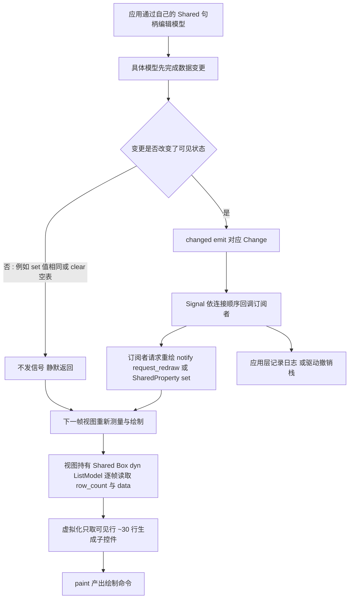
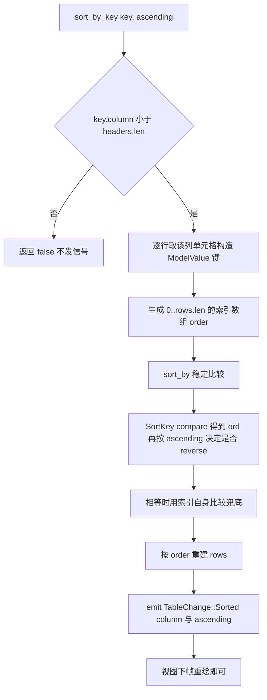
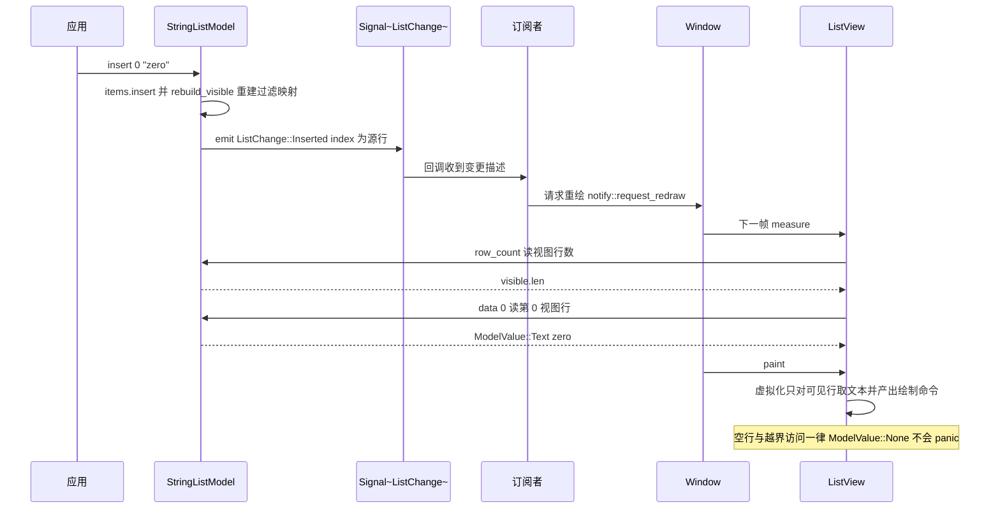
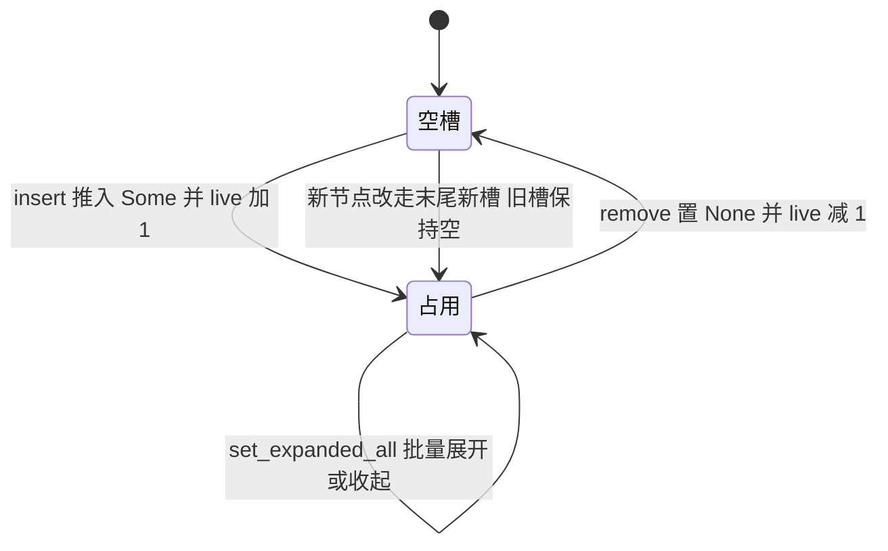

# rustui-model 模块详细设计

> 所属体系：[架构设计文档](../Architecture_Design_Document.md) · 分层：第 2 层（布局/数据层）
> 源码：`crates/rustui-model/src/` · 依赖：仅 rustui-core

本模块对应[详细设计文档](../Detailed_Design_Document.md) §27（Model）、§28（TableView）、
§29（TreeView），并落实[设计修正](../Design_Corrections.md) C-031、C-032、C-033、C-042
的 Model/View 约定。

## 1. 模块职责

`rustui-model` 是应用数据与 widget 之间的**词汇层**：它定义三种模型形状、与视图交换的
单元格类型、可直接使用的选择模型与排序键，以及贯穿全部模型的变更通知机制。

1. **三个模型 trait**（全部对象安全，可 `Box<dyn ...>`）：
   - `ListModel`：一维行列表，按 `row: usize` 寻址（`ListView` 用）；
   - `TableModel`：二维行列 + 表头，按 `(row, column)` 寻址（`TableView` 用）；
   - `TreeModel`：层级图，按 `NodeId` 寻址，**展开状态保存在模型里**（`TreeView` 用）。
2. **单元格类型 `ModelValue`**：`Text` / `Number` / `Bool` / `Icon` / `None` 五种变体的
   自有枚举（不是 `&Self::Item` 引用），惰性或远端模型也能返回数据；视图只按
   `Display` 渲染，模型 trait 因此不需要泛型，`Box<dyn TableModel>` 的虚拟化表格才成立。
3. **具体实现**：`StringListModel`（带过滤与双坐标行号）、`TableListModel`
   （容忍参差行、内置排序）、`TreeListModel`（竞技场存储、永不复用 id）与
   `TreeBuilder`（字面量搭树）。
4. **`SelectionModel`**：模型无关的选择集（单项 `Single` / 多选 `Multiple`），
   发布 `selection_changed` 信号与可绑定的 `current_property`。
5. **排序**：`SortKey`（`Text` / `Number` / `Bool` / `Custom`）与
   `compare_values` / `compare_text` / `numeric_value` / `boolean_value`，
   排序属于**模型层**——模型重排自己的行并广播，视图只负责重绘。
6. **变更通知**：每个具体模型持有一个 `rustui_core::Signal<Change>`，在**数据已经变更
   之后**发出对应的 `ListChange` / `TableChange` / `TreeChange`；`SelectionModel`
   同理发出 `SelectionChange`。

关键性质：

- **全量 total**：访问不存在的行、列或节点一律返回 `ModelValue::None` / `None`，
  绝不 panic，虚拟化视图因此无需在每个调用点写防御代码。
- **单线程所有权**：模型是基于 `Rc` / `Signal` 的普通值，不实现 `Send`
  （[详细设计文档](../Detailed_Design_Document.md) §37 线程模型）；应用持有模型，
  视图通过引用或 `Box<dyn TableModel>` 读取。**信号必须在数据装载之前 connect**，
  视图才能看到初始装载。
- **Shared 双句柄**：`SharedModel::boxed()` 把 `Shared<具体模型>` 复制出第二个句柄
  交给视图（`Shared<Box<dyn ListModel>>`），应用通过自己的句柄编辑，
  无需 downcast（C-031）。

## 2. 模块结构（文件表）

| 文件 | 内容 |
|------|------|
| `crates/rustui-model/src/lib.rs` | crate 文档（三种模型形状、total 性质、所有权约定）、模块声明、`prelude`、crate 根重导出、9 个集成级测试 |
| `crates/rustui-model/src/traits.rs` | `NodeId`、`ModelValue` 及其 `From` / `Display` / `PartialOrd` 转换、`ListModel` / `TableModel` / `TreeModel` 三个 trait（含默认方法） |
| `crates/rustui-model/src/list.rs` | `ListChange`、`StringListModel`（存储 + 过滤 + 视图/源行双向映射 + `Signal`），并实现 `ListModel` 与单列表的 `TableModel` |
| `crates/rustui-model/src/table.rs` | `TableChange`、`TableListModel`（表头 + `Vec<Vec<String>>` + 归一化 + 排序 + `Signal`），实现 `TableModel` |
| `crates/rustui-model/src/tree.rs` | `TreeChange`、`TreeNode`、`TreeListModel`（`Vec<Option<TreeNode>>` 竞技场）、`TreeBuilder` |
| `crates/rustui-model/src/selection.rs` | `SelectionMode`、`SelectionChange`、`SelectionModel`（选择集 + 当前行 + `Signal` + `SharedProperty`） |
| `crates/rustui-model/src/sort.rs` | `compare_values` / `compare_text` / `numeric_value` / `boolean_value`、`SortKey` 枚举与 `SortKey::compare` |
| `crates/rustui-model/src/shared.rs` | `SharedModel` trait：`Shared<具体模型>` → `Shared<Box<dyn trait>>` 的箱化句柄 |

## 3. 核心类型设计

### 3.1 类图

```mermaid
classDiagram
    direction TB
    class ListModel {
        <<trait>>
        +row_count() usize
        +data(row usize) ModelValue
        +is_empty() bool
        +contains(row usize) bool
        +get(row usize) Option~ModelValue~
    }
    class TableModel {
        <<trait>>
        +row_count() usize
        +column_count() usize
        +header_data(column usize) ModelValue
        +data(row usize, column usize) ModelValue
        +is_empty() bool
        +contains(row usize, column usize) bool
        +cell(row usize, column usize) Option~ModelValue~
    }
    class TreeModel {
        <<trait>>
        +root_count() usize
        +child_count(node NodeId) usize
        +child(node NodeId, index usize) Option~NodeId~
        +parent(node NodeId) Option~NodeId~
        +data(node NodeId) ModelValue
        +is_expanded(node NodeId) bool
        +set_expanded(node NodeId, expanded bool)
        +is_leaf(node NodeId) bool
    }
    class ModelValue {
        <<enum>>
        Text(String)
        Number(f64)
        Bool(bool)
        Icon(String)
        None
        +text(value) ModelValue
        +icon(value) ModelValue
        +is_none() bool
        +as_text() String
        +as_number() Option~f64~
        +as_bool() Option~bool~
        +compare(other ModelValue) Ordering
    }
    class NodeId {
        +INVALID NodeId
        +new(index u32) NodeId
        +to_u32() u32
        +as_usize() Option~usize~
        +is_valid() bool
    }
    class StringListModel {
        +items String[]
        +filter Option~String~
        +visible usize[]
        +changed() Signal~ListChange~
        +push(value) usize
        +insert(index usize, value) usize
        +remove(source_index usize) Option~String~
        +set_filter(filter)
        +source_row(view_row usize) Option~usize~
        +view_row(source_index usize) Option~usize~
    }
    class TableListModel {
        +headers String[]
        +rows String[][]
        +changed() Signal~TableChange~
        +push_row(cells) usize
        +remove_row(row usize) bool
        +set_data(row usize, column usize, value) bool
        +sort_by_column(column usize, ascending bool) bool
        +sort_by_key(key SortKey, ascending bool) bool
        +sorted_row_indices(key SortKey, ascending bool) usize[]
    }
    class TreeListModel {
        +nodes Option~TreeNode~[]
        +roots NodeId[]
        +live usize
        +changed() Signal~TreeChange~
        +insert(parent Option~NodeId~, index usize, label) NodeId
        +append(parent Option~NodeId~, label) NodeId
        +remove(id NodeId) bool
        +set_expanded(id NodeId, expanded bool) bool
        +path(id NodeId) Option~NodeId~[]
        +reveal(id NodeId) bool
        +visible_nodes() NodeId[]
    }
    class TreeNode {
        +label String
        +parent Option~NodeId~
        +children NodeId[]
        +expanded bool
        +is_leaf() bool
        +to_value() ModelValue
    }
    class TreeBuilder {
        +root(label str) NodeId
        +child(parent NodeId, label str) NodeId
        +build() TreeListModel
    }
    class SelectionMode {
        <<enum>>
        Single
        Multiple
    }
    class SelectionChange {
        +added usize[]
        +removed usize[]
        +current Option~usize~
        +is_empty() bool
        +added_row(index usize) bool
        +removed_row(index usize) bool
    }
    class SelectionModel {
        +mode SelectionMode
        +selected usize[]
        +current SharedProperty
        +selection_changed() Signal~SelectionChange~
        +select(index usize)
        +deselect(index usize)
        +toggle(index usize)
        +select_range(from usize, to usize)
        +select_all(count usize)
        +remove_rows_from(index usize) usize
        +set_current(index Option~usize~) bool
    }
    class SortKey {
        <<enum>>
        Text(usize)
        Number(usize)
        Bool(usize)
        Custom column, compare
        +text(column usize) SortKey
        +number(column usize) SortKey
        +custom(column usize, compare) SortKey
        +column() usize
        +compare(a ModelValue, b ModelValue) Ordering
    }
    class SharedModel {
        <<trait>>
        +Model type
        +boxed() Shared
    }
    class Signal {
        <<rustui-core>>
        +connect(callback) Connection
        +connect_scoped(guard, callback) Connection
        +connection_count() usize
        +emit(value T)
    }
    class SharedProperty {
        <<rustui-core>>
        +get() T
        +set(value T)
        +with_mut(f)
        +changed() Signal
    }
    ListModel <.. StringListModel : 实现
    TableModel <.. StringListModel : 实现
    TableModel <.. TableListModel : 实现
    TreeModel <.. TreeListModel : 实现
    ListModel ..> ModelValue : 返回
    TableModel ..> ModelValue : 返回
    TreeModel ..> ModelValue : 返回
    TreeModel ..> NodeId : 寻址
    TreeListModel *-- TreeNode : nodes 竞技场
    TreeBuilder *-- TreeListModel : model
    TableListModel ..> SortKey : sort_by_key
    SortKey ..> ModelValue : compare
    StringListModel --> Signal : changed 载荷 ListChange
    TableListModel --> Signal : changed 载荷 TableChange
    TreeListModel --> Signal : changed 载荷 TreeChange
    SelectionModel --> Signal : selection_changed 载荷 SelectionChange
    SelectionModel --> SharedProperty : current 载荷 Option usize
    SelectionModel --> SelectionMode : mode
    SharedModel ..> StringListModel : 箱化句柄
    SharedModel ..> TableListModel : 箱化句柄
    SharedModel ..> TreeListModel : 箱化句柄
```

> 类图中的 `Signal`、`SharedProperty` 是 `rustui-core` 的泛型类型
> （`signal.rs` / `property.rs`，即 `Signal<T>`、`SharedProperty<T>`），
> `Shared<T>` 由 `SharedProperty<T>` 包装而成；本 crate 只是持有并重导出它们，
> 载荷类型分别为 `ListChange` / `TableChange` / `TreeChange` / `SelectionChange`
> 与 `Option<usize>`。

### 3.2 类型说明表

| 类型 | 文件 | 说明 |
|------|------|------|
| `NodeId` | `traits.rs` | `u32` newtype；`NodeId::INVALID = u32::MAX` 是「空节点」，`Default` 即它；`Display` 输出 `#3` / `#invalid`，与 `ObjectId` 的渲染一致；视图必须当作不透明句柄 |
| `ModelValue` | `traits.rs` | 单元格枚举；`as_text()` 给出视图绘制文本（整数不带小数点，`Number(3.0)` → `"3"`）；`PartialOrd` 委托 `compare_values`；大量 `From` 转换（`&str`、数值、`bool`） |
| `ListModel` | `traits.rs` | `row_count` + `data(row)`；默认方法 `is_empty` / `contains` / `get`，全部基于越界返回 `ModelValue::None` |
| `TableModel` | `traits.rs` | 增加 `column_count` 与 `header_data`——表头也是数据，视图排序/改列宽不产生第二份真相 |
| `TreeModel` | `traits.rs` | `root_count` / `child_count` / `child` / `parent` / `data`；`is_expanded` 默认 `false`、`set_expanded` 默认空实现，不关心展开状态的模型可直接省略 |
| `ListChange` | `list.rs` | `Inserted { index }` / `Removed { index }` / `Moved { from, to }` / `Replaced { index }` / `Cleared`；**索引指源行**；过滤器变化也报 `Cleared`（可见行整体重编号） |
| `StringListModel` | `list.rs` | `Vec<String>` + 可选大小写不敏感子串过滤；`ListModel` / `TableModel` 说的是**视图行**（`0..row_count`），`push` / `insert` / `remove` / `set` 说的是**源行**，`source_row` / `view_row` 双向翻译；`Shared<StringListModel>` 也实现了两个 trait |
| `TableChange` | `table.rs` | `Inserted { row }` / `Removed { row }` / `Updated { row }` / `Sorted { column, ascending }` / `Cleared` |
| `TableListModel` | `table.rs` | 表头决定列数；短行补空、长行截断（`normalize_row`），无表头时 `insert_row` 用单元格数定义列数；`set_headers` 重排所有行宽并报 `Cleared`；`sorted_row_indices` / `preview_sort_by_column` 提供不改数据的排序预览 |
| `TreeChange` | `tree.rs` | `Inserted { node, parent }` / `Removed { node }` / `LabelChanged { node }` / `Expanded { node, expanded }` / `Cleared` |
| `TreeNode` | `tree.rs` | `label` / `parent` / `children` / `expanded` 四字段，`to_value()` 即视图绘制的 `ModelValue::Text` |
| `TreeListModel` | `tree.rs` | `Vec<Option<TreeNode>>` 竞技场 + `roots` + `live` 计数；`insert` 的 parent 无效时**降级为根节点**（builder 式 API 永远产出可用 id）；`remove` 用 BFS 整棵删除；`depth` / `path` / `reveal` / `visible_nodes` 服务树视图（`visible_nodes` 只展开 `expanded` 的节点） |
| `TreeBuilder` | `tree.rs` | `root` / `child` / `insert` 薄封装，`build()` 消费并返回 `TreeListModel` |
| `SelectionMode` | `selection.rs` | `Single`（默认，选择即替换）/ `Multiple`（累加） |
| `SelectionChange` | `selection.rs` | `added` / `removed` 升序去重，`current` 是变更后的光标行；`is_empty()` 判定的空变更**从不发出** |
| `SelectionModel` | `selection.rs` | 模型无关：只存行号，不知道行号来自哪种模型；`selected` 恒为升序无重复（`binary_search` 查询）；`set_mode(Single)` 保留当前行并丢弃其余（发出 `removed`）；`select_range` 归一化端点，`Single` 模式只选上界；`set_current` 只接受已选中的行；`select_next` / `select_previous` 在选择集内环绕 |
| `SortKey` | `sort.rs` | `Text` / `Number` / `Bool` 三个变体各持列号，`Custom` 持列号 + `fn(&ModelValue, &ModelValue) -> Ordering`；非 `PartialEq`（函数指针地址不是有意义的标识）；`Number` / `Bool` 键遇到无法解析的值回退为文本比较，解析失败的一侧排在后面 |
| `compare_values` | `sort.rs` | 全序：先按 kind 排名 `Bool < Number < Text/Icon < None`，同 kind 自然比较；`None` 最大，升序排序把空单元格压到末尾；`NaN` 视为 `Equal` 而不是 panic |
| `SharedModel` | `shared.rs` | `type Model: ?Sized + 'static` + `boxed()`；为 `Shared<StringListModel>` / `Shared<TableListModel>` / `Shared<TreeListModel>` 各给出实现，产出 `Shared<Box<dyn ...>>` |

## 4. 主要流程

### 4.1 数据变更 → Signal → 视图失效刷新

视图订阅约定：

- 视图**不缓存数据**：`ListView` / `TableView` / `TreeView` 每帧通过
  `model.with(|m| m.row_count())` 之类的接口重读，因此只要发生重绘，视图必然最新；
- 模型的 `changed()` 面向**应用与桥接层**——需要增量修补（如只重绘受影响行）的观察者
  自行 `connect`；`Signal::connect` 返回 `Connection`，Drop **不会**自动断开
  （C-042：信号连接不留句柄，长连接用 `connect_scoped` 或显式 `disconnect`）；
- `SelectionModel` 的 `current_property` 走 `SharedProperty::set`，其内部会
  `emit` + `request_redraw`；而 `Shared::with_mut` **不通知也不请求重绘**，
  编辑后是否重绘取决于模型信号的订阅者；
- 若信号在数据装载**之后**才连接，订阅者看不到初始装载（crate 根文档明确要求先连接）。

### 4.2 排序流程（`TableListModel::sort_by_key`）

- `sort_by_column(column, ascending)` 只是 `sort_by_key(SortKey::text(column), ...)`；
- 稳定性：升序与降序下相等键都保留原相对顺序（降序只反转键比较，最后仍以索引兜底）；
- `sorted_row_indices` / `preview_sort_by_column` 走同一比较逻辑但**不重排、不发信号**，
  供表头箭头预览。

## 5. 关键时序

一次列表模型 `insert` 到视图重绘（视图侧只到接口层面）：

选择变化的旁路时序（供对照）：`SelectionModel::select` 先更新 `selected` 与
`current`（`SharedProperty::set` 触发 `request_redraw`），再
`selection_changed.emit(SelectionChange)`；视图在下帧的 `measure` / `paint` 中
用 `is_selected(row)` 决定高亮，应用则可从
`ListView::selection_changed()`（`Signal::SelectionChange` 的克隆句柄）订阅。

## 6. 状态转换

本 crate 没有跨模块的全局状态机；最明确的状态机是 `TreeListModel` 竞技场中**单个槽位
的生命周期**（`nodes: Vec<Option<TreeNode>>`，`live` 计数随之增减）：

不变量：`NodeId` 是槽位下标，槽位**释放后永不复用**——陈旧 id 只会得到
`ModelValue::None` / `None` / `is_valid() == false`，绝不会指向另一个节点
（测试 `ids_are_never_reused_after_removal` 断言）。`NodeId::INVALID` 是永久无效的
哨兵，不参与状态转换。

选择侧还存在一个局部模式转换：`SelectionModel::set_mode(Single)` 会把多选折叠为
「当前行或首个选中行」并发出带 `removed` 的 `SelectionChange`，
`set_mode(Multiple)` 原样保留选择集；相同模式的切换是静默的。

## 7. 关键设计约束与不变式

引用编号来自 [Design_Corrections.md](../Design_Corrections.md) 与
[Detailed_Design_Document.md](../Detailed_Design_Document.md) §27 ~ §29。

- **C-031 用 `Shared<T>` 实现模型 trait**：`Shared<StringListModel>` 等直接实现
  `ListModel` / `TableModel` / `TreeModel`，视图读盒子里的句柄、应用通过自己的
  `Shared` 句柄写，双方操作同一个值；`SharedModel::boxed()` 负责产出视图形状的
  `Shared<Box<dyn ...>>`。
- **C-032 列表/表格/树自绘并虚拟化**：一万行不会变成一万个 widget，视图只把可见的
  ~30 行变成子控件；模型的 total 访问是这条路径的前提。
- **C-033 运行时数据靠 `SharedProperty` 绑定 + `ModelValue` 是自有枚举**：
  trait 放在 `rustui-model`，值类型不借用 `&Self::Item`，惰性/远端模型也能返回数据。
- **C-042 信号连接不留句柄**：`connect` 的返回值 `Connection` 不会因 Drop 断开，
  长生命周期信号的可观察行为不受临时句柄影响；需要作用域时用 `connect_scoped`。
- **§27 修正**：`TreeModel` 把**展开状态放在模型里**而非视图，展开状态能跨越视图重建
  并可持久化。

模块级不变式（P 原则，本 crate 自身约定）：

- **P-M1 全量 total**：任何越界行、越界列、未知节点的读取返回 `ModelValue::None` 或
  `None`，写入（`set` / `remove_row` / `set_label` …）返回 `false` 而不是 panic。
- **P-M2 先改后发**：`changed` 信号总是在数据已经变更之后 `emit`，
  订阅者在回调里读到的就是新状态。
- **P-M3 无变化不发**：值相同的 `set`、空表 `clear`、重复的 `set_filter` /
  `set_expanded`、空的 `SelectionChange` 一律静默。
- **P-M4 `NodeId` 永不复用**：删除只把槽位置 `None` 并递减 `live`，
  新节点永远追加到 `nodes` 末尾。
- **P-M5 行号双坐标**：`StringListModel` 的 trait 读接口讲视图行、变更事件与
  变更 API 讲源行，`source_row` / `view_row` 是唯一翻译通道；过滤器一变即发
  `Cleared`，因为可见行整体重编号。
- **P-M6 排序稳定且 `None` 沉底**：`SortKey::compare` 保证 `None` 最大，
  稳定排序保证相等键保留原顺序，降序只反转键比较。
- **P-M7 选择与模型解耦**：`SelectionModel` 不知道行号的来源，模型缩编后由调用方
  显式 `remove_rows_from(index)`（或 `select_all(count)`）修剪选择集，
  不做隐式联动。

## 8. 测试布局

本 crate 共 **109 个 `#[test]`**，分布在 8 个文件中（模块内单测 + `lib.rs` 集成级
测试，覆盖各层是否真的咬合）：

| 文件 | 数量 | 覆盖要点 |
|------|------|----------|
| `src/traits.rs` | 11 | `NodeId` 的 Display / Debug / 转换 / 排序；`ModelValue` 的 `From` 转换、访问器、`Display`（整数无小数点、`inf`）、偏序（`Bool < Number < Text < None`）；手写 `ListModel` / `TableModel` / `TreeModel` 的默认方法与越界行为 |
| `src/list.rs` | 16 | 空模型、`from_values` 与迭代、越界返回 `None`、`push` / `insert` / `remove` 的信号序列、`set` 只报真实变更、`clear` 只在非空时报、`move_row` 的钳制与静默、过滤器大小写不敏感与双向映射、过滤器与增删改同步、单列表的 `TableModel` 视图、表头置空隐藏 |
| `src/table.rs` | 17 | 空表答 `None`、表头与行读取、越界访问、`insert_row` 钳制与信号、短行补长行截、无表头时插入定义列数、`set_headers` 重排行宽、`clear` 保留表头、文本排序大小写不敏感且稳定、数值键排版本号、预览排序不改动表、空表/单行排序合法 |
| `src/tree.rs` | 21 | 竞技场结构、`insert` 的 index 钳制、无效 parent 降级为根、未知节点只答不崩、重命名只报一次、`remove` 整棵子树且可重复删、`clear` 静默、展开状态与 `visible_nodes`、`depth` / `path` / `reveal`、`TreeModel` trait 实现、id 永不复用、`TreeBuilder` |
| `src/selection.rs` | 21 | 单选替换、多选累加、重复选择静默、`toggle` 增删、`select_range` 归一化与保留范围外行、`clear` 报全部 `removed`、`current_property` 共享与更新、`select_all` 截断、单选模式下 `select_all` 为无操作、`set_current` 只接受已选行、`select_next` / `select_previous` 环绕、模式切换折叠、`remove_rows_from` |
| `src/sort.rs` | 12 | 数值比较、`NaN` 视为相等、kind 排名、`Text` / `Icon` 按字符串比较、`compare_text` 大小写两级、`numeric_value` / `boolean_value` 解析、四种 `SortKey` 的列号与回退行为、`Custom` 键 |
| `src/shared.rs` | 2 | `boxed()` 是同一值的第二个句柄；树的展开状态经盒化句柄双向可见 |
| `src/lib.rs` | 9 | 层间集成：`StringListModel` 直接驱动单列表格视图、trait 对象装箱、选择随表格删除收缩（`remove_rows_from`）、`TreeBuilder` 走读、自定义 `SortKey` 排序、`changed` / `selection_changed` 信号经 crate 根重导出可观察、`prelude` 暴露整层 |

运行方式：`cargo test -p rustui-model`（模块内单测）；文档示例（`NodeId`、
`ModelValue`、`StringListModel` 过滤、`SelectionModel`、`TreeBuilder`、
`SharedModel` 等 doctest）随 `cargo test --doc -p rustui-model` 一并执行。
