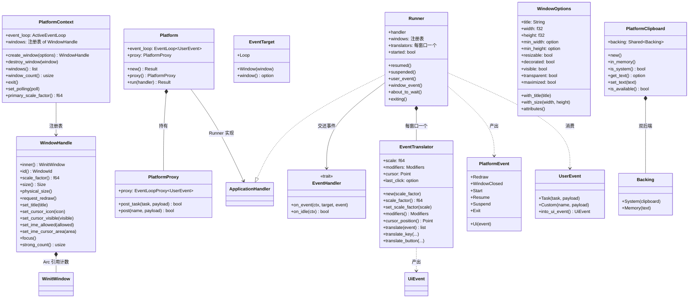
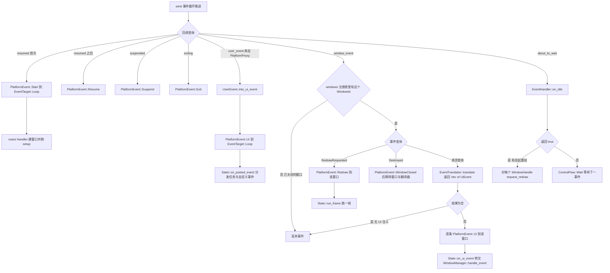
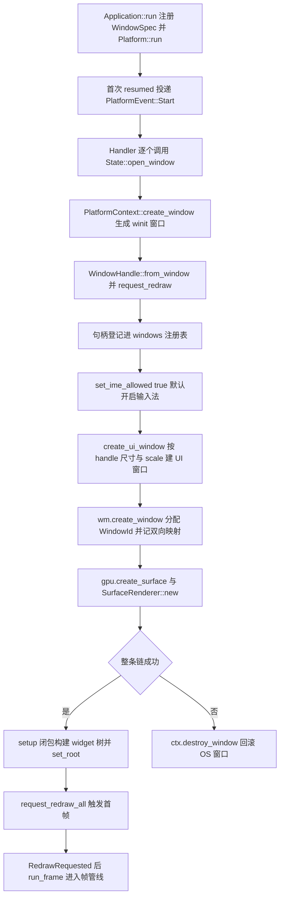
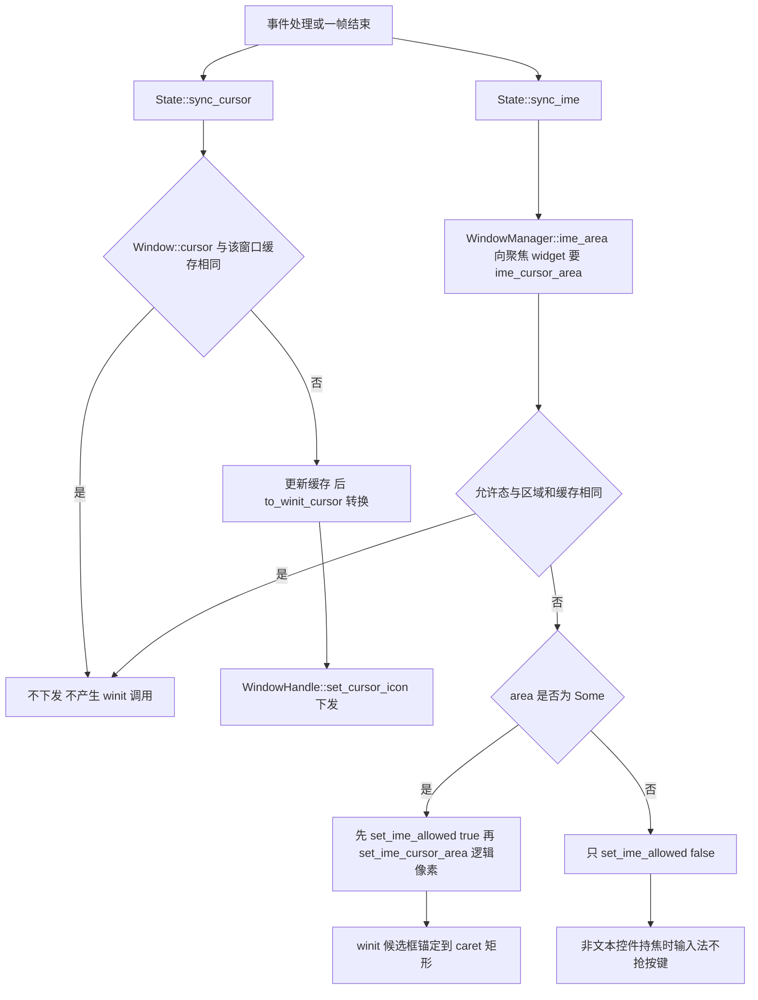
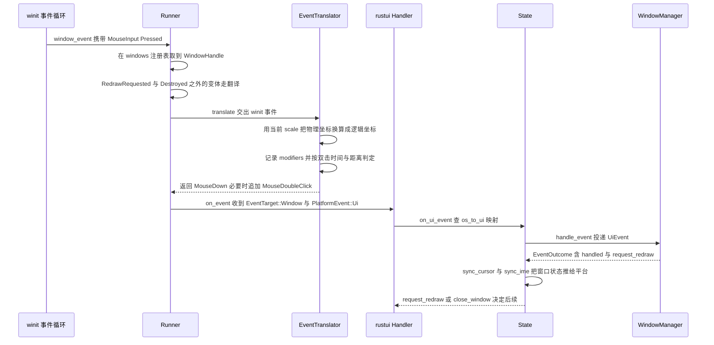
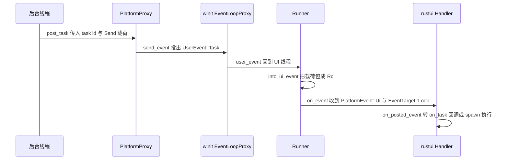
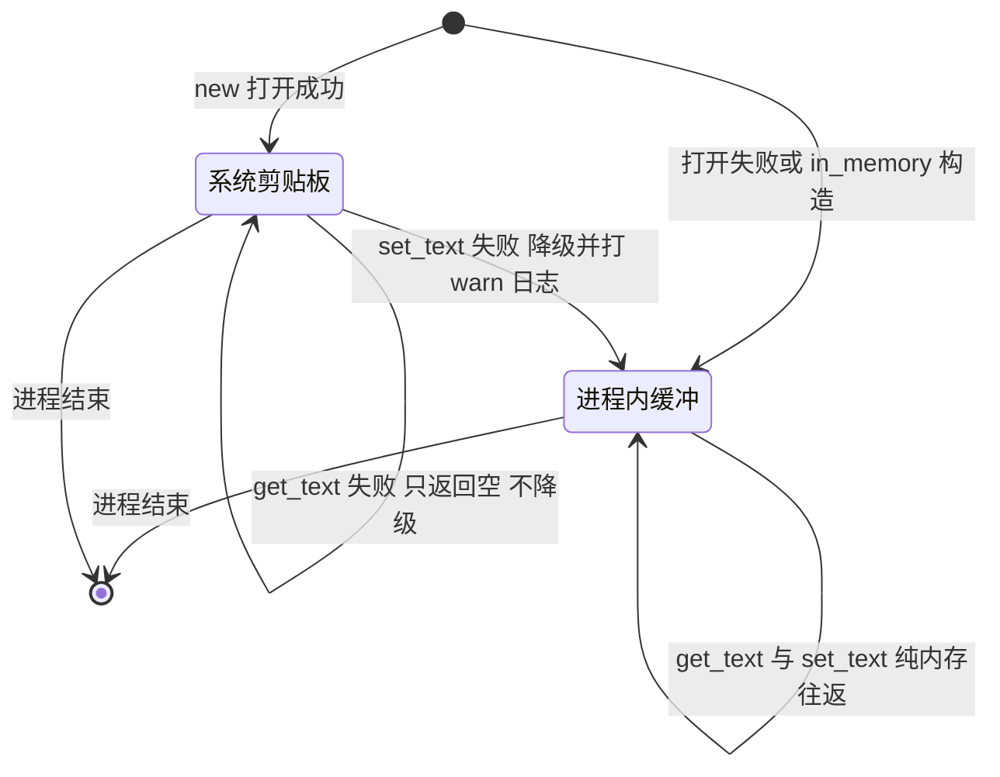
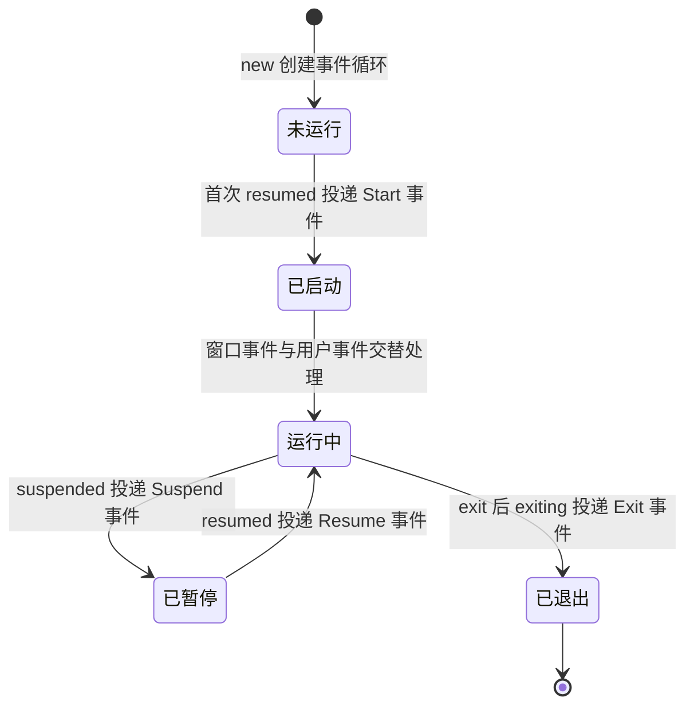

# rustui-platform 模块详细设计

> 所属体系：[架构设计文档](../Architecture_Design_Document.md) · 分层：第 3 层（平台/窗口层）
> 源码：`crates/rustui-platform/src/` · 依赖：`rustui-core`、`winit`、`log`、`arboard`

## 1. 模块职责

`rustui-platform` 是 RustUI 唯一允许接触 `winit`（以及 `arboard` 系统剪贴板）的 crate，对应
详细设计文档 §9（Platform Event）、§10 的上游、§39（Clipboard）、§40（Cursor / 输入法区域）
与 §41（DPI）。核心职责：

1. **拥有并运行 `winit` 事件循环**：`Platform` 构建 `EventLoop<UserEvent>` 并通过
   `Platform::run` 把控制权交给 `Runner`，后者实现 `winit` 的 `ApplicationHandler`，把循环
   回调翻译成平台无关的 `PlatformEvent` 交给 `EventHandler`。
2. **事件翻译（C-010）**：`EventTranslator` 把 `winit::WindowEvent` 逐条翻译为
   `rustui_core::UiEvent`，保证 winit 类型不越过本 crate 边界（原则 P1）：

   ```text
   winit::WindowEvent  ->  EventTranslator  ->  UiEvent  ->  Window  ->  Widget
   ```

3. **窗口创建与句柄管理**：`PlatformContext::create_window` / `destroy_window` 维护
   `WindowId -> WindowHandle` 注册表；`WindowHandle` 是引用计数、DPI 感知的可克隆句柄。
4. **光标与输入法（C-038 / §40、§40.1）**：`cursor.rs` 的 `to_winit_cursor` 完成光标形状
   映射；`WindowHandle::set_ime_allowed` / `set_ime_cursor_area` 承接帧末同步下来的
   输入法开关与预编辑（候选框）区域，区域一律**逻辑像素**。
5. **剪贴板（C-037 / C-054 / §39）**：`PlatformClipboard` 实现 `rustui-core` 的
   `Clipboard` trait，双后端 `Backing::{System(arboard), Memory(Option<String>)}`，打开或
   写入系统剪贴板失败时降级为进程内缓冲。
6. **跨线程投递**：`PlatformProxy` 让后台线程 `post_task` / `post` 把 `Send` 载荷投回 UI
   线程，进入循环后才包装成 `Rc` 成为 `UiEvent::TaskCompleted` / `UiEvent::Custom`。
7. **与 facade 对接**：`crates/rustui/src/app.rs` 的 `Handler<F>` 实现本 crate 的
   `EventHandler`，`State` 在回调里驱动 `WindowManager`（见下表）。

`PlatformEvent` 与 `rustui/src/app.rs` 的对接（真实实现）：

| `PlatformEvent` | `Handler::on_event` 中的动作 |
| --- | --- |
| `Start` | 逐个 `State::open_window` 创建窗口，执行 `setup` 构建 widget 树，`request_redraw_all` |
| `Resume` / `Suspend` | 忽略 |
| `Ui(event)` | `State::on_ui_event`：有窗口目标则 `wm.handle_event`，否则 `on_posted_event` 走 `on_task` / `on_custom` / `spawn` |
| `Redraw` | `State::run_frame`：`update → layout → paint → render` |
| `WindowClosed` | `State::close_window`：销毁 OS 窗口、渲染器与 UI 窗口，最后一个窗口关闭时 `ctx.exit()` |
| `Exit` | `renderers.clear()`，在窗口尚存时释放 GPU 资源 |
| `EventHandler::on_idle` | `wm.take_redraw()` 为真则返回 `true`，循环对每个窗口 `request_redraw` |

本 crate **不负责**：GPU 表面与呈现（`rustui-renderer` / `rustui` facade）、widget 树与帧管线
（`rustui-window`）、`Clipboard` trait 的定义（`rustui-core`）。

## 2. 模块结构

| 文件 | 职责 |
| --- | --- |
| `crates/rustui-platform/src/lib.rs` | crate 文档与再导出：`Platform` / `PlatformContext` / `PlatformEvent` / `PlatformProxy` / `EventHandler` / `EventTarget`、`EventTranslator` / `translate_event`、`WindowHandle` / `WindowOptions`、`PlatformClipboard`、`to_winit_cursor`；`Result` 别名指向 `rustui_core::Result` |
| `crates/rustui-platform/src/run.rs` | `winit` 事件循环封装：`Platform`（创建循环、`proxy()`、`run()`）、`Runner<H>`（`ApplicationHandler` 实现）、`PlatformContext`（窗口注册表 + `exit` / `set_polling` / `primary_scale_factor`）、`PlatformEvent`、`EventTarget`、`EventHandler` trait、`PlatformProxy` |
| `crates/rustui-platform/src/event.rs` | `UserEvent`（跨线程载荷 → `UiEvent`）、无状态 `translate_event`、有状态 `EventTranslator`（DPI、修饰键、双击计时、光标位置）以及 `to_key` / `to_named` / `to_button` / `to_modifiers` 等映射函数 |
| `crates/rustui-platform/src/window.rs` | `WindowOptions`（创建参数，全逻辑像素，builder 风格）与其 `attributes()`；`WindowHandle`（`Arc<WinitWindow>` 包装：尺寸/比例、光标、IME、标题、重绘请求、`strong_count`） |
| `crates/rustui-platform/src/cursor.rs` | `to_winit_cursor(CursorIcon) -> winit CursorIcon`：14 个 RustUI 光标形状到 `winit` 的一对一映射（§40） |
| `crates/rustui-platform/src/clipboard.rs` | `PlatformClipboard`：`Backing` 双后端状态机、`Clipboard` trait 实现（`get_text` / `set_text` / `is_available`）、降级与跨进程子客户端测试 |

## 3. 核心类型设计

### 3.1 类图（mermaid classDiagram）



### 3.2 关键类型说明（表）

| 类型 | 职责 | 关键成员 / API（以源码为准） |
| --- | --- | --- |
| `Platform` | 事件循环入口，必须在主线程创建 | `Platform::new()` 构建 `EventLoop::<UserEvent>::with_user_event()`；`proxy()` 返回可克隆句柄；`run(handler)` 设 `ControlFlow::Wait` 后 `run_app`，消费自身 |
| `Runner<H>` | `winit` `ApplicationHandler<UserEvent>` 到 RustUI `EventHandler` 的桥 | `windows: RefCell<HashMap<WindowId, WindowHandle>>`、`translators: HashMap<WindowId, EventTranslator>`、`started`；`resumed` 首次发 `Start` 之后发 `Resume`；`window_event` 里 `RedrawRequested → Redraw`、`Destroyed → WindowClosed` 并摘除窗口与翻译器、其余走翻译；`about_to_wait` 调 `on_idle`，返回 `true` 时对所有窗口 `request_redraw` |
| `PlatformContext<'a>` | 交给 `EventHandler` 的循环服务，`ActiveEventLoop` 保持私有 | `create_window(&WindowOptions) -> Result<WindowHandle>`（创建后 `request_redraw` 并入表）、`destroy_window`、`windows`、`window_count`、`exit`、`set_polling(bool)`（`Poll` / `Wait`）、`primary_scale_factor()`（查不到返回 1.0） |
| `EventHandler` | 应用实现的回调 trait | `on_event(&PlatformContext, &EventTarget, PlatformEvent)`、`on_idle(&PlatformContext) -> bool`（默认 `false`，§15 动画与挂起状态在此推进） |
| `EventTarget` | 事件归属：循环自身 `Loop` 或某个 `Window(WindowHandle)` | `window() -> Option<&WindowHandle>` |
| `PlatformEvent` | 循环上报给应用的全部事件 | `Ui(UiEvent)` / `Redraw` / `WindowClosed` / `Start` / `Resume` / `Suspend` / `Exit` |
| `PlatformProxy` | 后台线程投递句柄，`Clone` 且 `Send` | `post_task<T: Send>(task, payload) -> bool`、`post<T: Send>(name, payload) -> bool`；循环消失后返回 `false` |
| `UserEvent` | `EventLoopProxy` 携带的载荷（`Send`） | `Task(u64, Box<dyn Any + Send>)`、`Custom(&'static str, Box<dyn Any + Send>)`；`into_ui_event()` 在 UI 线程包成 `Rc` 得到 `UiEvent::TaskCompleted` / `UiEvent::Custom` |
| `EventTranslator` | 有状态的 winit → `UiEvent` 翻译器，**每窗口一个** | 字段 `scale` / `modifiers` / `cursor` / `last_click`；`translate(&WindowEvent) -> Vec<UiEvent>`；常量 `LINE_SCROLL = 16.0`、`DOUBLE_CLICK_TIME = 400ms`、`DOUBLE_CLICK_SLOP = 4.0`；`set_scale_factor` 忽略非正值 |
| `translate_event` | 无状态便捷入口（测试与一次性转换） | 等价于 `EventTranslator::new(1.0).translate(event)` |
| `WindowOptions` | 窗口创建描述，全部逻辑像素（§41） | 默认 1024×768、`resizable`、`decorated`、`visible`；`with_title` / `with_size` / `with_min_size` / `resizable` / `decorated` / `visible` / `maximized`；`attributes()` 生成 `WindowAttributes`，最小尺寸下限钳到 1.0 |
| `WindowHandle` | 可克隆的 OS 窗口句柄（`Arc<WinitWindow>`） | `inner()` 是唯一逃逸舱（供 facade 建 `wgpu` surface）；`size()` 逻辑像素、`physical_size()` 物理像素；`set_cursor_icon` 走 `to_winit_cursor`；`set_ime_cursor_area(Rect)` 用 `LogicalPosition` / `LogicalSize`，宽高钳到 ≥1.0；`strong_count()` 到 1 时窗口随 drop 关闭 |
| `PlatformClipboard` | 进程内共享的剪贴板实现（`Rc<RefCell<Backing>>`，`Clone` 共享同一后端） | `new()` 打开系统剪贴板、失败降级；`in_memory()` 直接降级态；`is_system()` 查询后端；`Clipboard::{get_text, set_text, is_available}` |
| `Backing` | 剪贴板数据实际所在 | `System(arboard::Clipboard)`（进程存活期间由 selection 服务线程响应外部客户端）、`Memory(Option<String>)` |

### 3.3 winit → `UiEvent` 全映射清单（`EventTranslator::translate`）

任务书提到的 `PlatformWindow` 在源码中**不存在**——本 crate 对应的概念是 `WindowHandle`
（窗口句柄）+ `WindowOptions`（创建参数）+ 每窗口一个 `EventTranslator`。完整的
`winit::WindowEvent` → `UiEvent` 映射（以 `event.rs` 的 `match` 为准）：

| `winit::WindowEvent` | 输出 `UiEvent` | 说明 |
| --- | --- | --- |
| `Resized(size)` | `Resize(Size)` | 物理像素 ÷ `scale`，出口为逻辑像素（§41） |
| `CloseRequested` | `CloseRequested` | 由窗口层判定是否真的关闭（C-012） |
| `Focused(focused)` | `WindowFocus(bool)` | 写入 `Interaction::window_focused` |
| `KeyboardInput` 按下 | `KeyDown { key, modifiers, text, repeat }`，随后可能追加 `TextInput` | `text` 非空且未按 Ctrl / Super 时才追加 `TextInput`，快捷键只留 `KeyDown` |
| `KeyboardInput` 松开 | `KeyUp { key, modifiers }` | 按下与松开最多各一条 |
| `ModifiersChanged(modifiers)` | **无输出** | 只更新翻译器内部 `modifiers`，供后续按键事件携带 |
| `Ime::Enabled` | `ImeStart` | 输入法组合开始 |
| `Ime::Preedit(text, cursor)` | `ImeUpdate { text, cursor: Option<Range<usize>> }` | 预编辑文本与字节游标区间 |
| `Ime::Commit(text)` | `ImeCommit(text)` | 已上屏文本 |
| `Ime::Disabled` | `ImeEnd` | 组合结束 |
| `CursorMoved { position }` | `MouseMove { position }` | 物理坐标 ÷ `scale`，并刷新内部 `cursor` 作为后续事件坐标 |
| `CursorEntered` | `MouseEnter` | 窗口级进入；**逐 widget** 的 Enter/Leave 由 `rustui-window` 合成 |
| `CursorLeft` | `MouseLeave` | 同上 |
| `MouseWheel { delta, phase }` | `MouseWheel { delta, phase }` | `LineDelta` 每格 × `LINE_SCROLL = 16.0`；`PixelDelta` 直取；`TouchPhase` → `ScrollPhase` |
| `MouseInput` 按下 | `MouseDown { button, position }`，命中双击条件时追加 `MouseDoubleClick` | 双击 = 同键 + 400ms 内 + 4.0 逻辑像素内；第二击同时发两条，第三击重新计时 |
| `MouseInput` 松开 | `MouseUp { button, position }` | 位置取自内部 `cursor` |
| `Touch(touch)` | `Touch { position, phase, id }` | 同样换算为逻辑坐标 |
| `HoveredFile(path)` | `DragEnter { position, payload }` | `payload` 为路径字符串，位置取内部 `cursor` |
| `HoveredFileCancelled` | `DragLeave` | 拖拽离开窗口 |
| `DroppedFile(path)` | `Drop { position, payload }` | 文件落地 |
| `ScaleFactorChanged { scale_factor }` | `ScaleFactorChanged(f64)` | 先 `set_scale_factor`（非正值被忽略）再发事件 |
| `RedrawRequested` | **不进翻译** | `Runner` 直接转 `PlatformEvent::Redraw` |
| `Destroyed` | **不进翻译** | `Runner` 转 `PlatformEvent::WindowClosed` 并摘除窗口与翻译器 |
| `Moved` / `Occluded` / `ThemeChanged` / 其余 | **无输出** | `_ => {}` 分支，`Runner` 对空结果直接返回 |
| `EventLoopProxy` 的 `UserEvent::Task` | `UiEvent::TaskCompleted { task, result }` | `Runner::user_event` → `into_ui_event`，载荷在此刻包装为 `Rc` |
| `EventLoopProxy` 的 `UserEvent::Custom` | `UiEvent::Custom { name, payload }` | 同上，投递到 `EventTarget::Loop` |

辅助映射函数（均为 `pub`）：

* `to_key`：`WinitKey::Named` → `Key::Named`（未知具名键回退 `Key::Unidentified`）、
  `Character` → `Key::Character`、`Dead` / `Unidentified` → `Key::Unidentified`；
* `to_named`：`Enter` 按 `KeyLocation` 拆成 `Enter` / `Return`（小键盘）、`F1` ~ `F35` 逐个
  展开、修饰键本身不进键位表（由 `Modifiers` 表达）；
* `to_button`：`Left` / `Right` / `Middle` 直取，`Back → Other(4)`、`Forward → Other(5)`
  （保留 X11 编号语义）；
* `to_modifiers`：`ModifiersState` 四个标志位 → `Modifiers { shift, control, alt, super_key }`。

> `UiEvent::FrameTick` / `UiEvent::MouseCapture` / `UiEvent::MouseRelease` 在整个 workspace
> 中**没有生产者**（仅出现在 `UiEvent` 的名字表里）；指针捕获实际走
> `EventQueue::capture_pointer`，帧节拍走 `FrameClock`。

## 4. 主要流程

### 4.1 事件循环与事件路由（`run.rs`）



### 4.2 窗口创建与 `rustui/src/app.rs` 对接



### 4.3 光标形状与输入法区域的帧末同步（`cursor.rs` / §40.1）



## 5. 关键时序

### 5.1 一个 winit 事件从循环到 `UiEvent` 的翻译与投递



### 5.2 后台线程投递事件（`PlatformProxy`）



## 6. 状态转换

### 6.1 剪贴板后端降级（C-054）



### 6.2 事件循环生命周期



## 7. 关键设计约束与不变式

引用编号见 `docs/Detailed_Design_Document.md`（§9 / §39 / §40 / §41）与
`docs/Design_Corrections.md`（C-010 / C-037 / C-038 / C-048 / C-054）。

| 编号 | 约束内容（以源码实现为准） |
| --- | --- |
| **C-010 / P1** | winit 事件必须经 `EventTranslator` 才能变成 `UiEvent`；winit 类型不得越过本 crate 边界，唯一例外是 `WindowHandle::inner()`（facade 用它建 `wgpu` surface，widget 永远看不到） |
| **G-001 / P3** | 本 crate 的 `Cargo.toml` 只有 `rustui-core`、`winit`、`log`、`arboard`——平台层不依赖 widget 层 |
| **C-037 / C-054** | `Clipboard` trait 在 `rustui-core`，实现（`PlatformClipboard`）在本 crate；`arboard`（`default-features = false`）依赖豁免，只允许出现在本 crate |
| **C-038 / §40** | 光标映射按值完成（`to_winit_cursor`），下发时机在 facade 帧末 `sync_cursor`，同一图标不重复下发 |
| **C-038 / §40.1** | 输入法区域来自聚焦 widget，`WindowHandle::set_ime_cursor_area` 收**逻辑像素**，须在 `set_ime_allowed(true)` 之后发送；X11 只用位置不用区域 |
| **§41 / C-048** | 本 crate 出口一律逻辑像素：`EventTranslator::to_point` / `to_size`、`WindowHandle::size` 都除以 `scale_factor`；物理尺寸只通过 `physical_size()` 交给渲染器 |
| **C-040 / C-041** | 跨线程只有 `PlatformProxy::post_task` / `post` 一条通路，载荷必须 `Send`，进 UI 线程才包装成 `Rc` |

**不变式：**

1. **翻译隔离**：任何 `winit` 类型不出本 crate（`WindowHandle::inner()` 除外）；`rustui-core`
   与 `rustui-window` 的事件面只有 `UiEvent`。
2. **一窗一翻译器**：每个 `WindowId` 对应一个 `EventTranslator`（DPI、修饰键、双击计时都是
   窗口局部状态），`Destroyed` 时与窗口句柄一起从注册表移除。
3. **空结果不投递**：`translate` 返回空 `Vec` 时（`Moved` / `Occluded` / `ThemeChanged` 等）
   `Runner` 直接返回，不回调 `EventHandler`；`RedrawRequested` / `Destroyed` 根本不进翻译器。
4. **未知窗口丢事件**：注册表中不存在的 `WindowId` 的事件被静默丢弃，不 panic。
5. **剪贴板单向降级**：`Backing` 只能从 `System` 降到 `Memory`（写失败触发），读失败只返回
   `None` 不降级；`PlatformClipboard` 的克隆共享同一个 `Rc<RefCell<Backing>>`，进程内唯一
   实例由 `rustui/src/app.rs` 注入 `UiContext`（`set_clipboard`），全窗口共用。
6. **上下文借用期**：`PlatformContext` 只在 `on_event` / `on_idle` 回调期间存在（内部借用
   `ActiveEventLoop` 与注册表），不得跨回调保存。
7. **窗口存亡 = 引用计数**：`destroy_window` 只把句柄摘出注册表，最后一个 `WindowHandle`
   drop 时 OS 窗口才关闭；`strong_count()` 暴露该计数。
8. **循环退出条件**：`PlatformContext::exit()` 或所有窗口关闭后循环停止；`Exit` 到达时
   facade 先释放 GPU 资源再让窗口消失。

## 8. 测试布局

全部为 crate 内单元测试，共 14 条，`cargo test -p rustui-platform`：

| 文件 | 条数 | 覆盖点 |
| --- | --- | --- |
| `crates/rustui-platform/src/event.rs` | 10 | `resize_is_converted_to_logical_pixels`（scale 2 下 800×600 → 400×300）、`cursor_moves_are_converted_to_logical_pixels`、`scale_factor_can_be_updated`（非正 scale 被忽略）、`key_press_emits_key_down_and_text`、`shortcut_presses_do_not_emit_text`（Ctrl+C 不产生 `TextInput`）、`key_release_only_emits_key_up`、`named_keys_and_modifiers_round_trip`（小键盘 Enter → `Return`、修饰键不进键位表）、`double_click_is_detected_within_slop_and_time`（第三击重新开始）、`wheel_lines_are_converted_to_logical_pixels`（LineDelta × 16）、`events_without_ui_meaning_are_ignored`（`Occluded` / `RedrawRequested` 无输出） |
| `crates/rustui-platform/src/cursor.rs` | 1 | `every_icon_maps_to_a_winit_icon`：14 个 `CursorIcon` 全量映射且稳定 |
| `crates/rustui-platform/src/clipboard.rs` | 3 | `in_memory_round_trips_and_is_shared_between_clones`（降级态往返 + 克隆共享）、`new_never_panics`（任何环境只探测打开）、`system_clipboard_round_trips_across_clients`（系统往返 + 第二句柄读取 + **跨进程子客户端**） |

剪贴板测试约定：

* **跨进程子客户端**：`system_clipboard_round_trips_across_clients` 读到环境变量
  `RUSTUI_CLIPBOARD_CHILD_READ=<text>` 时以子进程身份重新执行自身，断言
  `is_system()` 为真并读出父进程写入的文本——证明 arboard 的 selection 服务线程能应答
  外部 X11 客户端（真跨进程粘贴，T-3 / C-054）。
* **系统断言只此一条**：平台剪贴板是全局资源，并行测试会互相覆盖，因此所有系统后端断言
  合并进单条测试，结束后恢复用户原内容；无 `DISPLAY`（无显示服务器）时打印 `skipped`
  并只执行降级分支，`env -u DISPLAY` 实测走降级路径。
* **上层集成测试**不在本 crate：端到端管线见 `crates/rustui/tests/pipeline.rs`（C-044）、
  多窗口 DPI 见 `crates/rustui/tests/dpi.rs`（C-048），它们间接覆盖本 crate 的翻译与句柄。
