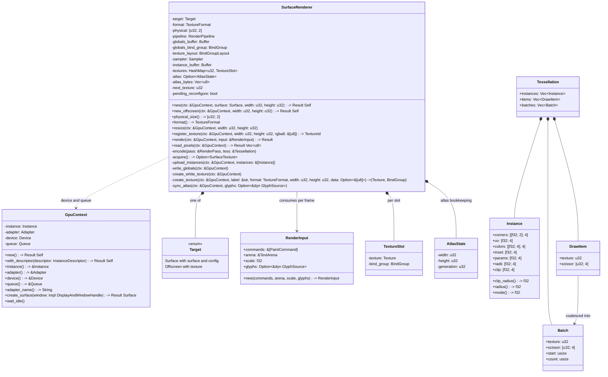
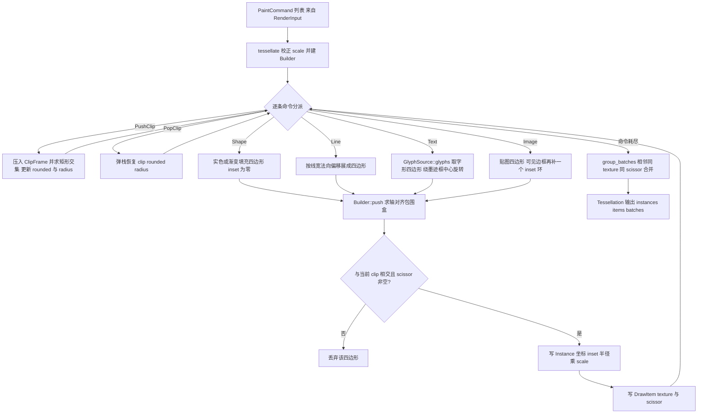
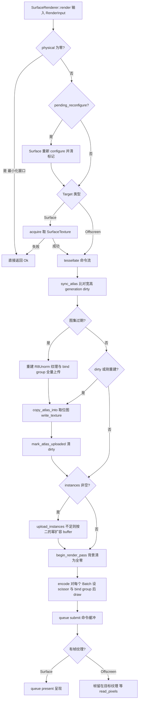
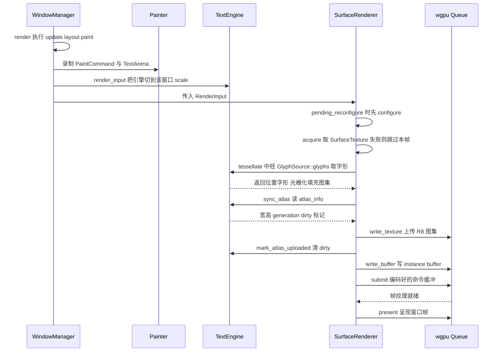
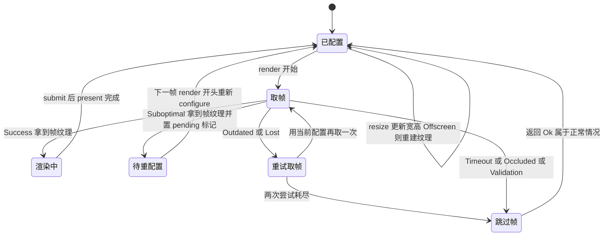

# rustui-renderer 模块详细设计

> 所属体系：[架构设计文档](../Architecture_Design_Document.md) · 分层：第 3 层（渲染/文本引擎）
> 源码：`crates/rustui-renderer/src/` · 依赖：`rustui-core`、`wgpu`、`bytemuck`、`log`、`pollster`（**不含** `winit`）

## 1. 模块职责

`rustui-renderer` 是 RustUI 的 GPU 侧：把 `rustui_core::PaintCommand` 录制流变成 `wgpu`
实例化绘制调用，管线数据流为
`Painter → PaintCommand[] → tessellate() → Instance[] + Batch[] → wgpu`（crate 文档注释引用
设计文档 §17–§21；按现行 [详细设计文档](../Detailed_Design_Document.md) 编号对应 §19 Paint API、
§20 PaintCommand、§22 Renderer、§23 GPU Pipeline、§24 GPU Resource Manager，字体侧对接 §25）。

具体职责：

* **进程级 GPU 引导**：`GpuContext` 持有 instance / adapter / device / queue，整个进程共享一份
  （[§22](../Detailed_Design_Document.md) 修正 C-030：没有 `Renderer` trait，只有两个具体类型）。
* **每窗口渲染器**：`SurfaceRenderer` 持有目标、管线、纹理槽位表与 instance buffer，逐帧执行
  acquire → tessellate → 图集上传 → 编码 → 提交 → 呈现（[§22](../Detailed_Design_Document.md)
  的帧内固定顺序，C-046）。
* **CPU 细分（tessellation）**：`tess.rs` 把逻辑像素命令流转换成物理像素四边形实例流——裁剪栈
  折叠为 scissor 与最内层圆角矩形、渐变在 CPU 端按四角采样、文本经 `GlyphSource` 取字形四边形。
* **单条渲染管线**：`shader.wgs` 一份 WGSL 同时服务纯色、渐变、边框环、贴图与字形——SDF 圆角、
  逐角半径（C-052）、圆角裁剪（C-051）、预乘 alpha 混合、coverage / color 双采样模式。
* **离屏渲染（T-10 / C-046）**：`SurfaceRenderer::new_offscreen` 渲进纹理、`read_pixels` 读回，
  支撑无头黄金图回归（[§58 Screenshot Test](../Detailed_Design_Document.md)）。
* **边界约束**：不理解任何业务逻辑（P4：Renderer 不理解业务逻辑），不依赖 `winit`（P1：平台
  无关——`create_surface` 只要求原始 window / display handle，由装配层传入 `winit` 窗口），
  UI 状态与 GPU 资源生命周期分离（P6）。

## 2. 模块结构（文件表）

| 文件 | 职责 | 关键类型 / 函数 / 常量 |
| --- | --- | --- |
| `crates/rustui-renderer/src/lib.rs` | crate 文档、模块声明与公开再导出 | `GpuContext`、`SurfaceRenderer`、`RenderInput`、`tessellate`、`group_batches`、`Batch`、`DrawItem`、`Instance`、`Tessellation`、`MODE_COLOR`、`MODE_COVERAGE`、`SLOT_WHITE`、`SLOT_GLYPH_ATLAS`、`Result` |
| `crates/rustui-renderer/src/gpu.rs` | GPU 设备引导（[§22](../Detailed_Design_Document.md)） | `GpuContext`：`new` / `with_descriptor` / `instance` / `adapter` / `device` / `queue` / `adapter_name` / `create_surface` / `wait_idle` |
| `crates/rustui-renderer/src/surface.rs` | 每窗口渲染器与一帧流程（[§22](../Detailed_Design_Document.md)/[§24](../Detailed_Design_Document.md)） | `SurfaceRenderer`、`RenderInput`、`Target::{Surface, Offscreen}`、`TextureSlot`、`AtlasState`、`INSTANCE_STRIDE`、`INSTANCE_ATTRIBUTES`、`create_target_texture`、`premultiplied_blend`、`instance_buffer_layout` |
| `crates/rustui-renderer/src/tess.rs` | CPU 细分：命令流 → 实例流 + 批次（[§20](../Detailed_Design_Document.md)/[§23](../Detailed_Design_Document.md)） | `tessellate`、`group_batches`、`texture_slot`、`Instance`、`DrawItem`、`Batch`、`Tessellation`、`Builder`、`ClipFrame`、`rect_corners`、`rotate_about`、`scissor_of`、`fill_colors`、`sample_gradient` |
| `crates/rustui-renderer/src/shader.wgs` | 唯一 WGSL 程序（`vs` / `fs` 两个入口） | `Globals`、`VsIn`、`VsOut`、`rounded_coverage` |
| `crates/rustui-renderer/tests/offscreen.rs` | 离屏读回集成测试（需 GPU，无适配器自动跳过） | 5 条测试：读回、resize 重建、read_pixels 守卫、圆角裁剪切角、逐角半径 |

## 3. 核心类型设计

### 3.1 类图

### 3.2 类型说明表

| 类型 | 文件 | 说明 |
| --- | --- | --- |
| `GpuContext` | `gpu.rs` | 进程级 GPU 资源：`Instance` + `Adapter` + `Device` + `Queue`。`new` 走默认实例描述，`with_descriptor` 供装配层带上 `winit` display handle（GLES 后端在 Wayland 上呈现需要）；适配器以 `HighPerformance` 请求，device 不要求额外 feature / limits；`wait_idle` 阻塞到排队的 GPU 工作完成（测试在建资源后调用）。 |
| `SurfaceRenderer` | `surface.rs` | 每窗口一个：目标 + 管线 + 全局 uniform + 采样器 + instance buffer + 纹理槽位表。构建时创建 shader 模块、globals / texture 两个 bind group layout、单条 `RenderPipeline`（三角形列表、无深度、无背面剔除、预乘 alpha 混合）、16 字节 globals buffer（视口物理像素尺寸）、线性过滤 clamp 采样器、64 KiB 起步的 instance buffer，并创建 1×1 白色纹理入 `SLOT_WHITE`。 |
| `Target` | `surface.rs` | 私有枚举，两种后端：`Surface { surface, config }` 窗口交换链（渲染后 present）与 `Offscreen { texture }` 离屏纹理（永不 present，`read_pixels` 读回）。`format` 由目标决定，窗口优先取能力表里第一个 sRGB 格式，离屏固定 `Rgba8UnormSrgb`，两者一致（[§22](../Detailed_Design_Document.md) C-046）。 |
| `RenderInput` | `surface.rs` | 一帧输入：`commands`（画家顺序的命令流）、`arena`（`PaintCommand::Text` 引用的字符串竞技场）、`scale`（物理/逻辑像素比）、`glyphs`（`Option<&dyn GlyphSource>`，`None` 时**丢弃全部文本命令**，C-027 回归点）。 |
| `TextureSlot` | `surface.rs` | 每纹理槽位同时持有 `Texture` 与它的 `BindGroup`，合批时只换 bind group（[§24](../Detailed_Design_Document.md) C-032：没有独立 ResourceManager）。 |
| `AtlasState` | `surface.rs` | 渲染器侧图集登记 `{width, height, generation}`，与 `GlyphSource::atlas_info` 对账决定是否重建纹理、是否全量上传（§25 对接点）。 |
| `Instance` | `tess.rs` | 单个四边形实例，`#[repr(C)]` 176 字节、`Pod + Zeroable`：四角物理像素坐标、`[u0, v0, u1, v1]`、四角色值（非预乘）、边框 inset、`params = [mode, 圆角裁剪半径, 保留, 保留]`、逐角半径（象限序 `top_left, top_right, bottom_left, bottom_right`，C-052）、圆角裁剪矩形（半径在 `params.y`，C-051）。 |
| `DrawItem` | `tess.rs` | 与 `instances[i]` 一一对应的绘制状态：纹理槽位 + 物理像素 scissor `[x, y, w, h]`。 |
| `Batch` | `tess.rs` | 连续且同纹理同 scissor 的 item 区间：`texture`、`scissor`、`start`、`count`，一段 = 一次 `draw(0..6, 0..count)`。 |
| `Tessellation` | `tess.rs` | `tessellate` 的结果三元组：`instances`（上传 GPU）、`items`（绘制状态）、`batches`（合批后的 draw 调用列表）。 |

## 4. 主要流程

### 4.1 PaintCommand → Instance → Batch → draw 合批

要点：

* 所有几何在 `Builder::push` 里乘 `scale` 转成物理像素，顶点着色器因此只剩视口换算；
* 实色与纹理批次的区分在 `mode_for_slot`：`slot <= SLOT_GLYPH_ATLAS`（白纹理 0 / 字形图集 1）
  走 `MODE_COVERAGE`（`alpha = color.a * tex.r`），其余用户纹理走 `MODE_COLOR`（RGBA 采样并乘色调）；
* 填充与边框是**两个实例**（边框实例带 `inset`，片元着色器在外矩形上减去内矩形成为环）；
* 裁剪矩形全部折进 scissor，只有最内层圆角裁剪随实例携带（C-051），因此不同 scissor 的相邻
  四边形无法合批——`group_batches` 只合并**连续**且状态相同的项，绝不重排绘制顺序。

### 4.2 一帧的编码与提交

关键顺序不变式（C-046）：字形在 `tessellate` 内经 `GlyphSource::glyphs()` **首次光栅化**并填入
图集，所以图集**必须在 tessellate 之后**上传——否则窗口首帧采样空图集，整个第一帧没有文字。

## 5. 关键时序

一帧从命令录制到 GPU 提交（`WindowManager::render` 录命令 → `render_input` 组装输入 →
`SurfaceRenderer::render`）：

同步语义（"fence"）：本 crate **没有显式的 fence / timeline 标量**——提交顺序由 `wgpu::Queue`
保证，`submit` 之后立刻 `present`，纹理获取与呈现由 wgpu 内部同步。唯一的 CPU 等待点是
`read_pixels`：`map_async` 的回调只有在 `device.poll` 时才触发，因此它用 `wait_idle` 阻塞
（`PollType::Wait`）充当栅栏，再从 mpsc channel 取回映射结果，逐行去掉 256 字节行对齐的
padding 后返回紧凑 RGBA8 行。

## 6. 状态转换

窗口目标的获取、丢失与重建（`acquire` + `pending_reconfigure` + `resize`）：

* 尺寸为零（最小化）的 `resize` 被忽略，`render` 也直接返回 `Ok(())`——跳帧是常态而非错误；
* `Suboptimal` 当帧仍可用，只把重新配置推迟到下一帧开头；
* `Outdated` / `Lost` 不报错，只在 `acquire` 内部重试，尺寸修正仍由 `resize` 负责；
* 离屏目标没有获取/丢失概念，`resize` 直接重建目标纹理并更新 globals 视口。

## 7. 关键设计约束与不变式

* **C-046（[Design_Corrections](../Design_Corrections.md)）**：`Target::{Surface, Offscreen}`
  二选一；帧内顺序固定 `acquire → tessellate → sync_atlas → upload_instances → encode → submit`；
  图集在 tessellate **之后**上传是首帧有文字的前提；`read_pixels` 返回紧凑 RGBA8 行。
* **C-051**：裁剪栈的矩形部分全部折进 scissor（外层矩形仍由 scissor 精确执行），**最内层**
  圆角逐片元 SDF 裁切；纯矩形裁剪（radius = 0）路径与改造前逐位一致。不变式：任意时刻
  `(scissor, 最内层 rounded)` 二元组完整描述裁剪栈，`PopClip` 必须恢复被压栈的三元组。
* **C-052**：`Instance.radii` 按象限序 `[top_left, top_right, bottom_left, bottom_right]`
  携带四个角半径，`rounded_coverage` 按片元所处象限取值；实例布局由 144 增至 176 字节，
  `INSTANCE_STRIDE == 176` 且 13 个顶点属性偏移由单元测试断言。
* **C-049**：旋转文本绕**墨迹框中心**（该 run 可见字形矩形并集的中心）旋转，恒等旋转直接
  返回原坐标；无可视字形时整个 Text 命令丢弃。
* **C-030 / C-031 / C-032（[§22](../Detailed_Design_Document.md)–[§24](../Detailed_Design_Document.md)）**：
  没有 `Renderer` trait、没有逐形状 vertex/index 生成、没有独立 `ResourceManager`——
  纹理槽位表就是 `SurfaceRenderer` 自己的 `HashMap<u32, TextureSlot>`。
* **C-027（对接约束）**：`RenderInput::glyphs == None` 时所有 `PaintCommand::Text` 被丢弃，
  因此 `TextMeasurer::glyph_source()` 必须返回 `Some(self)`（回归见 `crates/rustui/tests/pipeline.rs`）。
* **预乘 alpha 不变式**：片元输出 `rgb * a` 与 `a`，混合因子恒为 `src=One, dst=OneMinusSrcAlpha`；
  颜色属性以**非预乘**形式携带，保证四角线性插值后再乘 alpha 正确。
* **sRGB 不变式**：窗口格式优先选能力表中的 sRGB 格式，离屏目标固定 `Rgba8UnormSrgb`，
  两条路径帧内容一致；白纹理与用户图片纹理为 `Rgba8Unorm`，字形图集为 `R8Unorm`
  （`bytes_per_row` 等于宽度）。
* **物理像素不变式**：`tessellate` 内完成 `scale` 换算（非法 scale 回退 1.0），`Instance`
  与 scissor 全部是物理像素；globals uniform 只存视口物理尺寸。
* **图集对账不变式**：`AtlasState` 的 `(width, height, generation)` 与引擎一致才允许增量上传；
  重建纹理后必然全量上传；字节数与 `width * height` 不符时记 `log::warn` 并放弃上传，
  但仍调用 `mark_atlas_uploaded` 避免死循环重试。
* **P1**：crate 不依赖 `winit`，`create_surface` 只要求 `wgpu::DisplayAndWindowHandle`；
  **P4**：渲染器只认命令流，不理解控件；**P6**：GPU 资源生命周期由渲染器自持，trim 由上层发起。

## 8. 测试布局

| 位置 | 内容 | 需要 GPU |
| --- | --- | --- |
| `crates/rustui-renderer/src/tess.rs` 单元测试（18 条） | 无 GPU：矩形/线段→四边形、物理像素与 scale、填充+边框两实例、裁剪限制 scissor 与恢复、裁剪外四边形丢弃、相邻合批、渐变四角采样、字形槽位走 coverage 模式、圆角裁剪随实例携带与最内层生效（C-051）、逐角半径象限序（C-052）、恒等/旋转文本墨迹框中心（C-049）、无 GlyphSource 时文本丢弃、空命令无批次、`Instance` 176 字节布局 | 否 |
| `crates/rustui-renderer/src/surface.rs` 单元测试（3 条） | `INSTANCE_ATTRIBUTES` 与 `Instance` 字段偏移/location 一一对应、混合状态确为预乘、WGSL 经 naga 解析并校验且含 `vs` / `fs` 入口 | 否 |
| `crates/rustui-renderer/tests/offscreen.rs`（5 条） | 离屏渲染读回、resize 重建目标、读回守卫与最小化忽略、圆角裁剪四角必须是背景色（C-051）、一侧圆一角方的逐角半径像素断言（C-052）；无适配器时打印 skipped 并返回 | 是 |
| `crates/rustui/tests/golden.rs` | 黄金图三场景（控件行、下拉弹层、旋转文本 `rotated_label`），经 `new_offscreen` 渲染 → `read_pixels` → 8×8 量化网格与提交的 golden 比对（C-046 + C-049；重建：`UPDATE_GOLDEN=1 cargo test -p rustui --test golden`） | 是 |
| `crates/rustui/tests/pipeline.rs` | 端到端回归：字形源可达渲染器、裁剪栈不变式、容器边框为环 | 否 |
| `crates/rustui/tests/dpi.rs` | 多窗口 DPI：1.0 / 2.0 两窗口共享引擎时图集与光栅各自正确（C-048 的渲染侧配合） | 是 |

对应 [§58 测试策略](../Detailed_Design_Document.md)：单元测试覆盖 PaintCommand / Batch / Texture /
Font 四类渲染器断言；截图测试链路 `UI → Render → 离屏纹理 → readback → 量化网格 → 与 golden 比对`；
[§59 Benchmark](../Detailed_Design_Document.md) 的 `frame/labels_1000` 覆盖 update+layout+paint 全帧。
