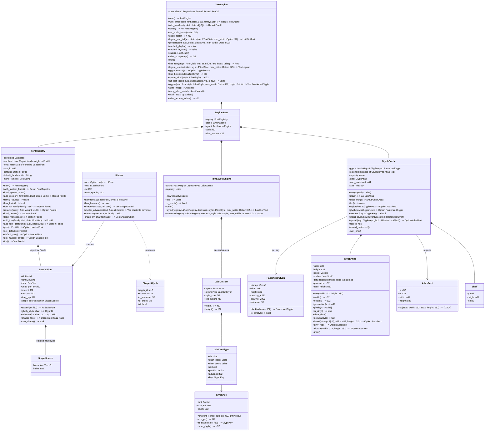
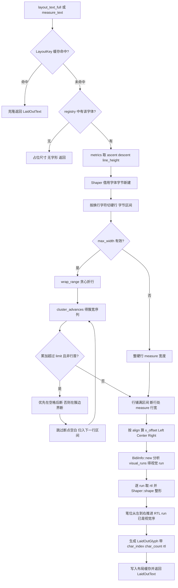
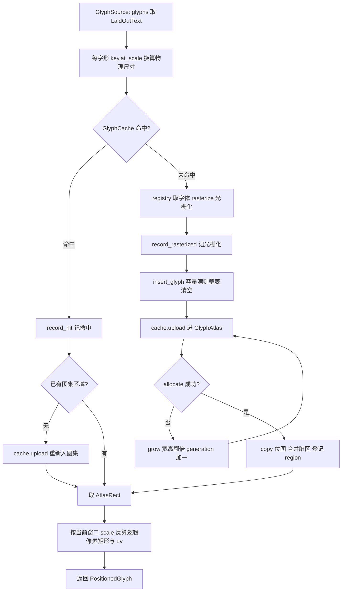
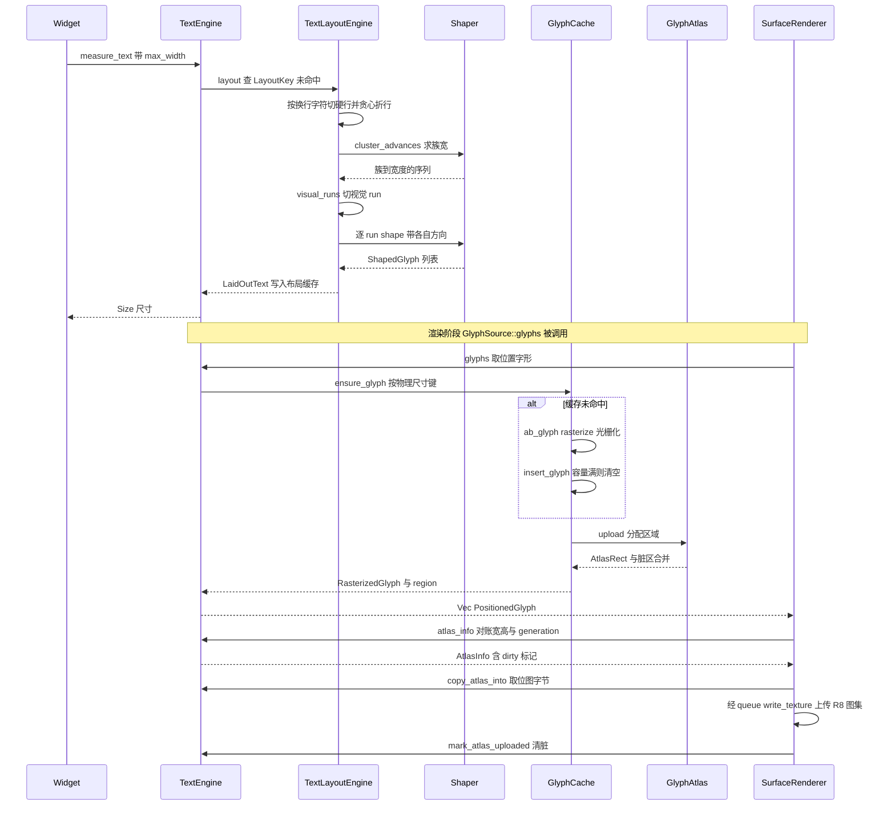
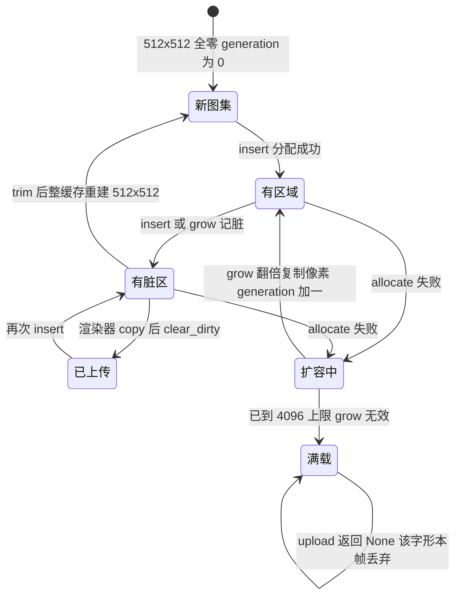
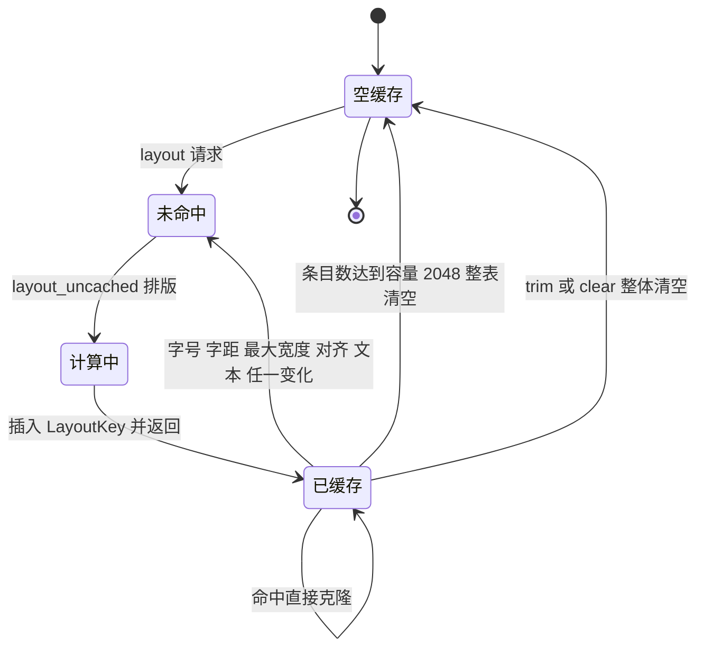

# rustui-text 模块详细设计

> 所属体系：[架构设计文档](../Architecture_Design_Document.md) · 分层：第 3 层（渲染/文本引擎）
> 源码：`crates/rustui-text/src/` · 依赖：`rustui-core`、`ab_glyph`、`fontdb`、`rustybuzz`、`unicode-bidi`、`log`（**不含** `wgpu` / `winit`）

## 1. 模块职责

`rustui-text` 是 RustUI 的文本引擎（[详细设计文档 §25 Font System](../Detailed_Design_Document.md)），
管线为 `Text → TextLayout → Glyph → GlyphAtlas → wgpu texture`：

* **字体资源**（`font.rs`）：`fontdb` 负责系统字体检索与族/字重查询，`ab_glyph` 负责度量与
  光栅化，`rustybuzz` 负责 HarfBuzz 风格整形（连字 / kerning / 复杂文种），三者读同一张 `cmap`
  （修正 C-026：全部封装在本 crate 内，`rustui-widgets` 与 `rustui-renderer` 只经 `rustui-core`
  里的 `TextMeasurer` / `GlyphSource` 两个 trait 访问，谁都不知道 `ab_glyph` 类型）。
* **整形**（`shape.rs`）：`Shaper` 按次借用字体原始字节构建 `rustybuzz::Face`，方向由调用方
  （bidi 分析）显式给定；无字节的裸 `FontVec` 自动退回逐字形排布（T-9 / C-053）。
* **排版**（`layout.rs`）：`\n` 硬行、按字簇贪心折行、三种对齐、`unicode-bidi` 视觉序分 run
  双向整形，结果按 (font, size, letter spacing, max width, align, text hash) 缓存。
* **光栅与图集**（`glyph.rs`）：`ab_glyph` 光栅化 + 按**物理像素尺寸**键控的 `GlyphCache`
  （C-048）+ shelf 打包的单通道 `GlyphAtlas`（可翻倍扩容、脏区跟踪、代数递增）。
* **引擎门面**（`lib.rs`）：`TextEngine` 把以上状态装进 `Rc<RefCell<EngineState>>`，同时实现
  `TextMeasurer`（供控件测量）与 `GlyphSource`（供渲染器取字形与图集字节）——`glyph_source()`
  必须返回 `Some(self)`，否则渲染器丢弃全部文本（C-027 的真实回归点）。
* **边界**：本 crate 不知道 `wgpu` 与 `winit`（P2：Widget 不直接依赖 wgpu；渲染器与控件只看
  core trait），排版全程在**逻辑像素**完成，只有光栅化跟 DPI 走（C-048）。

## 2. 模块结构（文件表）

| 文件 | 职责 | 关键类型 / 函数 |
| --- | --- | --- |
| `crates/rustui-text/src/lib.rs` | 引擎门面与两个 trait 的实现、字形确保流程 | `TextEngine`、`EngineState`、`ensure_glyph`、`measure`；`TextMeasurer` 实现（`layout_text`、`glyph_source`、`line_height`、`space_width`、`hit_test_x`）、`GlyphSource` 实现（`glyphs`、`atlas_info`、`copy_atlas_into`、`mark_atlas_uploaded`、`atlas_texture_index`） |
| `crates/rustui-text/src/font.rs` | 字体发现与字体资源 | `FontRegistry`、`LoadedFont`、`ShapeSource`、`default_sans_families`、`default_mono_families` |
| `crates/rustui-text/src/shape.rs` | rustybuzz 整形与回退（T-9 / C-053） | `Shaper`、`ShapedGlyph`、`base_rtl` |
| `crates/rustui-text/src/layout.rs` | 断行、对齐、字形定位与缓存 | `TextLayoutEngine`、`LaidOutText`、`LaidOutGlyph`、`LayoutKey`、`layout_uncached`、`wrap_range`、`layout_segment`、`caret_rect` |
| `crates/rustui-text/src/glyph.rs` | 光栅化、字形缓存与图集 | `GlyphCache`、`GlyphAtlas`、`GlyphKey`、`RasterizedGlyph`、`AtlasRect`、`Shelf`、`rasterize`、`raster_scale`、`glyph_key`、`render_text` |
| `crates/rustui-text/tests/shaping.rs` | 整形/双向排版集成测试（10 条，字体缺失自动跳过） | 连字、kerning、RTL、混排、glyph id 一致性、字簇不拆、hit-test、天城文、阿拉伯、无字节回退 |

## 3. 核心类型设计

### 3.1 类图

### 3.2 类型说明表

| 类型 | 文件 | 说明 |
| --- | --- | --- |
| `TextEngine` | `lib.rs` | 引擎句柄，`Clone` 只是加引用计数（多窗口共享同一份状态）。`new()` 加载系统字体 + 默认字体 + 等宽字体；`with_embedded_font` 注册嵌入字体并 `set_default`；`set_scale_factor` 把 scale 钳在 `[0.5, 4.0]` 且**不清任何缓存**（C-048）；`prepare` 预光栅化一段文本；`stats` 返回 (光栅化次数, 命中次数)；`trim` 丢弃字形缓存并清空布局缓存。 |
| `EngineState` | `lib.rs` | `RefCell` 内部状态：`registry` + `cache` + `layout` + 当前 `scale` + `atlas_texture`（固定 1，`SLOT_GLYPH_ATLAS` 的对应值）。 |
| `FontRegistry` | `font.rs` | 字体注册表：`fontdb::Database` 做发现，`resolved` 缓存 (family, weight) → `FontId`，`fonts` 存已加载的 `LoadedFont`，`defaults` 是 `FontId::DEFAULT` 的落点。`resolve` 先按族名+字重查询，失败依次回退 SansSerif → Monospace → 任意字体；`load_default` 依次尝试平台默认无衬线族、`monospace`、任意族；`load_face` 把 face 字节复制两份（一份给 `ab_glyph::FontVec`，一份 `Arc` 留给 `rustybuzz`）。 |
| `LoadedFont` | `font.rs` | 一个已入内存的字体：`FontVec` 光栅化后端 + `units_per_em` / `ascent` / `descent` / `line_gap` 度量 + 可选 `ShapeSource`。`can_shape()` 即"有没有原始字节"；`shaper_face()` 每次借用字节新建 `rustybuzz::Face`（不得跨请求持有）。 |
| `ShapeSource` | `font.rs` | 整形用原始字节 `Arc<Vec<u8>>` + 集合内 face `index`（普通文件为 0）。 |
| `Shaper` | `shape.rs` | 单次布局请求内的整形器，绑定 (字体, 字号, letter spacing)。`shape` 有 `rustybuzz::Face` 时走 `UnicodeBuffer → guess_segment_properties → set_direction → rustybuzz::shape`，推进量按 `px / units_per_em` 换算并按**字符数**追加 letter spacing（连字覆盖几个字符就收几份）；没有字节时 `shape_by_char` 逐字符给 `ab_glyph` 度量（`rtl` 恒为 false 的旧行为）。`cluster_advances` 把同簇字形推进量合并成"簇 → 宽度"序列供折行使用，`measure` 求总宽。 |
| `ShapedGlyph` | `shape.rs` | 整形结果单元：`glyph_id`（与 `ab_glyph` 光栅化同一 id）、`cluster`（相对切片的字节偏移）、`x_advance`、`x_offset`、`rtl`。 |
| `base_rtl` | `shape.rs` | 自由函数：`unicode_bidi::BidiInfo` 判段落方向（UAX#9），run 没有继承 level 时用它。 |
| `TextLayoutEngine` | `layout.rs` | 排版器 + 缓存（默认容量 2048）。键为 `LayoutKey`：font + 字号/字距/最大宽度的 1/64 量化 + align + 文本 FNV-1a 哈希；命中直接克隆返回，容量满**整表清空**后插入。 |
| `LaidOutText` | `layout.rs` | 排版结果：`TextLayout`（尺寸/ascent/descent/行区间）+ `glyphs` + `style_size` + `line_height`；`width()` 即最宽行。 |
| `LaidOutGlyph` | `layout.rs` | 已定位字形：`ch`、`char_index`（簇首字符在全文的字符序号）、`char_count`（簇覆盖的字符数，连字可大于 1）、`rtl`、逻辑像素 `position`、`advance`、逻辑尺寸 `key`（进图集前须 `at_scale`）。 |
| `caret_rect` | `layout.rs` | 自由函数：字符索引 → 光标矩形；簇内按比例插值，RTL 簇从右缘起算，簇末取后沿，间隙取最近字形，全空时返回 `(0, 0, 1, line_height)`。 |
| `GlyphKey` | `glyph.rs` | 缓存键：`font` + `size_64`（1/64 px 量化，`new` 钳 `size >= 1.0`）+ `glyph`；`at_scale` 把逻辑键换算成**物理尺寸**键（14px @2.0 与 28px @1.0 共享同一位图，C-048）。 |
| `RasterizedGlyph` | `glyph.rs` | 光栅结果：覆盖率位图 + `width/height` + `bearing_x`（笔位到左缘）+ `bearing_y`（基线到上缘）+ `advance`；空白与 `.notdef` 走 `blank` / 空心方框特例。 |
| `GlyphCache` | `glyph.rs` | 字形缓存（默认容量 4096）：`glyphs` 与 `regions` 双表 + 内嵌 `GlyphAtlas` + 两个统计计数；容量满的逐出策略是 `evict_one` **整表清空**（图集位图保留，重光栅化即可复用区域）。 |
| `GlyphAtlas` | `glyph.rs` | 单通道 coverage 图集（默认 512×512）：shelf 打包器（`Shelf{y, height, x}` 首次适配）、脏区并集 `dirty`、`generation` 在扩容时递增、`used_height` 记已用行数；`grow` 宽高各翻倍、上限 4096、按行复制旧像素并把脏区设为全图。 |
| `AtlasRect` | `glyph.rs` | 图集内矩形，`uv` 换算归一化纹理坐标；宽或高为 0 表示"空白字形的零区域"。 |
| `rasterize` | `glyph.rs` | 自由函数：`ab_glyph` 描边 → 覆盖率位图（取逐像素最大值），`bearing` 由 `px_bounds` 推出；`glyph_id == 0` 画空心方框，无轮廓（空白）返回带 advance 的空位图。 |

## 4. 主要流程

### 4.1 文本测量 + 折行 + bidi 排版

不变式：视觉行**铺满**源文本的字节区间（行间不重叠、不丢字符，`\n` 本身不计入任何行）；
断行点只落在**字簇边界**，超长词按簇断而连字永不拆开；`char_cursor` 逐行累计字符数并在
硬行结尾跳过 `\n` 那一个字符，保证 `char_index` 对全文连续。

### 4.2 字形从字符到图集瓦片

随后一帧内渲染器在 `tessellate` **之后**调用 `sync_atlas`：`atlas_info` 对账
`(width, height, generation)` 决定是否重建纹理，`dirty` 决定是否 `copy_atlas_into` 全量上传，
上传完调用 `mark_atlas_uploaded` 清脏（C-046 的协作协议，见 §7）。

## 5. 关键时序

一次文本测量的完整时序（缓存未命中 → 整形 → 排版 → 光栅 → 图集 → 渲染器上传）：

## 6. 状态转换

### 6.1 字形图集的生命周期（分配 / 脏区 / 扩容 / 收缩）

* 脏区是**并集矩形**：多次 `insert` 会把脏框扩到覆盖所有改动；
* `generation` 只在 `grow` 与 trim 重建时变化，渲染器据其变化丢弃旧 bind group 并全量重传；
* 图集**只增不缩**：收缩只发生于 `trim`（连同字形缓存一起丢弃，图集回到 512×512）。

### 6.2 布局缓存的失效

* 缓存键与 scale 无关——换 DPI 不影响布局（C-048 的前提）；
* 满容量策略是整表清空而非 LRU，简单可预测；`hit_test_x` 与 `prepare` 都会经由布局缓存，
  重复查询近乎零成本。

## 7. 关键设计约束与不变式

* **C-053（[Design_Corrections](../Design_Corrections.md) 复杂文种 shaping）**：
  `rustybuzz` 整形 + `unicode-bidi` 视觉序换行；`Shaper` **每次布局请求构建一次**，
  `rustybuzz::Face` 借用 `FontRegistry` 的原始字节、不得跨请求常驻；只注册裸 `FontVec`
  的字体没有字节，自动退回 `shape_by_char` 逐字形排布；`ab_glyph` 仍是度量与光栅化后端，
  与整形器读同一张 `cmap`——glyph id 一致性由 `shaped_glyph_ids_match_the_rasterizer` 钉住；
  rustybuzz / unicode-bidi 是本 crate 的依赖豁免项。
* **字簇不变式（C-053）**：折行只在簇边界断（`cluster_advances` 先合并同簇字形）、
  letter spacing 按簇内字符数收取、`LaidOutGlyph.char_index + char_count` 恒落在合法字符区间、
  `caret_rect` 在簇内按比例插值（连字里按方向键光标仍会移动）、`hit_test_x` 按像素位置定位
  到簇后**返回字符索引**（顺序扫描字形 + 簇内像素比例换算，RTL 簇内方向取反）。
* **C-048（多窗口 DPI）**：`GlyphKey::at_scale` 按物理尺寸键控，14px @2.0 与 28px @1.0 共享
  同一位图，多 DPI 光栅并存；`set_scale_factor` 钳制 `[0.5, 4.0]` 且**不清任何缓存**；
  `glyphs()` 用当前窗口 scale 把物理位图反算回逻辑 quad；scale 由
  `WindowManager::render_input` 在组装每帧输入时设置（[§25](../Detailed_Design_Document.md)）。
* **C-026 / C-027 / C-028**：`fontdb` + `ab_glyph` 选型与封装边界；`TextEngine::glyph_source()`
  必须返回 `Some(self)`，否则渲染器丢弃全部 `PaintCommand::Text`（回归测试
  `crates/rustui/tests/pipeline.rs`）；逻辑/物理换算只发生在光栅环节。
* **C-046 协作协议（渲染侧）**：字形在 `tessellate` 中首次光栅化，所以图集上传必须发生在
  tessellate 之后；`atlas_info` 的 `(width, height, generation)` 不匹配 → 渲染器重建纹理并
  全量上传，`dirty` → 增量全量复制（单副本原则：系统里只有一份长寿命位图，渲染器经
  `copy_atlas_into` 取走）。
* **无字体不变式**：`layout_uncached` 在字体缺失时仍返回正的占位尺寸（宽 = 字符数 × 0.5 × 字号，
  高 = 行数 × 1.45 × 字号）与空字形表——布局永不 panic；`TextMeasurer::line_height` 缺字体回退
  `size * 1.45`，`space_width` 回退 `size * 0.33`。
* **缓存量化不变式**：字号与字距在键里按 1/64 像素量化，微小浮点差不产生重复条目
  （`glyph_key_quantizes_size`、`at_scale_keys_rasters_by_physical_size`）。
* **P2**：本 crate 不接触 `wgpu`——渲染器只经 `GlyphSource` 拿位图与元数据；控件只经
  `TextMeasurer` 拿尺寸与光标/hit-test 结果（[High-Level §20 设计原则](../High-Level_Design_Document.md)）。

## 8. 测试布局

| 位置 | 内容 | 需要字体 / GPU |
| --- | --- | --- |
| `crates/rustui-text/src/font.rs` 单元测试（2 条） | 空注册表起手、注册后查询与 advance 为正 | 字体缺失则跳过断言 |
| `crates/rustui-text/src/layout.rs` 单元测试（10 条） | 无字体占位、布局缓存复用、字形位置单调、硬行成行、行字节区间无缺口、换行拆长文本、超长词按字符断、对齐位移、光标随索引移动、空文本零宽一行 | 系统字体缺失则返回 |
| `crates/rustui-text/src/glyph.rs` 单元测试（10 条） | shelf 分配不重叠、满则扩容且像素保留、脏区增长、零尺寸区域、键量化、`at_scale` 物理键并存、真字形光栅化、空白字形空位图带 advance、缓存往返、`raster_scale` 钳制 | 光栅化两条需字体 |
| `crates/rustui-text/src/lib.rs` 单元测试（9 条） | 测量合理、行高随字号、字形在屏幕空间、图集填充且只上传一次、重复 prepare 命中缓存、**换 scale 各 DPI 光栅并存且切回零重光栅（C-048）**、hit-test、无字体仍可测、Debug 不 panic | 多数需字体 |
| `crates/rustui-text/tests/shaping.rs` 集成测试（10 条，C-053） | `ffi` 连字成单字形且光标在簇内推进、`AV` kerning 变窄、RTL 首字符最右、混排 LTR 在左 RTL 在右、glyph id 与光栅器一致、折行不拆簇且字形数不变、hit-test 按位置切簇返回字符索引、天城文合字重排且含零宽 matra、阿拉伯语境合字与 lam-alef、裸 `FontVec` 逐字符回退 | DejaVu / Noto 系统字体缺失时对应测试自动返回；不需 GPU |
| `crates/rustui/tests/dpi.rs` | 1.0 / 2.0 双窗口共享引擎，切 scale 不清缓存（C-048 渲染侧） | 需 GPU |
| `crates/rustui/tests/pipeline.rs` | `glyph_source()` 可达渲染器等端到端回归（C-027） | 不需 GPU |
| `crates/rustui/tests/golden.rs` | 黄金图三场景的文字像素（C-046 + C-049；C-053 后三张按新排版重建并逐张比对） | 需 GPU |

对应 [§58 测试策略](../Detailed_Design_Document.md)：`cargo test --workspace` 的 text 部分即上述
单测 + `shaping.rs` 10 条集成测试；[§59 Benchmark](../Detailed_Design_Document.md) 记录整形接入后
`text/measure_natural` 与 `text/measure_wrapping` 的成本变化（整形固有开销约 20%，布局缓存命中
仍为零成本）。
