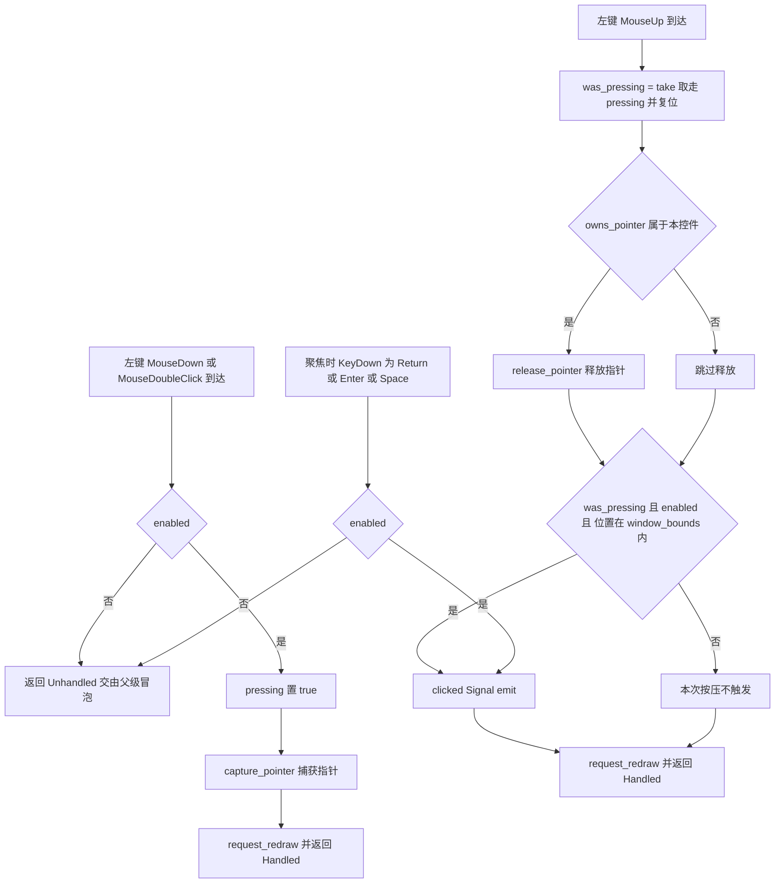
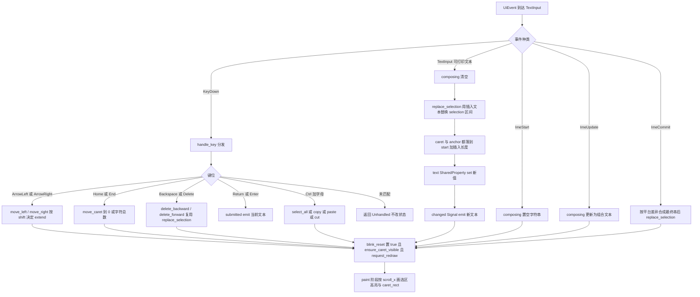
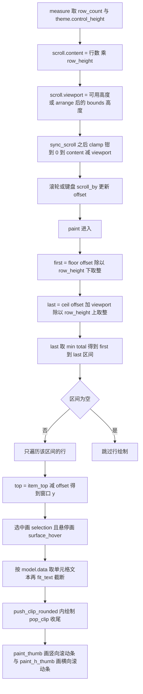
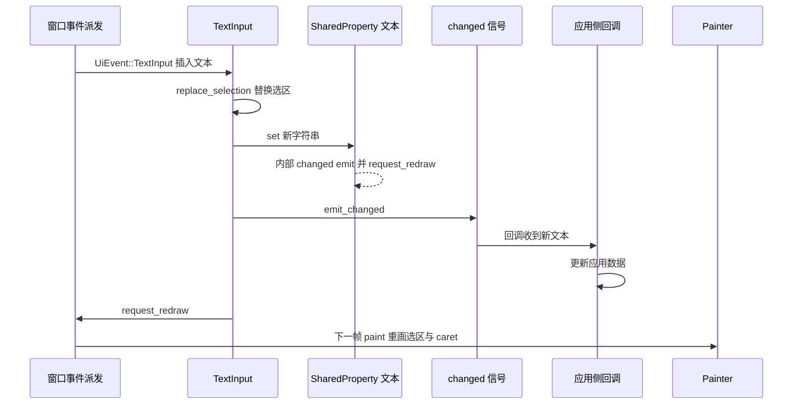
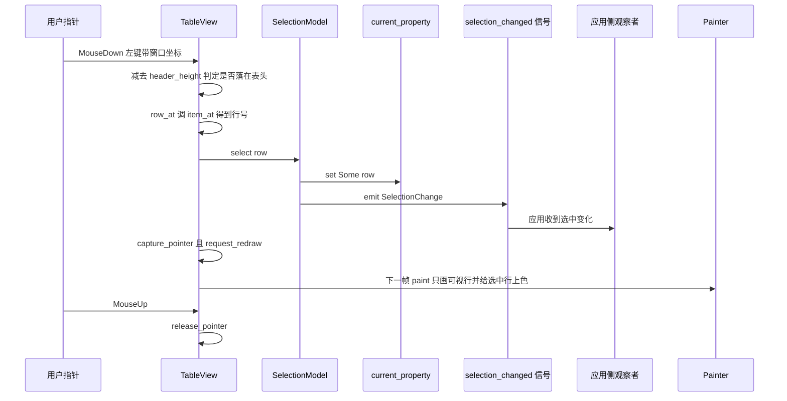
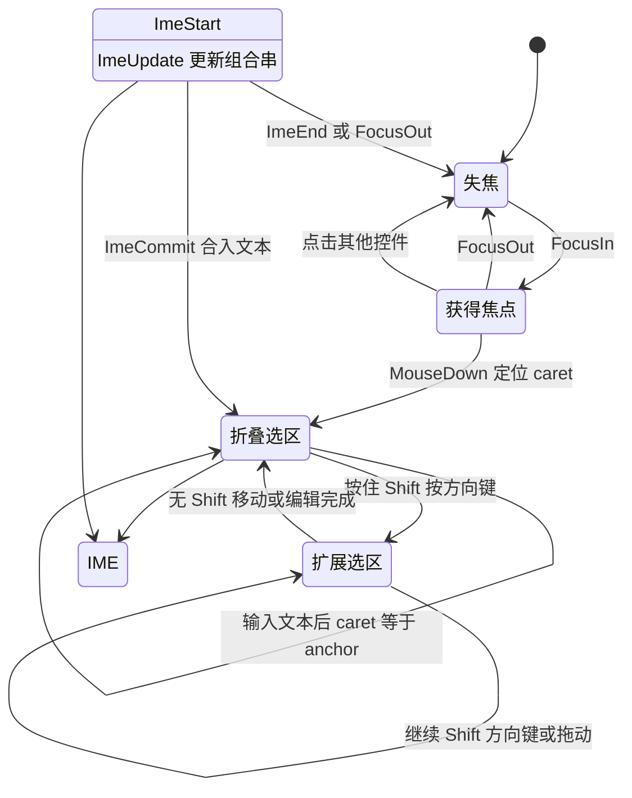
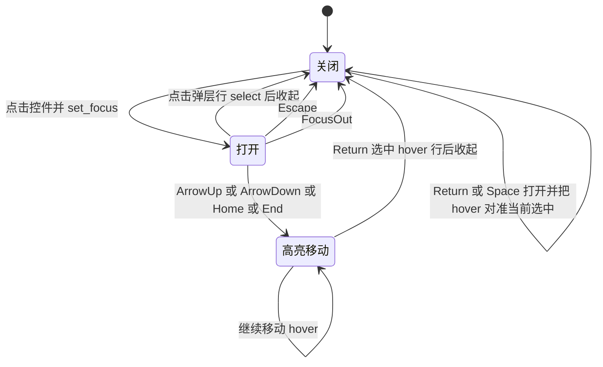

# rustui-widgets 模块详细设计

> 所属体系：[架构设计文档](../Architecture_Design_Document.md) · 分层：第 4 层（控件库）
> 源码：`crates/rustui-widgets/src/` · 依赖：rustui-core/rustui-layout/rustui-model/rustui-animation（不依赖 platform/wgpu，原则 P1）

## 1. 模块职责

`rustui-widgets` 是 RustUI 的控件库，提供应用直接可见、可交互的一批控件：文本展示、按钮、
勾选框、进度条、单行文本编辑、滚动容器、列表 / 表格 / 树三种数据视图、下拉选择、弹出菜单
与对话框。它对应设计文档 §26（TextInput 状态）、§45 – §48（Widget 状态、Button、Label、
TextInput 设计）与 §51（虚拟化），`src/lib.rs` 的 crate 文档即按此编号自述。

模块的四条基本定位（均可在源码中直接验证）：

1. **纯控件层**：每个控件都是一个普通的 `rustui_core::Widget`，被放进 `WidgetStore`、以
   `ObjectId` 寻址，**不持有父 / 子对象的引用**，因此对象模型里没有 `Rc<RefCell<Widget>>`
   （设计文档 §52「内存管理原则」）。Cargo.toml 依赖只有 `rustui-core` / `rustui-layout` /
   `rustui-text` / `rustui-model` / `rustui-animation`，不出现 `rustui-platform` 与 `wgpu`
   （原则 P1「Widget 不依赖平台」、P2「Widget 不直接依赖 wgpu」）。
2. **状态外露靠属性与信号**：控件自身状态（文本、勾选、选中行、进度）存进
   `SharedProperty<T>`，用户动作通过 `Signal<T>` 广播（C-033「运行时数据靠 `SharedProperty`
   绑定」）；应用侧 `clone` 属性句柄即可读写，无需 `&mut self`，也无需 downcast。
3. **列表 / 表格 / 树自绘并虚拟化**：`ListView` / `TableView` / `TreeView` / `ComboBox` /
   `Menu` 都自己 tessellate 行、表头、twisty 与滚动条，只画与视口相交的行（C-032、§51）。
   控件树节点数与模型规模无关——十万行模型与十行模型的控件树完全等价。
4. **弹层走窗口通道**：`ComboBox` 的下拉面板由控件自己在 `paint` 里 `request_popup` 登记、
   在 `paint_popup` 中绘制；`Menu` / `Dialog` 则是普通 widget，由应用以 overlay 形式挂到
   窗口上（C-006 / C-045）。

模块**不做**的事情：不排版文本（交给 `rustui-text` 经 `MeasureContext::measure_text`）、
不做布局算法（`rustui-layout`）、不保存业务数据（`rustui-model` 的模型 trait）、不渲染
（`Painter` 只负责记录 `PaintCommand`）。

## 2. 模块结构

`src/` 共 15 个文件、5197 行；另有 2 个集成测试文件。按控件分组如下。

**基础控件**

| 文件 | 行数（约） | 导出类型 | 职责 |
| --- | --- | --- | --- |
| `src/label.rs` | 423 | `Label` | 静态 / 绑定文本，支持 role、对齐、换行、旋转（C-049） |
| `src/button.rs` | 250 | `Button`、`ButtonVariant` | 按下 - 抬起 - 触发，三种视觉变体 |
| `src/checkbox.rs` | 291 | `CheckBox` | 二值勾选 + 可选标题 |
| `src/progress_bar.rs` | 145 | `ProgressBar` | 0.0 – 1.0 进度条，横向填满 |

**输入控件**

| 文件 | 行数（约） | 导出类型 | 职责 |
| --- | --- | --- | --- |
| `src/text_input.rs` | 773 | `TextInput` | 单行编辑：caret / 选区 / 剪贴板 / IME / 闪烁光标（§26、§48） |

**列表 / 表格 / 树**

| 文件 | 行数（约） | 导出类型 | 职责 |
| --- | --- | --- | --- |
| `src/list_view.rs` | 429 | `ListView`、`ActivateMode` | 一维虚拟化列表 + `SelectionModel` |
| `src/table_view.rs` | 618 | `TableView` | 多列表头 + 可拖拽列宽 + 双向滚动 + 虚拟化行（§28） |
| `src/tree_view.rs` | 617 | `TreeView` | 层级视图：twisty 折叠、按 `NodeId` 选中、虚拟化行（§29） |

**容器**

| 文件 | 行数（约） | 导出类型 | 职责 |
| --- | --- | --- | --- |
| `src/scroll_view.rs` | 201 | `ScrollView` | 单子项视口，滚动即 `-offset` 平移 + 裁剪 |

**菜单 / 对话框 / 选择**

| 文件 | 行数（约） | 导出类型 | 职责 |
| --- | --- | --- | --- |
| `src/combo_box.rs` | 513 | `ComboBox` | 收起态按钮 + 自绘弹层（C-045 / T-4） |
| `src/menu.rs` | 403 | `Menu`、`MenuItem` | 弹出菜单，应用以 overlay 展示 |
| `src/dialog.rs` | 324 | `Dialog` | 标题栏 + 关闭按钮 + 内容子项的浮层面板 |

**共享基础设施**

| 文件 | 行数（约） | 可见性 | 职责 |
| --- | --- | --- | --- |
| `src/lib.rs` | 69 | `pub` | 模块声明、`pub use` 导出、`prelude` |
| `src/common.rs` | 36 | `pub(crate)` | `focus_ring` / `center_in` / `control_radius` 三个绘制小工具 |
| `src/view.rs` | 105 | `pub(crate)` | `Scroll`、`visible_range`、`item_at`、`item_top`、`paint_thumb` —— 虚拟化共用基元 |

**测试**

| 文件 | 用例数 | 覆盖 |
| --- | --- | --- |
| `tests/widgets.rs` | 38 | Label / Button / CheckBox / TextInput / ScrollView / ProgressBar / ComboBox / Menu / Dialog + 端到端表单 |
| `tests/views.rs` | 12 | TableView 列几何、交互、虚拟化；TreeView 展平、twisty、键盘导航、虚拟化 |

## 3. 核心类型设计

### 3.1 类图

图中泛型一律用 `~T~` 写法；`Shared~ListModel~` 是 `Shared<Box<dyn ListModel>>` 的简写，
`Signal of NodeId` 之类是 `Signal<Option<NodeId>>` 的文字简写，字段类型出现嵌套泛型（如
`SharedProperty<Option<usize>>`）时只写字段名，完整签名一律见 3.2 表与源码。
除 `Scroll` / `MenuItem` / `ButtonVariant` 外，所有控件都以组合方式内含一个 `WidgetBase`，
不存在控件间的继承。

```mermaid
classDiagram
    direction TB
    class WidgetBase {
        +bounds Rect
        +measured Size
        +children Vec~ObjectId~
        +set_bounds(rect Rect)
        +set_measured(size Size)
        +window_bounds() Rect
        +add_child(child ObjectId)
        +state() WidgetState
        +is_enabled() bool
    }
    class SharedProperty~T~ {
        +get() T
        +set(value T)
        +changed() Signal~T~
    }
    class Signal~T~ {
        +emit(value T)
        +connect(callback) Connection~T~
    }
    class Scroll {
        +offset f32
        +content f32
        +viewport f32
        +clamp()
        +scroll_by(delta f32)
        +ensure_visible(top f32, height f32)
        +overflows() bool
    }
    class ButtonVariant {
        <<enum>>
        Primary
        Secondary
        Flat
    }
    class Label {
        +text SharedProperty~String~
        +role TextRole
        +align TextAlign
        +wrap bool
        +rotation f32
        +measure(ctx, available) Size
        +paint(ctx)
    }
    class Button {
        +text SharedProperty~String~
        +variant ButtonVariant
        +pressing bool
        +clicked Signal~()~
        +event(ctx, event) EventResult
        +paint(ctx)
    }
    class CheckBox {
        +caption
        +checked SharedProperty~bool~
        +toggled Signal~bool~
        +pressing bool
        +box_rect(ui) Rect
    }
    class ProgressBar {
        +value SharedProperty~f32~
        +size_hint() SizeHint
        +paint(ctx)
    }
    class TextInput {
        +text SharedProperty~String~
        +caret usize
        +anchor usize
        +scroll_x f32
        +composing Option~String~
        +changed Signal~String~
        +submitted Signal~String~
        +handle_key(ctx, key, modifiers) EventResult
        +ime_cursor_area(ui) Option~Rect~
        +update(ctx)
    }
    class ScrollView {
        +offset Vec2
        +content Size
        +viewport Size
        +content_id() Option~ObjectId~
        +paint(ctx)
    }
    class ListView {
        +model Shared~ListModel~
        +selection SelectionModel
        +scroll Scroll
        +activate ActivateMode
        +activated Signal~usize~
        +scroll_to_row(row usize)
        +paint(ctx)
    }
    class TableView {
        +model Shared~TableModel~
        +selection SelectionModel
        +scroll Scroll
        +h_scroll Scroll
        +columns Vec~f32~
        +resize_column Option~usize~
        +sync_columns(ui)
        +set_column_width(column usize, width f32)
        +activated Signal~usize~
    }
    class TreeView {
        +model Shared~TreeModel~
        +rows Vec of NodeId 与 depth
        +scroll Scroll
        +selection
        +selection_changed Signal of NodeId
        +refresh_rows()
        +toggle(node NodeId)
        +activated Signal of NodeId
    }
    class ComboBox {
        +items Shared~ListModel~
        +selection
        +open bool
        +hover Option~usize~
        +viewport Rect
        +popup_rect() Option~Rect~
        +hit_test(position Point) bool
        +paint_popup(ctx)
    }
    class MenuItem {
        <<struct>>
        +label String
        +shortcut Option~String~
        +enabled bool
        +separator bool
    }
    class Menu {
        +items Vec~MenuItem~
        +selected Option~usize~
        +activated Signal~usize~
        +closed Signal~()~
        +hide(ctx)
        +index_at(position, bounds) Option~usize~
    }
    class Dialog {
        +title SharedProperty~String~
        +closeable bool
        +close_requested Signal~()~
        +min_width Option~f32~
        +content_id() Option~ObjectId~
        +close_rect(ui, rect) Rect
    }
    class SelectionModel {
        +mode SelectionMode
        +current_property SharedProperty of usize
        +selection_changed Signal of SelectionChange
        +select(index usize)
        +is_selected(index usize) bool
    }
    class ListModel {
        <<trait rustui-model>>
        +row_count() usize
        +data(row usize) ModelValue
    }
    class TableModel {
        <<trait rustui-model>>
        +column_count() usize
        +header_data(column usize) ModelValue
        +data(row usize, column usize) ModelValue
    }
    class TreeModel {
        <<trait rustui-model>>
        +root_count() usize
        +child(node NodeId, index usize) Option~NodeId~
        +is_expanded(node NodeId) bool
        +set_expanded(node NodeId, expanded bool)
    }

    Button *-- WidgetBase : base
    Label *-- WidgetBase : base
    CheckBox *-- WidgetBase : base
    ProgressBar *-- WidgetBase : base
    TextInput *-- WidgetBase : base
    ScrollView *-- WidgetBase : base
    ListView *-- WidgetBase : base
    TableView *-- WidgetBase : base
    TreeView *-- WidgetBase : base
    ComboBox *-- WidgetBase : base
    Menu *-- WidgetBase : base
    Dialog *-- WidgetBase : base

    Button *-- ButtonVariant : variant
    Button *-- SharedProperty~String~ : text
    Button *-- Signal~()~ : clicked
    Label *-- SharedProperty~String~ : text
    CheckBox *-- SharedProperty~bool~ : checked
    CheckBox *-- Signal~bool~ : toggled
    ProgressBar *-- SharedProperty~f32~ : value
    TextInput *-- SharedProperty~String~ : text
    TextInput *-- Signal~String~ : changed
    TextInput *-- Signal~String~ : submitted
    ListView *-- SelectionModel : selection
    ListView *-- Shared~ListModel~ : model
    ListView *-- Scroll : scroll
    TableView *-- SelectionModel : selection
    TableView *-- Shared~TableModel~ : model
    TableView *-- Scroll : scroll
    TreeView *-- Shared~TreeModel~ : model
    TreeView *-- Scroll : scroll
    ComboBox *-- Shared~ListModel~ : items
    Menu *-- MenuItem : items
    Menu *-- Signal~usize~ : activated
    Dialog *-- SharedProperty~String~ : title
    Dialog *-- Signal~()~ : close_requested
    SelectionModel *-- Signal~SelectionChange~ : selection_changed
    ListView ..> ListModel : 读
    TableView ..> TableModel : 读
    TreeView ..> TreeModel : 读写展开状态
    ComboBox ..> ListModel : 读
```

### 3.2 关键类型说明

| 类型 | 源文件 | 关键字段 / 方法（真实签名） | 说明 |
| --- | --- | --- | --- |
| `WidgetBase` | rustui-core `widget.rs` | `set_bounds` / `set_measured` / `window_bounds` / `add_child` / `state` / `is_enabled` | 由 `impl_widget_base!(T)` 宏接入；控件只存这一个基字段 |
| `SharedProperty<T>` | rustui-core `property.rs` | `get` / `set` / `changed` | `set` 会 emit 内部 `changed` 信号并请求重绘 |
| `Signal<T>` | rustui-core `signal.rs` | `emit` / `connect` | 控件对外动作的唯一广播通道 |
| `Label` | `src/label.rs` | `text`、`role`、`align`、`wrap`、`rotation`、`changed()` | `paint` 用 `painter().text_transformed(.., Transform::rotated(rotation))`；`rotated_extent` / `fitting_wrap_width` 是自由函数 |
| `Button` | `src/button.rs` | `pressing`、`clicked: Signal<()>`、`variant`、`tooltip` | `accepts_focus() = true`；`is_opaque()` 仅非 `Flat` 为真；文本自绘，不内嵌 `Label` |
| `CheckBox` | `src/checkbox.rs` | `checked: SharedProperty<bool>`、`toggled: Signal<bool>`、`box_rect(ui)` | 勾选标记是两段 `painter().line` |
| `ProgressBar` | `src/progress_bar.rs` | `value: SharedProperty<f32>`、`size_hint()` | `size_hint.width = INFINITY`（横向填满），绘制时把值钳到 0..1 |
| `TextInput` | `src/text_input.rs` | `caret` / `anchor`（**字符**计数）、`scroll_x`、`composing`、`blink_epoch`、`blink_on` | `replace_selection` 是所有编辑的唯一入口；`caret_rect` 同时供 `ime_cursor_area` 与 `paint` 使用 |
| `ScrollView` | `src/scroll_view.rs` | `offset: Vec2`、`content`、`viewport`、`show_thumb` | 唯一持有真实子 widget 的容器（`content_id` 是 `ObjectId`，不是对象引用） |
| `Scroll` | `src/view.rs` | `offset` / `content` / `viewport`、`clamp`、`page`、`ensure_visible` | `page() = viewport * 0.9`；`clamp` 走 `rustui_core::clamp_scroll` |
| `visible_range` / `item_at` / `item_top` / `paint_thumb` | `src/view.rs` | 自由函数 | 三个列表视图与滚动条共用的虚拟化基元 |
| `ListView` | `src/list_view.rs` | `model: Shared<Box<dyn ListModel>>`、`selection: SelectionModel`、`activate: ActivateMode` | `ActivateMode::{ DoubleClick, DoubleClickAndEnter }`；`item_height` 取 `theme.control_height()` |
| `TableView` | `src/table_view.rs` | `columns: Vec<f32>`、`h_scroll`、`resize_column`、`sync_columns`、`fit_text` | 列宽**由 widget 持有**，与 `TableModel::column_count` 同步；`fit_text` 为 `pub(crate)` 供 `TreeView` 复用 |
| `TreeView` | `src/tree_view.rs` | `rows: Vec<(NodeId, usize)>`、`refresh_rows`、`roots_of`、`flatten` | 选中以 `NodeId` 寻址并经 `SharedProperty` + `Signal` 双通道发布 |
| `ComboBox` | `src/combo_box.rs` | `open`、`hover`、`viewport`、`popup_rect`、`row_at`、`paint_popup` | `MAX_POPUP_ROWS = 8`；弹层不是子 widget；`hit_test` 覆写以接受弹层区域 |
| `Menu` / `MenuItem` | `src/menu.rs` | `items: Vec<MenuItem>`、`selected`、`activated`、`closed`、`hide` | `MenuItem` 含 `label` / `shortcut` / `enabled` / `separator` 四个公开字段 |
| `Dialog` | `src/dialog.rs` | `title`、`closeable`、`close_requested`、`min_width`、`content_id` | 内容由应用 `child(ObjectId)` 注入；`min_width` 对应 C-050 |
| `SelectionModel` | rustui-model `selection.rs` | `select` / `is_selected` / `current_property` / `selection_changed` | 模型无关：只存行号，广播 `SelectionChange` |
| `ListModel` / `TableModel` / `TreeModel` | rustui-model `traits.rs` | 见 3.1 图 | 控件只读模型；`TreeView` 例外，可写 `set_expanded` |

## 4. 主要流程

### 4.1 按下 → 抬起 → 触发判定（Button / CheckBox）

要点：指针在按下时被捕获，所以**在按钮外抬起不会触发**（`tests/widgets.rs`
`pressing_and_releasing_a_button_emits_exactly_one_click` 断言了这一条）；CheckBox 走完全相同
的按下 / 抬起骨架，只是把 `clicked.emit` 换成 `checked.set(新值)` 之后 `toggled.emit(新值)`。

### 4.2 TextInput 一次按键编辑 + caret / 选区更新

要点：`caret` / `anchor` 一律按**字符**计数，切片时才经 `char_to_byte` 转字节（§26 实现修正）；
`selection()` 返回 `(min, max)` 有序区间，`caret == anchor` 即折叠选区。`blink_*` 只在
`update` 里按 `ctx.clock().elapsed_seconds()` 推进——事件处理器没有时钟，只置 `blink_reset`。

### 4.3 列表 / 表格虚拟化：可视范围计算

要点：行高恒等于 `theme.control_height()`，所以区间换算是 O(1) 的除法，与模型规模无关
（§51「虚拟化」）。TableView 额外按列做水平剔除：`x >= bounds.width` 或 `x + width <= 0`
的列直接 `continue`；TreeView 的差别只在 `rows` 来自 `flatten` 的深度优先展平，计算方式
与上图完全一致。

## 5. 关键时序

### 5.1 TextInput 编辑经 Signal 通知应用

两条观察通道并存：应用可以 `input.changed().connect(..)` 订阅**编辑动作**，也可以
`input.text_property()` 随时读取当前值，或给属性自己 `connect` 订阅**值变化**（`Label::changed`
就是直接转发 `text.changed()`）。`Enter` 走独立的 `submitted` 信号，不修改文本。

### 5.2 TableView 行点击 → SelectionModel → 重绘

表头点击被明确吞掉（`ctx.accept()` 后直接返回），**永不改变选中**；双击行或 `Return` 另走
`activated: Signal<usize>`，与选中信号互不混淆。`tests/views.rs`
`table_click_selects_a_row_and_ignores_header_clicks` 同时断言 `current_property` 与信号序列
`vec![Some(0), Some(1)]`。

## 6. 状态转换

### 6.1 TextInput 焦点 / 选区状态

焦点态同时决定三件事：`ime_cursor_area` 是否返回 caret 矩形（`None` 即关闭输入法，
C-038 / T-1）、caret 是否按 `blink_on` 闪烁、`focus_ring` 是否绘制。

### 6.2 ComboBox 弹出层开合

打开期间 `paint` 会 `request_popup(id)` 登记弹层，窗口在整棵树之后调用 `paint_popup`，因此
面板既不被祖先裁剪也不被后继兄弟盖住（C-045 三个缺陷的修复）；`popup_rect` 依据 `arrange`
时缓存的 `viewport` 决定向下还是向上翻转，`hit_test` 覆写后开合两种状态下命中的区域一致。

## 7. 关键设计约束与不变式

**依赖与对象模型**

- **P1 / P2**：控件不依赖平台、不直接依赖 wgpu。本 crate 的 Cargo.toml 只有 core / layout /
  text / model / animation 五个内部依赖（其中 `rustui-animation` 目前在 `src/` 中尚未被引用，
  属预留）；任何 `winit` / `wgpu` 类型都不得出现在控件签名里。
- **§52 无 `Rc<RefCell>` 对象引用**：控件存于 `WidgetStore`、以 `ObjectId` 通信，字段里只有
  `SharedProperty` / `Signal` / `Shared<Model>` 这类值句柄；`ScrollView::content_id`、
  `Dialog::content_id` 返回的都是 `ObjectId` 而非对象。
- **C-033**：运行时数据一律 `SharedProperty` 绑定（`Label::with_text` / `TextInput::with_text`
  / `ProgressBar::with_value` / `Dialog::with_title`），模型数据一律 `Shared<Box<dyn ...Model>>`。

**绘制与坐标**

- **C-020 坐标双空间**：`ctx.painter()` 吃**窗口坐标**（控件普遍先 `ctx.to_window_rect(bounds)`），
  `ctx.push_clip*` / `ctx.fill_rect` 等 helper 吃**本地坐标**；这是本模块最易错的一条，源码中
  以注释反复标注。
- **`paint_child` 裁剪**：子节点被裁到自己的 bounds，所以 `Label` 旋转必须在 `measure` 里就
  用 `rotated_extent` 预留外接框（C-049 / T-8），`ScrollView` 用 `push_clip` + `paint_child`
  + `pop_clip` 实现视口裁剪，`TextInput` / 列表视图用 `push_clip_rounded` 裁住自身内容再
  `pop_clip`——**帧末裁剪栈必须配平**。
- **C-045 弹层通道**：超出自身矩形的内容（ComboBox 面板）不能在 `paint` 里直接画，必须
  `request_popup` 登记、由 `paint_popup` 在内容树之后绘制；`Menu` / `Dialog` 走独立 overlay root
  （C-006），由应用挂载，widget 模型里没有隐藏子节点。
- **C-030 状态取色**：`ctx.state_of(id, base)` 合并出 `WidgetState`（enabled / hovered /
  pressed / focused），颜色从 `theme.button` / `theme.input` / `theme.colors` 取，不在控件里
  硬编码色值；焦点一律用 `common::focus_ring` 画 1px 环。

**交互不变式**

- 按下必须 `capture_pointer`、抬起才 `release_pointer`，触发判定要求 `was_pressing && enabled &&
  inside`——这三条缺一就会产生「拖出按钮仍触发」或「指针卡死」类缺陷。
- 指针类事件在 `enabled == false` 时不得 `accept`，必须冒泡（测试
  `a_disabled_button_is_inert` 断言未消费）。
- `TextInput` 的 `caret` / `anchor` 用字符计数；`replace_selection` 是所有文本修改的唯一
  入口，保证「替换 + caret 归位 + `text.set` + `changed.emit`」四步永不遗漏。
- **C-038**：`ime_cursor_area` 在未聚焦 / 不可见 / 禁用时返回 `None`，否则返回与 `paint` 同源的
  `caret_rect`，候选框不会与光标漂移（T-1）。
- `Scroll::clamp` 之后 `offset` 恒在 `0 ..= content - viewport`；`visible_range` 在
  `item_height <= 0`、`total == 0` 或 `viewport <= 0` 时返回空区间，除法永不除零。
- **TableView 列宽同步**：`sync_columns` 在 measure / event / paint 三处都会跑，模型列数变化时
  既有列保留宽度、新列按表头测量宽度初始化，`columns` 长度恒等于 `column_count`；
  `set_column_width` 钳到 `MIN_COLUMN_WIDTH = 24.0`，越界列静默忽略。
- **TreeView 根探测**：`TreeModel` 只给 `root_count()` 不给根 id，`roots_of` 从 `NodeId::new(0)`
  递增探测，连续 `MAX_EMPTY_PROBES = 4096` 个未知 id 即停；因此对 id 稠密不复用的
  `TreeListModel` 结果精确，异构 id 布局可能少报根（源码文档注释明确声明）。
- **C-050**：`Dialog::min_width` 默认 `control_height * 4`，可被 builder 覆盖，内容更宽时内容优先。

**测试约束**

- **C-043**：任何几何断言必须先 `layout` —— `window_bounds()` 只在 `arrange` 后更新；两个测试
  harness 的 `Tree::layout` 都是断言前的必经步骤。
- 信号回调里用 `Rc<Cell<u32>>` 计数，连接句柄在测试里用 `_connection` 接住（C-042 语境）。

## 8. 测试布局

**集成测试 `tests/widgets.rs`（38 个用例）**

自建 harness `Tree`，无窗口、无 GPU 地复刻 `rustui-window` 的驱动方式：

- `StubText: TextMeasurer` —— 每字符固定 7px、行高 14px，几何断言可精确到小数；
- `MemoryClipboard` 注入 `UiContext`，用于 Ctrl+C / Ctrl+V 往返；
- `Tree::deliver` 从目标沿 `ObjectRegistry::parent` 向上冒泡，直到 `EventResult::Handled`
  或 `ctx.accept()`，与窗口派发器一致；`Tree::click` / `key` / `shortcut` / `type_text` 是
  输入原语；`Tree::paint` 返回记录了 `PaintCommand` 的 `Painter`，并在内容树后补跑
  `overlays.take_popups()` 弹层通道（对齐 `Window::paint`，T-4）。
- 断言手段：`painted_texts` / `painted_text_positions` 取文本命令，`shape_count` 计形状，
  `clip_rects` 取裁剪矩形，`ime_area` 取输入法锚点。

覆盖分组：Label（居中、换行、旋转 `Transform` 携带）、Button（单次点击、外部抬起不触发、
禁用惰性、Enter 激活、冒泡）、CheckBox（点击切换、Space 切换）、TextInput（caret 插入、
全选删除、剪贴板往返、Shift 扩展选区、逐字符删除、占位符、IME 提交、光标与焦点环、密码掩码、
输入法跟随 caret 并随焦点关闭）、ScrollView（滚轮钳制、视口裁剪）、ProgressBar（值钳制与
不越界绘制）、ComboBox（开合选中、开态绘制选项、**面板逃出自身裁剪**、空间不足向上翻转、
**面板画在后继兄弟之上**）、Menu（高亮不等于激活、禁用项永不命中、Escape 只关闭、绘制分隔线）、
Dialog（关闭按钮与 Escape 只请求、按内容自适应尺寸、`min_width` 覆盖、绘制标题与内容）、
端到端（表单整体绘制与堆叠、二次 measure 尺寸稳定）。

**集成测试 `tests/views.rs`（12 个用例）**

harness 与 `widgets.rs` 同构（`TableView` 以自身为根）。覆盖：表头与列几何（列宽由表头文字
测量播种：15 字符 × 7 + 16 padding = 121，第二列保持默认 80）、列宽 setter 钳制、拖拽表头边界
改列宽、点击选中且表头点击无效、键盘移动选中并 `ensure_visible`（End 后 `row99` 可见而
`row0` 不可见）、双击与 Return 激活、**万行模型只画不足 100 条文本**；TreeView：展平顺序与
选中在折叠后仍以 `NodeId` 存活、twisty 点击切换展开、点击标签只选中不折叠、选中按节点 id
寻址、键盘 `←` `→` 展开 / 收起 / 进入子节点、**五千根只画可视行**并 `End` 跳到末行。

**单元测试（`src/` 内 `#[cfg(test)] mod tests`）**

- `src/label.rs`：8 个 —— measure 钳制、空标签占一行、`rotated_extent` 在四分之一圈交换
  轴、旋转标签预留外接框、`fitting_wrap_width` 收缩求解与无解回退、共享属性驱动文本、
  `arrange` 把本地 bounds 钉在原点。
- `src/list_view.rs`：4 个 —— `visible_range` 只覆盖视口、`item_at` 局部 y 映射行号、
  `Scroll` 钳制与 `ensure_visible` 最小滚动、`ListView` 计数与越界 `select` 被忽略。

合计 62 个用例。全部几何断言都安排在 `layout` 之后（C-043），信号观察统一用计数闭包而非
时序假设（C-042）。
