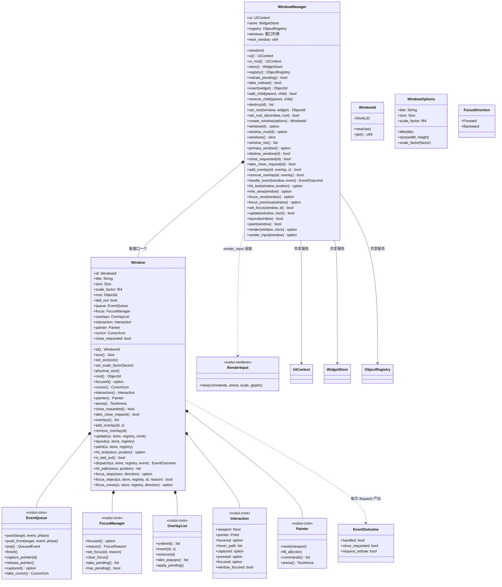
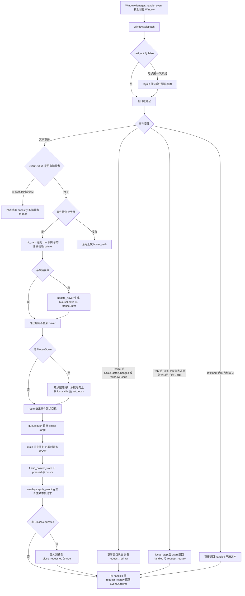
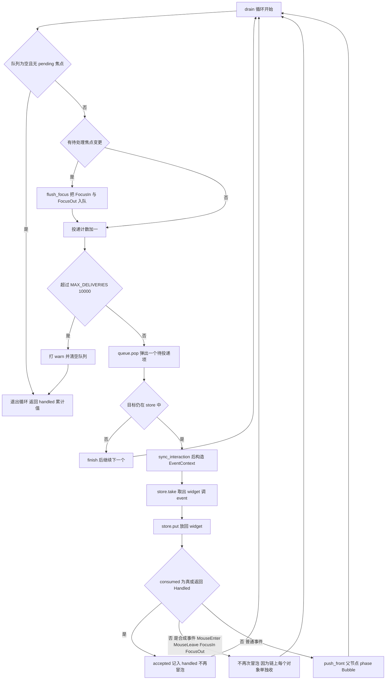
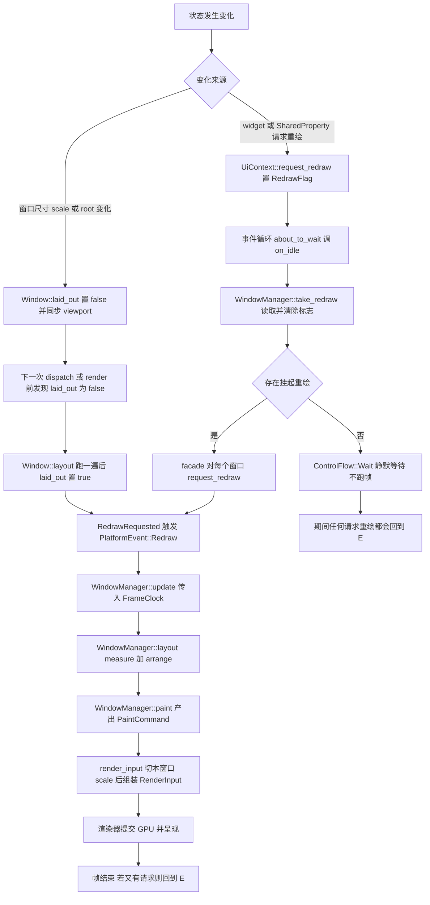
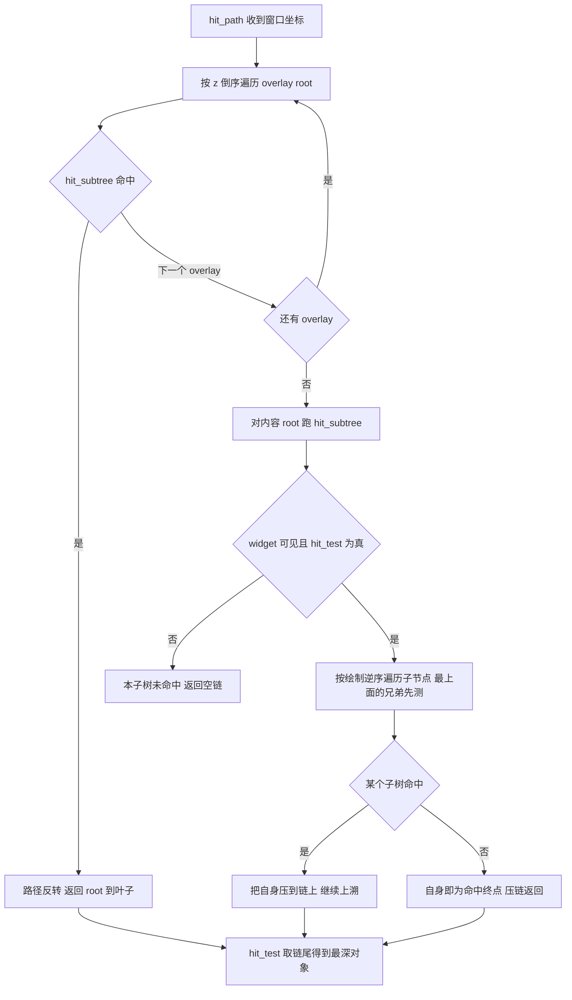
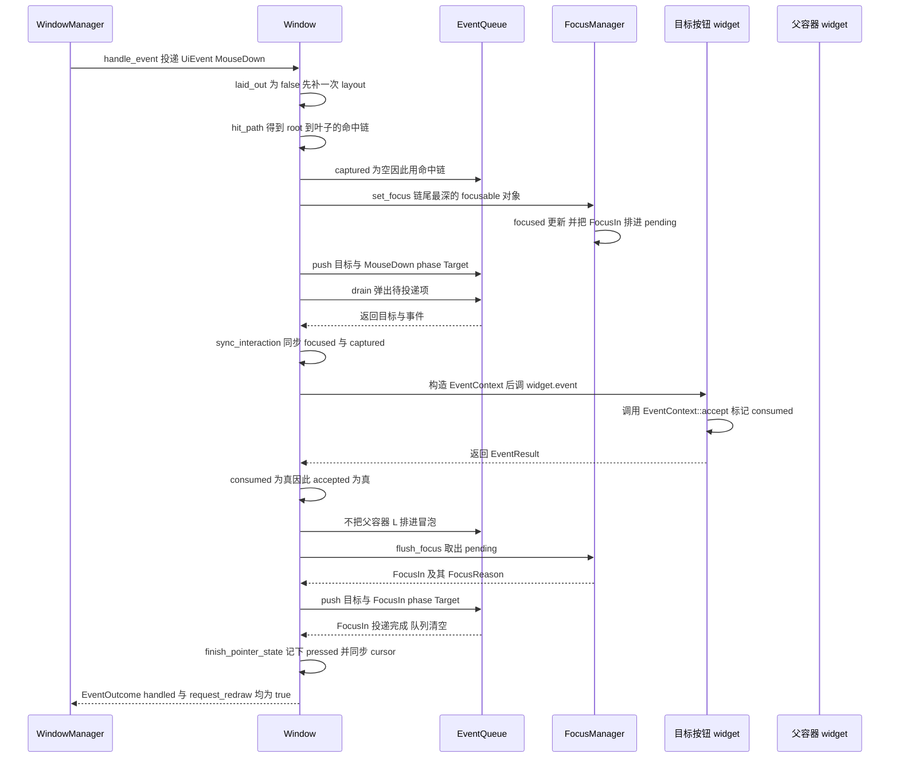
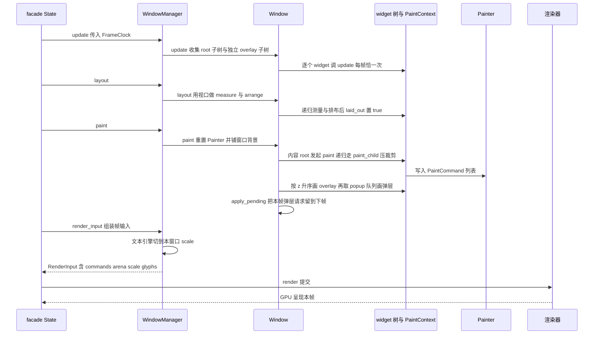
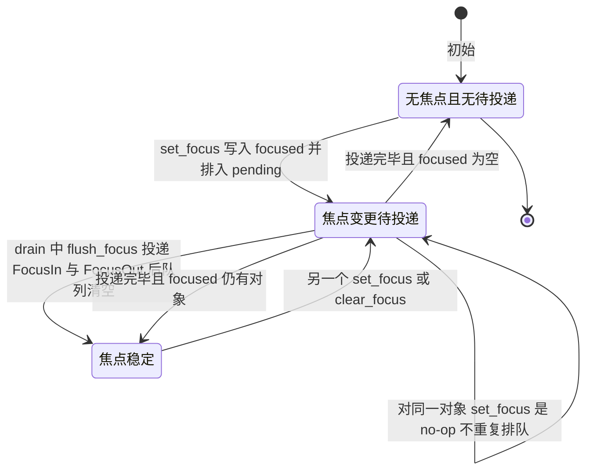
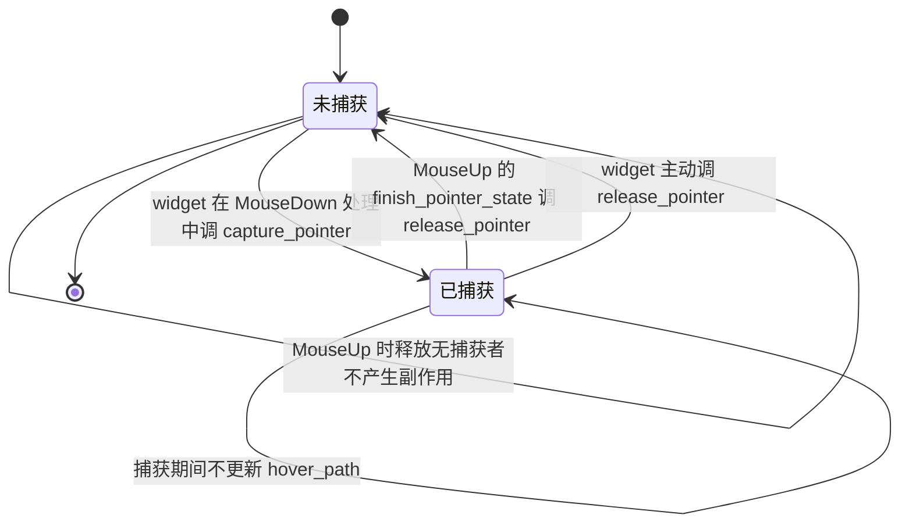

# rustui-window 模块详细设计

> 所属体系：[架构设计文档](../Architecture_Design_Document.md) · 分层：第 3 层（平台/窗口层）
> 源码：`crates/rustui-window/src/` · 依赖：`rustui-core`、`rustui-renderer`、`log`

## 1. 模块职责

`rustui-window` 是 RustUI 的**窗口与帧管线层**，对应详细设计文档 §10（事件分发）、
§11（命中测试）、§12（焦点）、§30（Window）、§31 上游、§32（帧管线），并在实现中落实
C-008 / C-011 / C-012 / C-039 / C-045 等修正。核心职责：

1. **共享服务 + 每窗口状态（§52）**：`WindowManager` 独占 `UiContext`（主题、文本引擎、
   剪贴板、重绘标志）、`WidgetStore`、`ObjectRegistry`；每个 `Window` 只持有自身的焦点、
   事件队列、指针交互态、overlay 列表与 painter。服务只在**一次调用的持续期间**借给窗口，
   对象模型里没有任何 `Rc<RefCell<T>>` 共享。
2. **事件投递与冒泡（§10 / C-008）**：`dispatch` 把目标压入 `EventQueue` 再统一排空——
   事件永不重入投递；widget 返回 `EventResult::Handled` 或调用 `EventContext::accept()`
   即停止向父级冒泡。
3. **命中测试（§11）**：`hit_path` 返回 root 到叶子的整条链，overlay 先于内容、子节点按
   绘制逆序测试，最深者为目标；整条链留在 `Interaction::hover_path` 让祖先（按钮里的一行
   文本）也能推出 `hovered`。
4. **鼠标捕获与焦点**：拖拽期间 `EventQueue::capture_pointer` 把后续指针事件重定向到
   捕获者；焦点跟随指针按下移动，Tab / Shift+Tab 在窗口层拦截（C-011）。
5. **帧管线（§32）**：`update → layout → paint` 三段式，由 `FrameClock` 驱动；`paint`
   按"窗口背景 → 内容树 → overlay 按 z → popup 层"出命令，最终 `render_input` 组装
   `RenderInput` 交给渲染器（`render_input` 同时把共享文本引擎切到本窗口 scale，C-048）。
6. **overlay 与弹层（C-006 / C-045）**：`OverlayList` 管理独立 root 的 overlay 与
   `Widget::paint_popup` 申请的弹层通道，事件后立即 `apply_pending`、绘制后下一帧生效。
7. **窗口生命周期与系统事件（C-012）**：`Resize` / `ScaleFactorChanged` / `CloseRequested`
   由窗口自己处理，统一返回 `EventOutcome { handled, close_requested, request_redraw }`。

分层边界（原则 P1 / P2）：本 crate 依赖只有 `rustui-core` + `rustui-renderer` + `log`，
**没有 `winit`、没有 `wgpu`**（`RenderInput` 之外不接触 GPU 类型）；OS 窗口的创建与事件
循环在 `rustui-platform`，`render_input` 的消费方是 `rustui` facade 的 `State::render`。

## 2. 模块结构

| 文件 | 职责 |
| --- | --- |
| `crates/rustui-window/src/lib.rs` | crate 文档（五条设计决策：共享服务、排队投递、命中链、每帧布局、无 winit/wgpu）与再导出：`WindowManager`、`Window` / `WindowId` / `WindowOptions` / `EventOutcome` / `FocusDirection` |
| `crates/rustui-window/src/manager.rs` | `WindowManager`：共享服务访问器、树构建（`insert` / `add_child` / `remove_child` / `destroy` / `set_root` / `set_root_id`）、窗口集合（`create_window` / `window` / `windows` / `window_ids` / `primary_window` / `destroy_window` / `close_requested` / `take_close_request`）、overlay 增删、输入（`handle_event` / `hit_test` / `ime_area` / `focus_next` / `focus_previous` / `set_focus`）、帧管线（`update` / `layout` / `paint` / `render` / `render_input`） |
| `crates/rustui-window/src/window.rs` | `WindowId`、`WindowOptions`（逻辑配置：title / size / scale_factor）、`EventOutcome`、`FocusDirection`、`Window` 本体与帧管线三段实现（`update` / `layout` / `paint`）、尺寸与 scale 变更使 `laid_out` 失效、对外只读状态（`cursor` / `focused` / `painter` / `arena` / `overlays` / `close_requested`） |
| `crates/rustui-window/src/dispatch.rs` | `Window::dispatch` 主流程、`hit_path` / `hit_subtree` 命中测试、`route` 目标选择、`drain` 排空与冒泡、`flush_focus` 焦点通知、`update_hover` / `finish_pointer_state` 指针与光标簿记、`focus_step` / `focus_object` / `focus_move` 焦点遍历、`focusable` / `ancestry` 辅助函数、`MAX_DELIVERIES = 10_000` 上限 |

## 3. 核心类型设计

### 3.1 类图（mermaid classDiagram）

### 3.2 关键类型说明（表）

| 类型 | 职责 | 关键成员 / API（以源码为准） |
| --- | --- | --- |
| `WindowManager` | 应用级单例：共享服务 + 窗口集合 | `new(Box<dyn TextMeasurer>)`；`redraw_pending` / `take_redraw` 代理 `UiContext::redraw()`；`set_root_id` 会把新 root 从原父级摘下并在不同时销毁旧子树；`destroy_window` 同时 `destroy_subtree` 销毁内容树；`render(window, clock)` = `update → layout → paint` 并返回 `&Painter` |
| `Window` | 单个窗口的状态容器 | `root: ObjectId`（无效值 `ObjectId::INVALID`）、`laid_out` 布局脏标记、`queue` / `focus` / `overlays` / `interaction` / `painter` / `cursor` / `close_requested`；`set_size` 与 `set_scale_factor` 变更时同步 `interaction.viewport` 并把 `laid_out` 置回 `false`；`physical_size()` 按 `size × scale_factor` 四舍五入且下限 1 |
| `WindowId` | 逻辑窗口标识，由 `WindowManager` 递增分配 | `INVALID = u64::MAX`、`new(u64)`、`get()`、`Copy + Eq + Hash` |
| `WindowOptions` | 注册窗口时的逻辑配置（OS 窗口由 platform 创建） | `title`、`size: Size`（逻辑像素）、`scale_factor`；默认 "RustUI"、800×600、1.0 |
| `EventOutcome` | 一次事件分发的结果（C-012） | `handled`（有 widget 消费）、`close_requested`（系统请求关闭且无人否决）、`request_redraw`（应安排重绘）；`Default` 全 `false` |
| `FocusDirection` | Tab 遍历方向（§12） | `Forward` / `Backward` |
| `Window::dispatch` | 事件入口 | 懒布局 → 窗口级簿记 → Tab 拦截 → 计算投递链 → 焦点跟随 → `route` + 入队 → `drain` → 指针/光标收尾 → `apply_pending` → `CloseRequested` 判定 |
| `Window::drain` | 队列排空与冒泡 | 循环 `pop` → `EventContext` → `store.take/put` 调 `widget.event`；`accepted = consumed 或 Handled`；未接受且非合成事件则 `push_front(parent, Bubble)`；每投递一次计数，超过 `MAX_DELIVERIES = 10_000` 打 warn 并 `clear` |
| `Window::update` | 帧管线第一段 | 同步 `interaction.focused` / `captured`，收集 `root` 子树 + 独立 overlay 子树（去重），逐个 `UpdateContext::update_child`——容器不自行向下传播，因此每 widget 每帧恰一次（C-039） |
| `Window::layout` | 帧管线第二段 | 视口 = `(0, 0, size)`；`MeasureContext::measure_child(root, size)` 后 `ArrangeContext::arrange_child(root, viewport)`；独立 overlay 按自身 `window_bounds().origin()` 单独 measure + arrange；结束时 `laid_out = true` |
| `Window::paint` | 帧管线第三段 | `painter.reset(viewport)` → `fill_all(theme.colors.window_background)`（窗口背景由框架画，C-024）→ 内容 root `paint` → `paint_overlay` 按 z 升序 → `paint_popup` 弹层通道（T-4 / C-045）→ `overlays.apply_pending()` |
| `Window::hit_test` / `hit_path` | 命中测试（§11） | overlay 逆 `ordered()` 先测；内容走 `hit_subtree`（不可见或点不在其上则 `false`，子节点**逆绘制序**遍历，最上面的兄弟先命中）；`hit_test` 取链尾 |
| `WindowManager::ime_area` | 输入法锚点（T-1 / C-038） | 向**当前聚焦** widget 要 `ime_cursor_area(&ui)`；`None` 表示暂不需要输入法，facade 据此 `set_ime_allowed(false)` |
| `WindowManager::render_input` | 组装 GPU 帧输入（C-048） | `ui.text().set_scale_factor(本窗口 scale)` 是唯一 scale 设置点；`painter` 为空返回 `None`；否则 `RenderInput::new(commands, arena, scale, glyph_source)` |

## 4. 主要流程

### 4.1 事件分发与冒泡（`dispatch.rs`）

### 4.2 冒泡子流程：`drain` 直到被接受

### 4.3 帧管线的 dirty 判定（§32 / §49）

### 4.4 命中测试（`hit_path` / `hit_subtree`）

## 5. 关键时序

### 5.1 一次 `MouseDown` 从 `WindowManager::handle_event` 到 widget 且被 accept

### 5.2 一帧渲染管线：`update → layout → paint → PaintCommand` 交给渲染器

## 6. 状态转换

### 6.1 焦点对象状态（`FocusManager`，§12 / C-011）

### 6.2 鼠标捕获状态（`EventQueue::capture`）

## 7. 关键设计约束与不变式

引用编号见 `docs/Detailed_Design_Document.md`（§10 / §11 / §12 / §30 / §32 / §49 / §52）与
`docs/Design_Corrections.md`（C-006 / C-008 / C-009 / C-011 / C-012 / C-020 / C-024 /
C-039 / C-043 / C-045 / C-048）。

| 编号 | 约束内容（以源码实现为准） |
| --- | --- |
| **C-008** | 事件结果只有两态：`EventResult::Unhandled` / `Handled`，或在回调里 `EventContext::accept()`；"是否继续冒泡"与"是否已处理"是同一个决定，冒泡在 accepted 处停止 |
| **C-009** | `EventContext` 只携带 `ui / store / interaction / focus / queue / overlays / depth / consumed`，没有 `clock`（帧钟走 `UpdateContext` / `FrameClock`）、没有 `modifiers`（在 `UiEvent` 自身字段里） |
| **C-011** | Tab / Shift+Tab 由**窗口层**拦截：`KeyDown(Tab)` 走 `focus_step` 后直接返回 `handled`；随后的 `TextInput("\t")` 被吞掉，不进文本缓冲 |
| **C-012** | `Resize` / `ScaleFactorChanged` / `WindowFocus` / `CloseRequested` 在 `Window::dispatch` 内部处理；`close_requested = !handled`，facade 用 `outcome.close_requested \|\| wm.take_close_request(id)` 决定关窗 |
| **C-020** | 坐标双空间：窗口层的 `hit_path` / `viewport` / `ime_area` / `window_bounds` 一律**窗口坐标**；`Painter` 收窗口坐标零偏移，局部到窗口的偏移只由 `PaintContext` 提供 |
| **C-024** | `Window::paint` 的首条命令是覆盖 viewport 的 `fill_all(window_background)`，窗口背景由框架而不是 widget 绘制 |
| **C-039** | `update` 按窗口遍历：只跑本窗口 root 子树与独立 overlay 子树，多窗口帧时钟互不干扰 |
| **C-043** | `window_bounds` 只在 `arrange` 后更新；发事件或改属性后必须先 `layout` / `render` 才能断言几何——本 crate 的测试 `Harness::render` 即如此封装 |
| **C-045** | 弹层通道：`paint_popup` 排在内容树与 overlay 之后，context 的 `offset` 取该 widget 的 `window_bounds().origin()`、`clip` 为窗口矩形，弹层不会被祖先裁剪切掉，也不会被后绘制的兄弟盖住 |
| **C-048** | `render_input` 是共享文本引擎唯一的 scale 设置点：谁渲染谁设置；布局与测量恒为逻辑像素，与 scale 无关 |
| **C-006** | overlay 是独立 root：`Window::update` / `layout` / `paint` 对"不属于内容树的 overlay"单独遍历，不重复计入 |
| **§52** | 共享服务只在一次调用期间借给窗口（`handle_event` / `update` / `layout` / `paint` 内部先借用 `ui / store / registry` 再找窗口），对象模型不使用 `Rc<RefCell<T>>` |
| **§49 / P1 / P2** | 帧只在"有东西请求重绘"时运行，但**每次都完整 layout**，因此不需要全树脏标记协议；依赖仅 `rustui-core` + `rustui-renderer` + `log` |

**不变式：**

1. **投递不重入**：widget 只可能在 `EventContext` 回调中收到已排队的事件；`store.take` /
   `store.put` 成对出现，回调期间对象不会被别处借走。
2. **冒泡终止条件唯一**：`consumed || Handled` 才停止；合成事件（`MouseEnter` /
   `MouseLeave` / `FocusIn` / `FocusOut`）已经逐个投递给链上每个对象，**不再冒泡**。
3. **捕获优先于命中**：只要有捕获者，投递链就是 `ancestry(捕获者)`，且不更新 hover；
   `MouseUp` 一律释放捕获。
4. **每帧每 widget 恰一次 update**：`Window::update` 先收集 root 子树，再把不属于内容树的
   overlay 子树去重后追加。
5. **绘制顺序固定**：背景 → 内容 root → overlay 按 `z` 升序 → popup 队列；事件后
   `apply_pending` 立即生效 overlay 变更，绘制后 `apply_pending` 留到下一帧。
6. **队列有界**：单次事件的投递次数超过 `MAX_DELIVERIES = 10_000` 时打 warn 并清空队列，
   防止 widget 之间互相无限重发事件导致死循环。
7. **无 root / 空 painter 安全**：root 无效或已被销毁时 `update` / `layout` / `paint` 直接
   跳过；`painter` 为空时 `render_input` 返回 `None`，渲染器不会拿到半帧。
8. **未知窗口不 panic**：`WindowManager` 对不存在的 `WindowId` 返回默认 `EventOutcome` 或
   `false` / `None`。

## 8. 测试布局

集成测试 `crates/rustui-window/tests/window.rs` 共 19 条，用桩文本测量器与桩 widget 构建
`Harness`（封装 `insert` / `add` / `render` / `mouse_down` / `tab` / `focused` / `hover` /
`state` 等入口），`cargo test -p rustui-window`：

| 分组 | 测试（文件内函数名） |
| --- | --- |
| 帧管线与布局 | `frame_pipeline_arranges_the_content_into_the_window`、`update_runs_exactly_once_per_widget_per_frame`、`a_resize_event_reflows_the_tree` |
| 命中测试与冒泡 | `hit_testing_returns_the_deepest_widget_and_events_bubble_up`、`an_unhandled_event_keeps_bubbling_to_the_root`、`a_child_that_handles_the_event_stops_the_bubbling`、`hover_keeps_the_whole_chain_hovered`、`mouse_enter_and_leave_follow_the_pointer` |
| 焦点与 Tab | `pressing_the_pointer_focuses_the_deepest_focusable_widget`、`tab_walks_the_focus_order_and_wraps`、`focus_moves_can_also_go_through_the_manager`、`clicking_a_focusable_container_takes_focus_and_sets_the_cursor` |
| 鼠标捕获 | `capture_routes_follow_up_pointer_events_to_the_grabbing_widget` |
| overlay 与弹层 | `overlays_are_arranged_painted_and_hit_above_the_content`、`the_popup_layer_is_painted_after_the_content_tree` |
| 光标与输入法 | `the_cursor_follows_the_hovered_widget`、`the_input_method_area_is_asked_of_the_focused_widget` |
| 窗口生命周期 | `closing_a_window_is_reported_unless_a_widget_vetoes_it`、`destroying_a_window_removes_its_tree` |

相关上层测试（不属本 crate，但直接回归这里的行为）：

* `crates/rustui/tests/pipeline.rs` —— 端到端管线与裁剪栈配平（C-044）：真实 `TextEngine`
  下断言 `RenderInput::glyphs` 非空、填充型子项不饿死兄弟、首条命令是窗口背景（C-020 /
  C-024）。
* `crates/rustui/tests/dpi.rs` —— 1.0 / 2.0 双窗口 DPI：`render_input` 切 scale 的唯一
  设置点（C-048）。
* `crates/rustui/tests/golden.rs` —— 黄金图：控件行 / 打开的下拉弹层 / 旋转文本，验证
  overlay 与 popup 层的绘制顺序（C-045 / C-046）。
* `crates/rustui/benches/pipeline.rs` —— criterion 基准直接走 `wm.layout` / `wm.paint` /
  `wm.hit_test` / `wm.render`（C-047），覆盖本 crate 的热路径。
