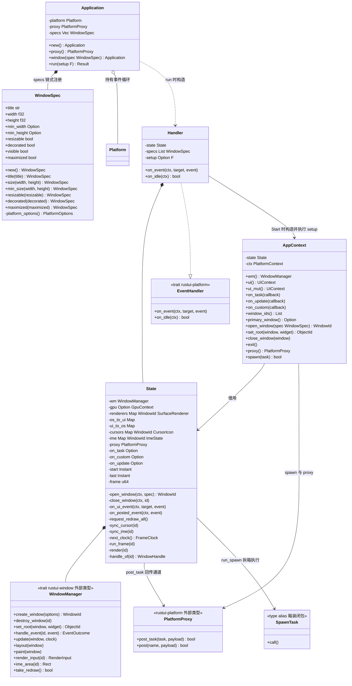
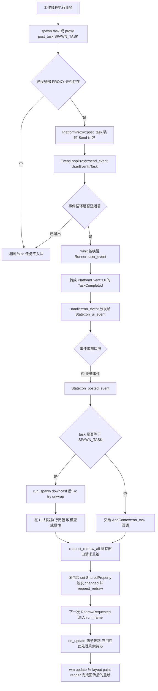
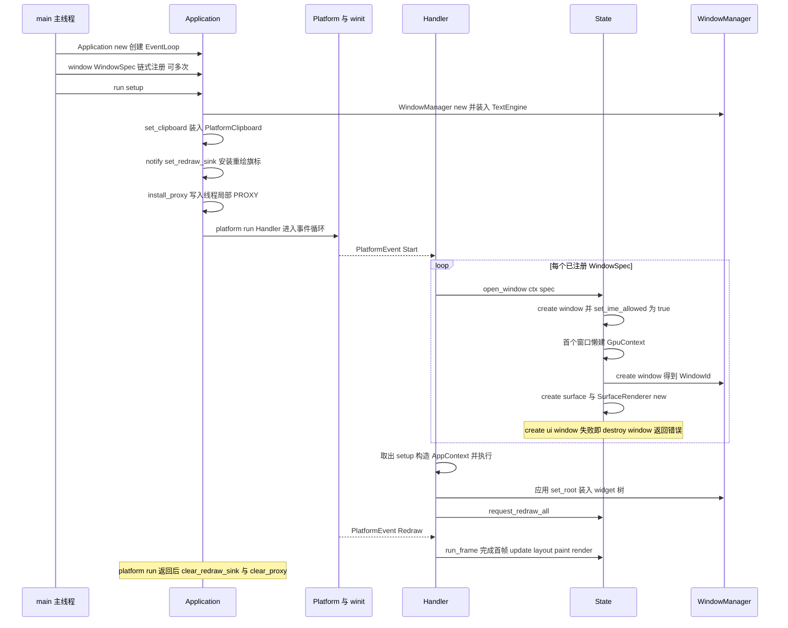
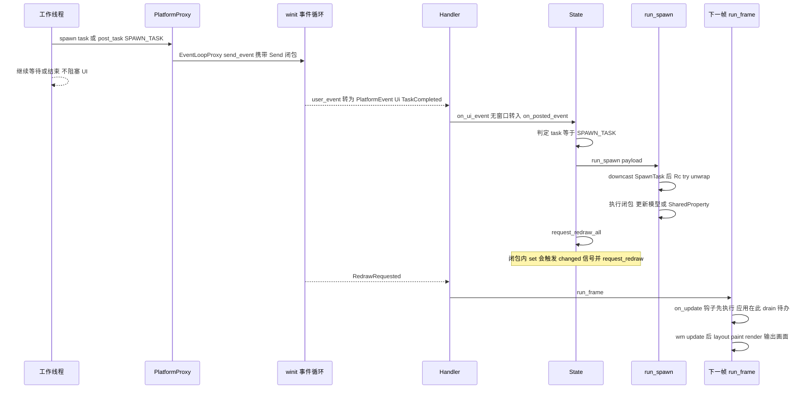
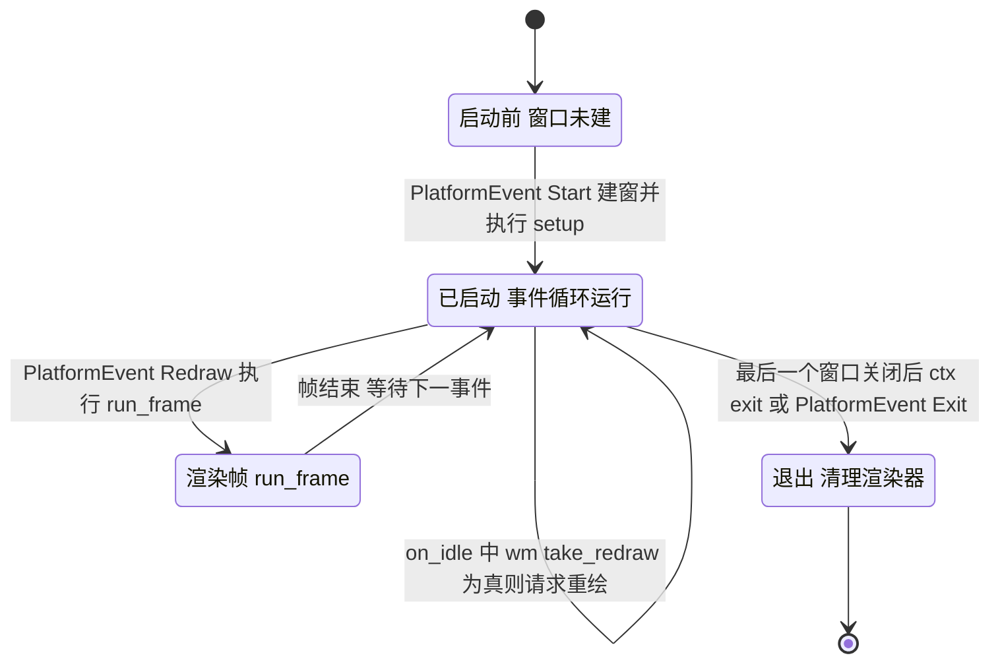
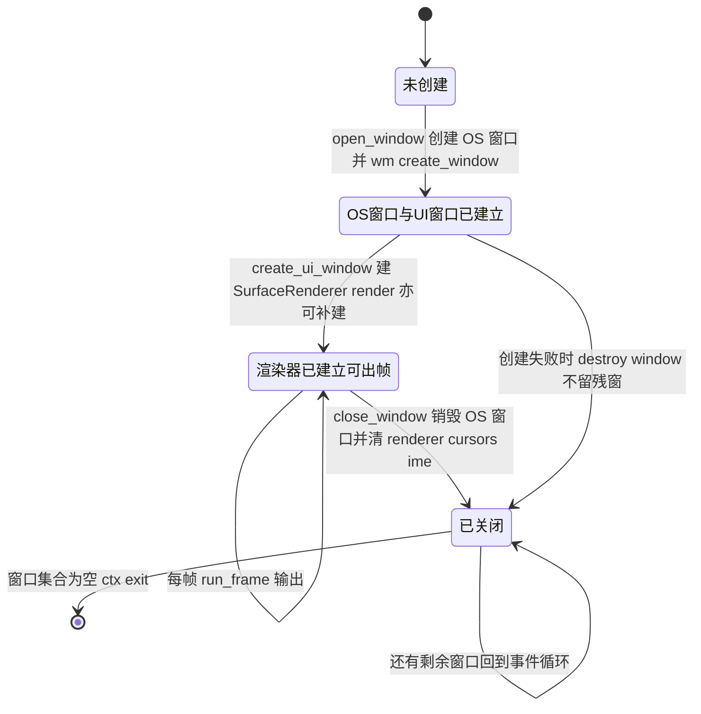

# rustui 模块详细设计

> 所属体系：[架构设计文档](../Architecture_Design_Document.md) · 分层：第 5 层 应用 facade
> 源码：`crates/rustui/src/` · 依赖：rustui-core / rustui-layout / rustui-model / rustui-animation / rustui-widgets / rustui-window / rustui-platform / rustui-text / rustui-renderer + `winit` + `wgpu` + `raw-window-handle` + `log`（C-034）

## 1. 模块职责

- **接线层（wiring）**：把 `winit` 事件循环（`rustui-platform`）、`WindowManager`（`rustui-window`）与 `wgpu` 渲染器（`rustui-renderer`）接在一起——平台事件 → `WindowManager::handle_event`，`WindowManager` 的重绘请求 → 平台；整个 crate 只有两个源文件 `app.rs` / `lib.rs`，是全 workspace 唯一同时看到 `winit` 与 `wgpu` 类型的模块（详细设计 §9 / §10，修正 C-034）。
- **应用入口 `Application`**：`new()` 创建事件循环，链式 `window(WindowSpec)` 注册零到多个窗口，`run(setup)` 创建窗口、执行 `setup` 并进入主循环；`setup` 拿到 `AppContext`，是应用构建 widget 树（`set_root`）的地方（详细设计 §31，修正 C-035 / C-036）。
- **帧管线执行**：`Handler::on_event` 收 `PlatformEvent::Start / Ui / Redraw / WindowClosed / Exit`；每帧 `State::run_frame` = `on_update 钩子 → update → layout → paint → render → sync_cursor → sync_ime`（详细设计 §32，修正 C-035 / C-039）。
- **跨线程回传 facade**：自由函数 `spawn(task)` 与 `AppContext::spawn`、`AppContext::proxy()` / `on_task` / `on_custom`——后台线程经 `PlatformProxy::post_task` / `post` 把闭包投回 UI 线程，由 `run_spawn` 在主线程执行并 `request_redraw_all`（详细设计 §37 / §38，修正 C-040 / C-041）。
- **多窗口管理**：`WindowSpec` 描述顶层窗口（标题 / 尺寸 / 最小尺寸 / 可缩放 / 装饰 / 可见 / 最大化），`State` 维护 `os_to_ui` / `ui_to_os` 双射、每窗口 `SurfaceRenderer`、光标与 IME 缓存；`AppContext::open_window` / `close_window` 运行期开关窗口，最后一个窗口关闭即 `exit`（详细设计 §30 / §42）。
- **平台能力 facade**：光标 `sync_cursor`、输入法 `sync_ime`（开关 + 候选区，先开开关再发区域）、剪贴板在 `run` 里装入 `PlatformClipboard`（trait 在 core、实现在 platform，修正 C-037 / C-038 / C-054）。
- **re-export 与 `prelude`**：把九个子 crate 以短名 re-export（`rustui::animation` / `core` / `layout` / `model` / `platform` / `renderer` / `text` / `widgets` / `window`），`prelude` 汇总应用日常所需的全部符号。

> **与设计文档的差异（如实说明）**：源码中**没有** `State` 生命周期 trait，也不存在 `window_options` / `build_root` / `update` 之类 trait 方法。生命周期由三样东西承担：`Application` 的链式注册 + `run(setup)`（`FnOnce(&mut AppContext)` 一次性构建首屏）、私有结构体 `State` 上的方法、以及实现 `EventHandler` 的 `Handler<F>`。`Builder` 也不是独立类型：`Application` 与 `WindowSpec` 都是**链式 builder 风格方法**（`self` 消费式返回），`on_task` / `on_custom` / `on_update` 三个回调注册在 `AppContext` 上而非 `Application` 上（修正 C-036）。

## 2. 模块结构（文件表）

| 文件 | 职责 |
| --- | --- |
| `lib.rs` | crate 文档与分层图、`mod app`、顶层 re-export（`spawn` / `AppContext` / `Application` / `WindowSpec`、`Result` / `UiError`）、九个子 crate 短名 re-export、`prelude` |
| `app.rs` | `SPAWN_TASK` / `SpawnTask` / `UpdateHook` 类型别名、线程局部 `PROXY`、自由函数 `spawn` 与 `install_proxy` / `clear_proxy` / `run_spawn`、`WindowSpec`、私有 `SurfaceTarget`、`Application`、`AppContext`、私有 `State`、私有 `Handler<F>`，以及 4 个单测 |
| `tests/pipeline.rs` | 端到端回归：真实 `TextEngine` + `WindowManager`，不碰 GPU（C-044） |
| `tests/golden.rs` | 渲染金样：控件场景 / 下拉弹层 / 旋转文字的像素比对 |
| `tests/dpi.rs` | 多窗口不同 scale 共享字形缓存不抖动（C-048） |
| `benches/pipeline.rs` | criterion 基准，走真实 `WindowManager` 入口（C-047） |

## 3. 核心类型设计

### 3.1 类图

### 3.2 类型说明表

| 类型 | 关键 API | 语义与注意点 |
| --- | --- | --- |
| `Application` | `new()`、`window(spec)`、`run(setup)`、`proxy()` | `new` 必须在主线程调用；`window` 可重复调用即多窗口；`run` 内部依次：建 `WindowManager`、装 `PlatformClipboard`、`notify::set_redraw_sink(wm.ui().redraw())`、`install_proxy` 装线程局部句柄、构造 `State` 与 `Handler`、`platform.run`，返回后再 `clear_redraw_sink` + `clear_proxy` |
| `WindowSpec` | `new()`、`title` / `size` / `min_size` / `resizable` / `decorated` / `maximized` | 逻辑像素；默认 1024x768、`resizable=true`、`decorated=true`、`visible=true`；`platform_options()` 把它翻成 `rustui-platform::WindowOptions`（含 `with_min_size` 仅在两个 `Some` 都存在时下发） |
| `AppContext` | `wm` / `ui` / `ui_mut` / `window_ids` / `primary_window` / `open_window` / `set_root` / `close_window` / `exit` / `proxy` / `spawn` / `on_task` / `on_update` / `on_custom` | `setup` 闭包与注册回调期的唯一入口；`set_root(window, Box<dyn Widget>) -> ObjectId` 装入内容根；`on_update(FnMut(&mut WindowManager))` 每帧 `update` **之前**执行，是动画推进与待办落地的位置（C-036）；`exit()` 结束事件循环 |
| `State`（私有） | `open_window` / `close_window` / `on_ui_event` / `on_posted_event` / `run_frame` / `render` / `sync_cursor` / `sync_ime` / `next_clock` / `request_redraw_all` | 全应用共享状态：`wm` + 懒建 `gpu` + 每窗口 `renderers` + 双射映射 + 光标 / IME 缓存 + 三个可选回调 + 帧计数（`start` / `last` / `frame`）；`next_clock` 用 `Instant` 算 `FrameClock { frame, delta, elapsed }` |
| `Handler<F>`（私有） | `on_event`、`on_idle` | 把普通闭包适配成 `EventHandler`（C-035）：`Start` 建窗并执行 `setup`（`setup.take()` 只跑一次）、`Ui` → `on_ui_event`、`Redraw` → `run_frame`、`WindowClosed` → `close_window`、`Exit` → 清空 `renderers`、`Resume`/`Suspend` 空操作；`on_idle` 只做 `wm.take_redraw()` |
| `spawn` 自由函数 | `spawn(task) -> bool` | 从线程局部 `PROXY` 取 `PlatformProxy`，`post_task(SPAWN_TASK, Box<task>)`；没有应用在跑或循环已退出返回 `false`；闭包必须 `Send`，因此不能直接碰 `SharedProperty`（C-040 限制） |
| `run_spawn`（私有） | `run_spawn(payload) -> bool` | `payload.downcast::<SpawnTask>()` 后 `Rc::try_unwrap` 拿到唯一引用，在 **UI 线程**执行闭包；类型不符返回 `false`（不 panic） |
| `SurfaceTarget`（私有） | `HasWindowHandle` / `HasDisplayHandle` / `Debug` | 包一层 `WindowHandle`，把窗口 + 显示句柄交给 `wgpu::InstanceDescriptor::new_with_display_handle` 创建 surface，避免 `winit` 类型外泄（P1，C-035） |
| 线程局部 `PROXY` | `install_proxy` / `clear_proxy` | `RefCell<Option<PlatformProxy>>`，`run` 启动时装、退出时清，让自由函数 `spawn` 不需要上下文参数 |

## 4. 主要流程

### 4.1 应用启动到首帧：`build_root` → 创建窗口 → 渲染器 → 主循环

```mermaid
flowchart TD
    A["main 调用 Application::new"] --> B["Platform::new 创建 EventLoop 并缓存 proxy"]
    B --> C["链式 window WindowSpec 注册进 specs"]
    C --> D["Application::run setup"]
    D --> E["WindowManager::new 装入 TextEngine"]
    E --> F["set_clipboard 装入 PlatformClipboard"]
    F --> G["notify::set_redraw_sink 安装全局重绘旗标"]
    G --> H["install_proxy 写入线程局部 PROXY"]
    H --> I["构造 State 与 Handler 后 platform.run"]
    I --> J["winit 首次 resumed 发出 PlatformEvent::Start"]
    J --> K["逐个 specs 调用 State::open_window"]
    K --> L["ctx.create_window 平台窗口 set_ime_allowed 为 true"]
    L --> M{"gpu 是否已建"}
    M -->|首个窗口| N["用 SurfaceTarget 懒建 GpuContext"]
    M -->|后续窗口| O["复用 GpuContext"]
    N --> P["wm.create_window 记录双射映射 光标与 IME 缓存"]
    O --> P
    P --> Q["gpu.create_surface 后 SurfaceRenderer::new"]
    Q --> R{"创建成功"}
    R -->|否| S["ctx.destroy_window 不留残窗"]
    R -->|是| T["setup 构造 AppContext 执行应用闭包"]
    S --> T
    T --> U["应用 set_root 装入 widget 树"]
    U --> V["request_redraw_all 请求所有窗口重绘"]
    V --> W["winit RedrawRequested 发出 PlatformEvent::Redraw"]
    W --> X["State::run_frame 窗口 id 匹配"]
    X --> Y["on_update 钩子先行 可改模型与属性"]
    Y --> Z["next_clock 产出 FrameClock"]
    Z --> AA["wm.update 按窗口推进动画与状态"]
    AA --> AB["wm.layout 两阶段布局"]
    AB --> AC["wm.paint 生成 PaintCommand"]
    AC --> AD["render 切到该窗口 scale 后提交 wgpu"]
    AD --> AE["sync_cursor 与 sync_ime 下发平台"]
```

### 4.2 `spawn` 任务完成回传：工作线程 → UI 线程 drain → `request_redraw`

## 5. 关键时序

### 5.1 `Application::run` 启动时序

### 5.2 一次 `spawn` 任务从线程到 `update` 被调用

## 6. 状态转换

源码**没有显式的应用状态枚举**：应用与窗口的状态由 `Handler::on_event` 的事件分支与 `State` 内几张映射表（`os_to_ui` / `ui_to_os` / `renderers` / `cursors` / `ime`）的存在性隐式表达。下图即按这两个维度如实刻画。

### 6.1 应用与事件循环（由 `PlatformEvent` 驱动）

### 6.2 单个窗口的生命周期（映射表存在性）

## 7. 关键设计约束与不变式

引用编号来自 [Design_Corrections.md](../Design_Corrections.md) 与 [Detailed_Design_Document.md](../Detailed_Design_Document.md) §9 / §10 / §31 / §32 / §37 / §38 / §39 / §40 / §41。

- **C-034 crate 依赖方向**：接线全部在 facade——平台事件 → `WindowManager`、`WindowManager` 请求 → 平台；`rustui-window` 不依赖 `rustui-platform`，`rustui-widgets` 不依赖平台与 wgpu，因此窗口管理能在无平台测试里跑（`WindowManager::new(text)` 即可）。
- **C-035 应用骨架**：`Application` 只是外壳，真正的状态在私有 `State`；winit 的 `EventLoop` 属于 `rustui-platform`，`ObjectRegistry` 归 `WindowManager`，应用不直接持有 `Renderer`；`SurfaceTarget` 实现 rwh 的窗口 + 显示句柄供 `create_surface` 使用。
- **C-036 `AppContext` 能力与 `on_update`**：`on_update(FnMut(&mut WindowManager))` 在每帧 `update` 之前回调，解决"信号回调签名是 `Fn(&T)`、拿不到 `WindowManager`"的问题；动画推进（`AnimationDriver`）也由此钩子承接——本 crate 只 re-export `rustui::animation`，并不自持 driver。
- **C-037 / C-054 剪贴板**：`Clipboard` trait 在 `rustui-core`，facade 在 `run` 里装入 `rustui-platform::PlatformClipboard`（`arboard` 接系统剪贴板，失败降级进程内缓冲），widgets 零改动。
- **C-038 光标与 IME**：`to_winit_cursor` 按值映射，帧末 `sync_cursor` 统一下发；`sync_ime` 以 `(allowed, area)` 双字段缓存，无变化不调平台，且**先开开关再发候选区**（Wayland 后端只在允许输入法时接受 cursor area），`area` 来自 `WindowManager::ime_area` 即当前聚焦 widget 的 caret 矩形。
- **C-039 update 按窗口遍历**：`run_frame(id)` 只推进该窗口的 root 与 overlay 子树，多窗口帧时钟各自独立，不可见窗口不付代价。
- **C-040 / C-041 跨线程回传**：`spawn` 走 `post_task(SPAWN_TASK = TaskId(0xC0_FF_EE_01))`，闭包在主线程由 `downcast + Rc::try_unwrap` 执行；其余 `TaskCompleted` / `Custom` 走 `on_task` / `on_custom`，无回调时 `Custom` 投给主窗口 widget；`spawn` 闭包 `Send` 而 `SharedProperty` 非 `Send`，**不能在 `spawn` 里直接改 UI**，正确路径是 `proxy.post` + `on_custom` 或同线程 `on_update`。
- **C-048 多窗口 DPI**：`render` 内 `wm.render_input(id)` 把共享 `TextEngine` 切到该窗口 display scale 后才 tessellate，字形缓存按物理尺寸键控。
- **P1 / P2 边界**：`rustui` 是唯一接线层，`rustui-core` / `rustui-layout` / `rustui-widgets` 看不到 `winit` / `wgpu` 类型；底层直接依赖只有 `winit` + `wgpu`（剪贴板 / shaping 走 `arboard` / `rustybuzz`，见 P2）。

模块级不变式（P 原则，本 crate 自身约定）：

- **P-APP1 setup 只跑一次**：`Handler::setup` 是 `Option`，`PlatformEvent::Start` 里 `take()` 后执行，再次 `resumed` 只发 `Resume`，窗口不会重复初始化、`setup` 不会二次执行。
- **P-APP2 双射不悬垂**：`os_to_ui` 与 `ui_to_os` 同步插入、同步删除；`close_window` 无论来自 `WindowClosed`、`close_requested` 还是 `AppContext::close_window`，都会同时清 `renderers` / `cursors` / `ime` 并 `wm.destroy_window`。
- **P-APP3 零尺寸不提交**：`render` 对 `width<=0` 或 `height<=0`（最小化）直接返回，绝不创建零尺寸 surface；渲染器缺失时按需补建，失败只记日志不中断循环。
- **P-APP4 平台调用必须幂等缓存**：`sync_cursor` / `sync_ime` 先比对缓存，无变化一次 `winit` 调用都不发。
- **P-APP5 退出顺序**：`PlatformEvent::Exit` 先 `renderers.clear()`（窗口还在时释放 GPU 资源），`platform.run` 返回后再 `clear_redraw_sink` 与 `clear_proxy`，保证全局线程局部状态不跨应用残留。
- **P-APP6 重绘单向汇聚**：任何线程 / 任何层级的重绘请求最终都落到 `RedrawFlag`（`notify::set_redraw_sink`）或 `handle.request_redraw()`；`on_idle` 只消费 `wm.take_redraw()`，是"属性变了但没人请求重绘"的兜底。
- **P-APP7 投递事件无窗口**：`on_posted_event` 先问 `on_task` / `on_custom`，都没有时才把事件递给主窗口 widget，避免后台消息误入某个具体窗口的焦点链。

## 8. 测试布局

本 crate 共 **12 个 `#[test]`**，另有 1 个 criterion 基准目标：

| 位置 | 数量 | 覆盖要点 |
| --- | --- | --- |
| `src/app.rs` | 4 | `WindowSpec` → 平台选项的字段映射（标题 / 尺寸 / `min_size` / `resizable` / `decorated` 与默认 1024x768）；无应用时 `spawn` 返回 `false`；`run_spawn` 对合法 `SpawnTask` 执行闭包（`Arc<AtomicU32>` 计数）；外来 payload 被忽略返回 `false` |
| `tests/pipeline.rs` | 4 | C-044 端到端回归，真实 `TextEngine` + `WindowManager` 不碰 GPU：真实文本引擎出图且每条 `PaintCommand::Text` 能解出非空字形；填充型子项不挤压兄弟；裁剪栈配平且首条命令是覆盖 viewport 的窗口背景；容器边框是环且子项可见 |
| `tests/golden.rs` | 3 | 像素金样：控件场景、下拉弹层、旋转文字（C-049），带 `grid` 量化与 `check` 比对，`UPDATE_GOLDEN=1` 时重写金样文件 |
| `tests/dpi.rs` | 1 | 两个不同 scale 的窗口共享同一字形缓存且不互相抖动（C-048） |
| `benches/pipeline.rs` | criterion | `text` / `measure_text` 等 CPU 热路径基线，走真实 `WindowManager` 入口（C-047） |

运行方式：`cargo test -p rustui`（模块单测 + 三个集成测试文件），基准 `cargo bench -p rustui`。注意集成测试需要系统字体（真实 `TextEngine`），且几何断言必须放在 `layout` / `render` 之后（C-043）。
